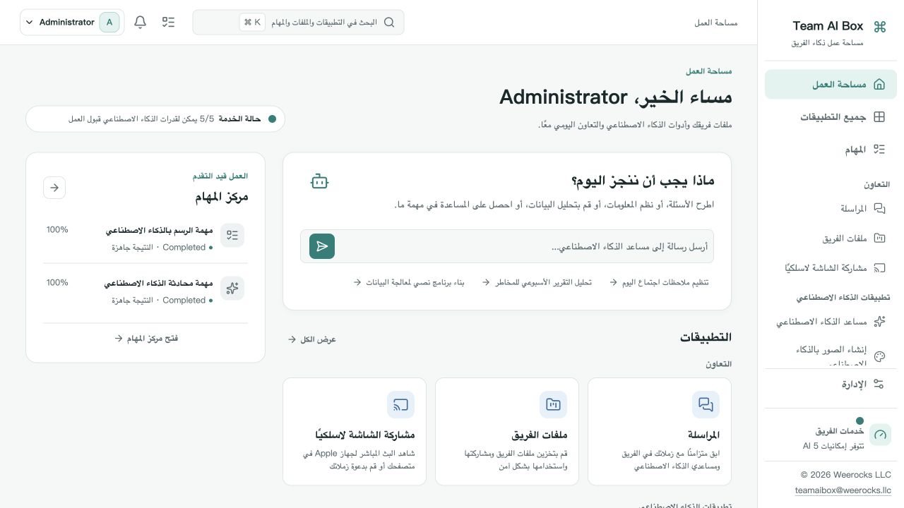

<!-- Generated from docs/readme-locales/ar.json by tools/render-readmes.mjs. -->
# Team AI Box

**Powered by NVIDIA DGX Spark · MIT · Weerocks LLC**

[English](README.md) · [简体中文](README.zh-CN.md) · [繁體中文](README.zh-TW.md) · [日本語](README.ja.md) · [한국어](README.ko.md) · [Français](README.fr.md) · [Deutsch](README.de.md) · [Español](README.es.md) · [Português](README.pt-BR.md) · [Русский](README.ru.md) · [العربية](README.ar.md) · [हिन्दी](README.hi.md) · [Bahasa Indonesia](README.id.md) · [Italiano](README.it.md) · [Türkçe](README.tr.md) · [Tiếng Việt](README.vi.md) · [ไทย](README.th.md)

**جهاز DGX Spark الخاص بك، ومساحة ذكاء اصطناعي لفريقك.** يجمع Team AI Box الذكاء الاصطناعي المحلي والملفات والمحادثات والأجهزة الافتراضية على جهاز NVIDIA DGX Spark واحد. يعمل الفريق عبر المتصفح دون إعداد بيئة ذكاء اصطناعي منفصلة لكل حاسوب.

[teamaibox.com](https://teamaibox.com/) · [GitHub](https://github.com/weerocksllc/teamaibox) · [MIT](LICENSE) · [teamaibox@weerocks.llc](mailto:teamaibox@weerocks.llc)

## لماذا Team AI Box؟

- **مساحة موحدة:** واجهة وحسابات مشتركة للذكاء الاصطناعي والتعاون والأجهزة.
- **المعالجة المحلية أولاً:** الاستدلال على Spark، وواجهات النماذج الخارجية اختيارية، ولا يلزم مفتاح USB.
- **مصمم لـ DGX Spark:** يعتمد Ubuntu ARM64 وحاويات NVIDIA GPU وKVM، وليس إعدادات جهاز المطور.
- **مفتوح للمساهمة:** الشيفرة الأصلية بترخيص MIT، و17 لغة وسمتان فاتحة وداكنة مع حفظ الاختيار اليدوي. الإنجليزية هي اللغة الافتراضية.

## مساحة العمل الحقيقية

لقطة فعلية بالعربية وليست تصميماً تخيلياً. تتبع الصورة سمة GitHub، والأصلان أدناه. لا تتضمن ملفات عملاء أو بيانات اعتماد. لمخرجات النماذج والأنظمة الضيفة والأسماء المخصصة إعدادات لغة مستقلة.

<picture>
  <source media="(prefers-color-scheme: dark)" srcset="docs/assets/screenshots/ar/workbench-dark.jpg">
  <source media="(prefers-color-scheme: light)" srcset="docs/assets/screenshots/ar/workbench-light.jpg">
  
</picture>

[السمة الفاتحة](docs/assets/screenshots/ar/workbench-light.jpg) · [السمة الداكنة](docs/assets/screenshots/ar/workbench-dark.jpg)

## ما الذي يمكنك فعله؟

### مساعد الذكاء الاصطناعي

اطرح الأسئلة واكتب وراجع النصوص ولخص المعلومات وعالج المستندات بالمحادثة. النماذج المحلية هي الأساس، والخدمات الخارجية حسب اختيارك.

### إنشاء الصور

أنشئ الصور وعدلها بالتعليمات واحفظ النتائج وتابع تقدم المهام.

### التعرف على النص

استخرج النص والتخطيط من الصور والمستندات ثم راجعه وأعد استخدامه.

### تفريغ الصوت

حوّل الصوت والفيديو إلى نص مع طوابع زمنية لمحاضر الاجتماعات والترجمة النصية.

### الترجمة

ترجم النص والملفات المدعومة. تعتمد اللغات على النموذج المثبت، وهي قائمة مستقلة عن لغات الواجهة.

### المراسلة

محادثات فردية وجماعية إلى جانب ملفات الفريق، مع أدوات واضحة لإدارة الرسائل وحذف المحادثات.

### ملفات الفريق

ارفع الملفات ونظمها وشاركها وأعد استخدامها مباشرة داخل التطبيقات المتوافقة.

### مشاركة الشاشة لاسلكياً

شاهد شاشة أجهزة Apple المتوافقة واستمع إلى الصوت في المتصفح مع الزملاء. يتطلب اكتشاف المستقبل اتصالاً مناسباً بالشبكة المحلية.

### هواتف Android افتراضية

ثبت التطبيقات واستعد حالة كل هاتف عبر المتصفح. يحتفظ كل جهاز ببياناته وتطبيقاته؛ تخضع خدمات Google لشروط توافق وترخيص مستقلة.

### حواسيب Windows وLinux افتراضية

ارفع ISO مرخصة بمعمارية ARM64 أو اخترها من ملفات الفريق، ثم اربط محرك الأقراص الافتراضي وثبت النظام عبر الشاشة الافتراضية. شاهد الإقلاع وإعادة التشغيل واستخدم الصوت، وادع الآخرين للمشاهدة أو التحكم، وانقل التحكم أو شاركه واستعده بصفتك المالك. سطح المكتب البعيد وضع إضافي.

### إدارة الفريق والمهام

أنشئ الحسابات وأدر الوصول وتابع جاهزية التطبيقات وتقدم المهام. يتاح كل تطبيق بعد جاهزية اعتماداته؛ قد يستغرق التشغيل الأول للنموذج وقتاً.

## التثبيت على DGX Spark جديد

تحتاج **DGX Spark غير مثبت عليه المنتج مع Ubuntu 24.04 ARM64** وDocker Engine وCompose v2 وتعريفات ودعم حاويات NVIDIA وKVM وGit وPython 3.10+. وفر عدة مئات من الجيجابايت مؤقتاً للنماذج والبناء والحزمة. لا تنفذ تثبيتاً جديداً فوق بيانات قائمة.

```sh
git clone https://github.com/weerocksllc/teamaibox.git
cd teamaibox
sudo bash install/from-source.sh
```

نفذ الأوامر **على Spark**. ينزل البرنامج المدخلات والنماذج ويبني الصور وينشئ حزمة كاملة دون اتصال ثم يثبتها. البناء الأول يحتاج الإنترنت والوقت؛ الاستنساخ وحده ليس تثبيتاً. يعاد استخدام Docker/NVIDIA دون نسخ حسابات المطور أو أقراصه أو أسراره.

### الفحص والاستئناف

يفحص `--check` المتطلبات. عند الانقطاع احتفظ بـ `/var/tmp/teamaibox-source-build` وأعد **الأمر نفسه** لاستخدام التنزيلات والمراحل المتحققة. لا تمسح الذاكرة المؤقتة ولا تبدأ بناءات متنافسة. المصادر الرسمية هي الافتراضية. عند تعذر الوصول راجع [الدليل](install/SOURCE-INSTALL.md) للبدائل أو انقل ذاكرة مؤقتة/حزمة كاملة متحققة؛ توافر المرايا غير مضمون. تغيير الشيفرة يتطلب `--work-dir` جديداً دون تجاوز نقاط التحقق.

```sh
sudo bash install/from-source.sh --check
sudo bash install/from-source.sh
```

### بعد التثبيت

1. افتح `https://<BOX_LAN_IP>/` بعنوان الشبكة الحالي وتحقق أن شهادة HTTPS المحلية تخص جهازك.
2. ادخل بـ `admin` / `admin` ثم **غيّر كلمة المرور الأولية** وأنشئ حسابات عادية. لا تعرض بيانات الدخول الافتراضية للإنترنت.
3. انتظر جاهزية التطبيقات واختر اللغة والسمة من الملف الشخصي. السجل: `/srv/teamaibox/installation/readiness.json`.
4. وفر ISO مرخصة لـ Windows/Linux ARM64 وترخيص النظام. للتثبيت دون اتصال جهز الحزمة كاملة أولاً واتبع [دليلها](install/README.md)؛ تجهيز المصدر يحتاج اتصالاً.

## الترخيص والحدود

الشيفرة الأصلية والوثائق MIT، **وليس كل ملف ثنائي مثبت**. يحتفظ كود الأطراف الأخرى والنماذج وNVIDIA والبرامج الثابتة وGoogle وWindows بشروطها. لا يتضمن Git أوزاناً أو أقراص ضيوف مثبتة أو جلسات دخول أو ISO أو حزم تثبيت. توافق Google ليس اعتماد Play Protect؛ مشاركة الشاشة لا تشمل DRM أو اعتماد Apple. لا ندعي دعم Windows 10 ARM64. الأداء والتزامن يعتمدان على الحمل والعتاد. الموقع التسويقي خاص ومنفصل، وواجهة المنتج مفتوحة.

## ساهم معنا

نرحب بالبلاغات والوثائق والترجمات وتحسين الإتاحة والتكاملات والشيفرة. اشرح المشكلة في issue وأنشئ fork وفرعاً محدداً وأرسل PR مع الفحوص والصور ذات الصلة. لا تحتاج Spark لتحسين الوثائق أو المكونات المعزولة؛ وضح ما اختبر فعلياً. لا تنشر أسراراً أو ملفات شخصية أو صور أجهزة مسجل دخولها. أبلغ عن الثغرات سراً وفق SECURITY.md. لا يوجد CLA إلزامي أو إذن مدفوع للمساهمة.

[Issues](https://github.com/weerocksllc/teamaibox/issues) · [Pull requests](https://github.com/weerocksllc/teamaibox/pulls) · [CONTRIBUTING](CONTRIBUTING.md) · [SECURITY](SECURITY.md)

## مراجع إضافية

- [تثبيت المصدر والاستعادة](install/SOURCE-INSTALL.md)
- [الحزمة دون اتصال](install/README.md)
- [بيئة التطوير والبناء](docs/open-source/BUILDING.md)
- [كيفية المساهمة](CONTRIBUTING.md)
- [الإبلاغ الأمني الخاص](SECURITY.md)
- [تراخيص الأطراف الأخرى ونطاق التوزيع](THIRD_PARTY_NOTICES.md)

`apps/` · `services/` · `packages/` · `install/` · `deploy/` · `docs/`

© 2026 Weerocks LLC. [MIT](LICENSE) · [تراخيص الأطراف الأخرى ونطاق التوزيع](docs/open-source/RELEASING.md)
