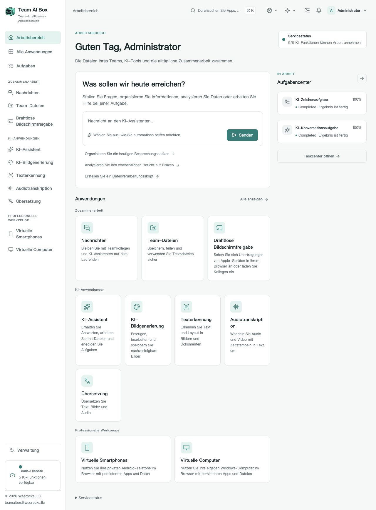

<!-- Generated from docs/readme-locales/de.json by tools/render-readmes.mjs. -->
# Team AI Box

<p></p>

**Powered by NVIDIA DGX Spark · MIT · Weerocks LLC**

[English](README.de.md) · [简体中文](README.de.md) · [繁體中文](README.de.md) · [日本語](README.de.md) · [한국어](README.de.md) · [Français](README.de.md) · [Deutsch](README.de.md) · [Español](README.de.md) · [Português](README.de.md) · [Русский](README.de.md) · [العربية](README.de.md) · [हिन्दी](README.de.md) · [Bahasa Indonesia](README.de.md) · [Italiano](README.de.md) · [Türkçe](README.de.md) · [Tiếng Việt](README.de.md) · [ไทย](README.de.md)

**Dein DGX Spark. Der KI-Arbeitsbereich deines Teams.** Team AI Box vereint lokale KI, Dateien, Kommunikation und virtuelle Geräte auf einem NVIDIA DGX Spark. Das Team greift per Browser zu, ohne auf jedem Rechner eine eigene KI-Umgebung einzurichten.

[teamaibox.com](https://teamaibox.com/) · [GitHub](https://github.com/weerocksllc/teamaibox) · [MIT](LICENSE) · [teamaibox@weerocks.llc](mailto:teamaibox@weerocks.llc)

## Warum Team AI Box?

- **Ein gemeinsamer Arbeitsbereich:** einheitliche Oberfläche und Konten für KI, Zusammenarbeit und Geräte.
- **Lokal zuerst:** Inferenz auf dem Spark, externe Modell-APIs optional, kein USB-Hardwareschlüssel nötig.
- **Für DGX Spark entwickelt:** Ubuntu ARM64, NVIDIA-GPU-Container und KVM statt Abhängigkeiten von einem Entwicklerrechner.
- **Offen für Verbesserungen:** eigener Code unter MIT, 17 Sprachen, helle/dunkle Designs und gespeicherte manuelle Auswahl. Standardsprache ist Englisch.

## Der echte Arbeitsbereich

Echte deutsche Produktaufnahme, kein Entwurf. Das Bild folgt dem GitHub-Design; beide Originale sind verlinkt. Keine Kundendateien oder geheimen Zugangsdaten. Modellausgaben, Gastsysteme und eigene Namen haben separate Spracheinstellungen.

<picture>
  <source media="(prefers-color-scheme: dark)" srcset="docs/assets/screenshots/de/workbench-dark.jpg">
  <source media="(prefers-color-scheme: light)" srcset="docs/assets/screenshots/de/workbench-light.jpg">
  
</picture>

[Helles Design](docs/assets/screenshots/de/workbench-light.jpg) · [Dunkles Design](docs/assets/screenshots/de/workbench-dark.jpg)

## Funktionen im Überblick

### KI-Assistent

Fragen stellen, Texte schreiben und überarbeiten, Informationen zusammenfassen und Dokumente im Dialog bearbeiten. Lokale Modelle sind der Ausgangspunkt, externe Anbieter optional.

### KI-Bilder

Bilder aus Beschreibungen erzeugen, bearbeiten und speichern. Aufgabenfortschritt und Ergebnisse bleiben im Arbeitsbereich sichtbar.

### Texterkennung

Text und Layout aus Bildern und Dokumenten extrahieren, prüfen und wiederverwenden statt abtippen.

### Transkription

Audio und Video in Text mit Zeitstempeln umwandeln, etwa für Besprechungsnotizen und Untertitel.

### Übersetzung

Text und unterstützte Dateien übersetzen. Die Modellsprachen hängen vom installierten Modell ab und sind nicht mit den UI-Sprachen identisch.

### Nachrichten

Direktnachrichten und Gruppenunterhaltungen neben Teamdateien nutzen. Nachrichten verwalten und Chats über sichtbare Bedienelemente entfernen.

### Team-Laufwerk

Dateien hochladen, ordnen, teilen und in unterstützten Anwendungen direkt wiederverwenden.

### Drahtlose Bildschirmübertragung

Bild und Ton kompatibler Apple-Geräte im Browser ansehen und Kollegen einladen. Die Gerätesuche setzt eine geeignete LAN-Verbindung voraus.

### Virtuelle Android-Telefone

Apps installieren und den gespeicherten Zustand jedes Geräts im Browser weiterverwenden. Apps und Daten bleiben getrennt; Google-Dienste haben eigene Kompatibilitäts- und Lizenzbedingungen.

### Virtuelle Windows- und Linux-Rechner

Eine berechtigte ARM64-ISO hochladen oder im Team-Laufwerk auswählen, virtuell einlegen und das System selbst installieren. Der virtuelle Bildschirm zeigt Booten und Neustarts und unterstützt Ton. Zuschauer und Bediener einladen, Steuerung übergeben oder gemeinsam nutzen und als Besitzer zurückholen. Remote Desktop ist ein zusätzlicher Modus.

### Verwaltung und Aufgaben

Konten und Zugriffe verwalten sowie Bereitschaft und Fortschritt verfolgen. Anwendungen werden unabhängig verfügbar, sobald ihre Dienste bereit sind; der erste Modellstart kann dauern.

<a id="install"></a>

## Auf einem neuen DGX Spark installieren

Benötigt wird ein **noch nicht eingerichteter DGX Spark mit Ubuntu 24.04 ARM64**, funktionierendem Docker Engine/Compose v2, NVIDIA-Treibern und Container-Unterstützung, KVM, Git und Python 3.10+. Mehrere hundert GB temporären Platz für Modelle, Builds und Paket vorsehen. Keine Neuinstallation über vorhandene Geschäftsdaten ausführen.

```sh
git clone https://github.com/weerocksllc/teamaibox.git
cd teamaibox
sudo bash install/from-source.sh
```

Diese Befehle **auf dem Spark** ausführen. Das Skript lädt Modelle und Build-Eingaben, baut Images, erstellt ein vollständiges Offline-Paket und installiert es. Der erste Quellcode-Build braucht Internet und Zeit; Klonen allein installiert nichts. Docker/NVIDIA werden wiederverwendet, Entwicklerkonten, Gastplatten und Geheimnisse nicht kopiert.

### Vorprüfung und Fortsetzen

`--check` prüft Voraussetzungen. Bei Unterbrechung `/var/tmp/teamaibox-source-build` behalten und **denselben Befehl** erneut ausführen; geprüfte Downloads und abgeschlossene Schritte werden genutzt. Cache nicht löschen, keine konkurrierenden Builds starten. Standard sind offizielle Quellen. Bei Netzproblemen nennt die [Anleitung](install/SOURCE-INSTALL.de.md) Alternativen oder den Transfer geprüfter Caches/Offline-Pakete; Spiegel sind nicht garantiert erreichbar. Geänderter Code braucht ein neues `--work-dir`, keine umgangenen Prüfpunkte.

```sh
sudo bash install/from-source.sh --check
sudo bash install/from-source.sh
```

### Nach der Installation

1. `https://<BOX_LAN_IP>/` mit der aktuellen LAN-Adresse öffnen und das lokal erzeugte HTTPS-Zertifikat dem eigenen Gerät zuordnen.
2. Mit `admin` / `admin` anmelden, **Startpasswort ändern** und normale Konten anlegen. Standardzugang nicht ins Internet stellen.
3. Anwendungsbereitschaft abwarten und Sprache/Design im Profil wählen. Status: `/srv/teamaibox/installation/readiness.json`.
4. Eigene berechtigte Windows/Linux-ARM64-ISOs und Lizenzen verwenden. Für Offline-Ziele zuerst das vollständige Paket vorbereiten und die [Paket-Anleitung](install/README.de.md) nutzen. Quellcode-Vorbereitung ist online.

## Lizenz und Grenzen

Eigener Code und Dokumentation sind MIT, **nicht sämtliche installierten Binärdateien**. Drittcode, Modelle, NVIDIA, Firmware, Google und Windows behalten ihre Bedingungen. Git enthält keine Gewichte, installierten Gastplatten, Anmeldespuren, ISOs oder Offline-Pakete. Google-Kompatibilität ist keine Play-Protect-Zertifizierung; Casting umfasst weder DRM noch Apple-Zertifizierung. Windows 10 ARM64 wird nicht als unterstützt beworben. Leistung und Parallelität hängen von Last und Hardware ab. Die Marketingwebsite bleibt separat privat, die Produktoberfläche ist öffentlich.

## Gemeinsam weiterentwickeln

Fehlerberichte, Dokumentation, Übersetzungen, Barrierefreiheit, Integrationen und Code sind willkommen. Problem als Issue beschreiben, forken, einen fokussierten Branch erstellen und PR mit passenden Prüfungen und Bildern einreichen. Für Dokumentation oder isolierte Komponenten ist kein Spark nötig; Hardwareprüfungen ehrlich kennzeichnen. Keine Geheimnisse, persönlichen Dateien oder angemeldeten Geräte-Images hochladen. Sicherheitslücken privat nach SECURITY.md melden. Kein verpflichtendes CLA und keine kostenpflichtige Mitarbeitserlaubnis.

[Issues](https://github.com/weerocksllc/teamaibox/issues) · [Pull requests](https://github.com/weerocksllc/teamaibox/pulls) · [CONTRIBUTING](CONTRIBUTING.de.md) · [SECURITY](SECURITY.de.md)

## Weitere Informationen

- [Quellcode-Installation und Wiederaufnahme](install/SOURCE-INSTALL.de.md)
- [Offline-Paket](install/README.de.md)
- [Entwicklungsumgebung und Build](docs/open-source/BUILDING.de.md)
- [Mitwirken](CONTRIBUTING.de.md)
- [Private Sicherheitsmeldung](SECURITY.de.md)
- [Drittlizenzen und Veröffentlichungsumfang](THIRD_PARTY_NOTICES.de.md)

`apps/` · `services/` · `packages/` · `install/` · `deploy/` · `docs/`

© 2026 Weerocks LLC. [MIT](LICENSE) · [Drittlizenzen und Veröffentlichungsumfang](docs/open-source/RELEASING.de.md)
