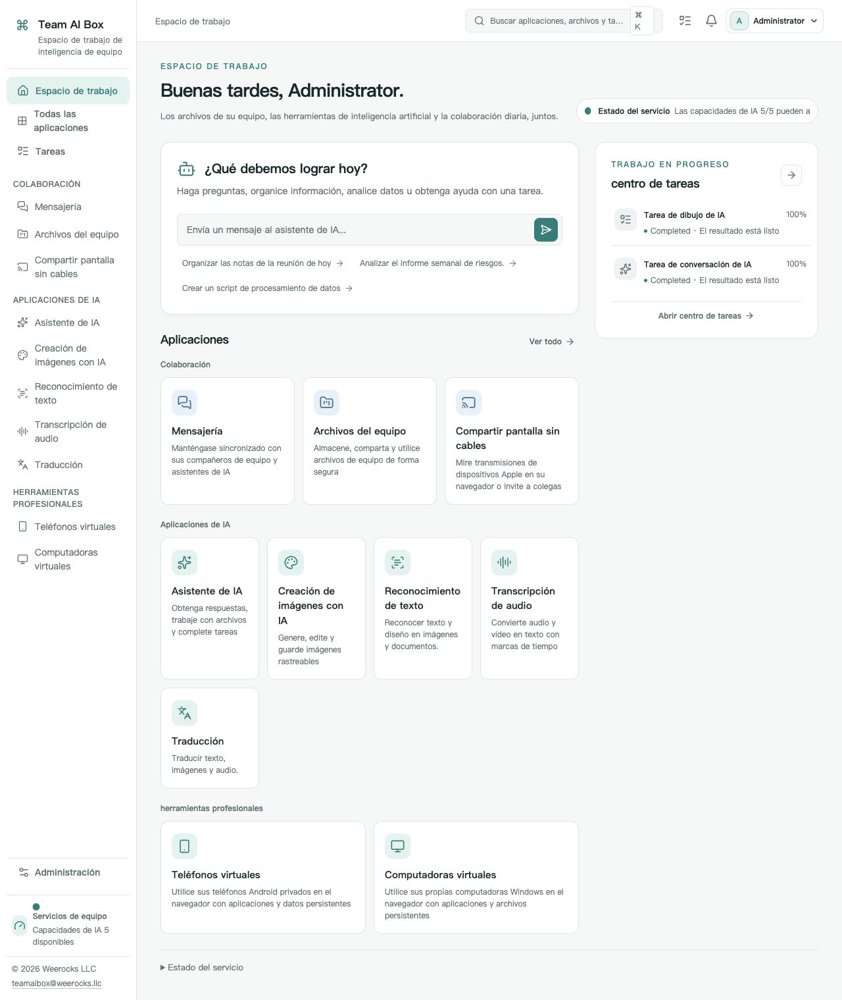

<!-- Generated from docs/readme-locales/ and docs/readme-features/es.json by tools/render-readmes.mjs. -->
# Team AI Box — Software de código abierto para NVIDIA DGX Spark

<p></p>

**Powered by NVIDIA DGX Spark · MIT · Weerocks LLC**

[English](README.md) · [简体中文](README.zh-CN.md) · [繁體中文](README.zh-TW.md) · [日本語](README.ja.md) · [한국어](README.ko.md) · [Français](README.fr.md) · [Deutsch](README.de.md) · [Español](README.es.md) · [Português](README.pt-BR.md) · [Русский](README.ru.md) · [العربية](README.ar.md) · [हिन्दी](README.hi.md) · [Bahasa Indonesia](README.id.md) · [Italiano](README.it.md) · [Türkçe](README.tr.md) · [Tiếng Việt](README.vi.md) · [ไทย](README.th.md)

**Convierte tu NVIDIA DGX Spark en el espacio de IA de tu equipo.** Ejecuta IA local, generación de imágenes y herramientas de documentos en NVIDIA DGX Spark. Team AI Box reúne archivos de equipo, mensajería y dispositivos virtuales en un espacio de código abierto desde el navegador.

[teamaibox.com](https://teamaibox.com/) · [GitHub](https://github.com/weerocksllc/teamaibox) · [MIT](LICENSE) · [teamaibox@weerocks.llc](mailto:teamaibox@weerocks.llc)

[Lista completa de funciones](#features) · [Instalar en un DGX Spark nuevo](#install) · [Construyámoslo juntos](#contribute)

## ¿Por qué Team AI Box?

- **Un espacio integrado:** cuentas e interfaz coherentes para IA, colaboración y dispositivos.
- **IA local como prioridad.** Ejecuta la inferencia en tu Spark y conecta API de modelos externos si lo necesitas.
- **Diseñado para DGX Spark.** Instala en Ubuntu ARM64 con contenedores GPU NVIDIA y virtualización KVM.
- **Abierto a contribuciones:** código propio MIT, 17 idiomas, temas claro/oscuro y preferencias manuales guardadas. El idioma inicial es inglés.

## El espacio real

<picture>
  <source media="(prefers-color-scheme: dark)" srcset="docs/assets/screenshots/es/workbench-dark.jpg">
  <source media="(prefers-color-scheme: light)" srcset="docs/assets/screenshots/es/workbench-light.jpg">
  
</picture>

[Tema claro](docs/assets/screenshots/es/workbench-light.jpg) · [Tema oscuro](docs/assets/screenshots/es/workbench-dark.jpg)

<a id="features"></a>

## Lista completa de funciones

**Ir a un módulo**

- [Espacio de trabajo y navegación cotidiana](#feature-workspace)
- [Asistente de IA y flujos Agent bajo control](#feature-assistant)
- [Generación de imágenes con IA](#feature-drawing)
- [Reconocimiento y corrección de texto](#feature-ocr)
- [Transcripción de grabaciones y voz en directo](#feature-transcription)
- [Traducción de texto, archivos y contenido multimedia](#feature-translation)
- [Mensajería de equipo](#feature-messaging)
- [Unidad de equipo y colaboración con archivos](#feature-drive)
- [Proyección inalámbrica compatible con AirPlay](#feature-casting)
- [Teléfonos Android virtuales persistentes](#feature-phones)
- [Ordenadores virtuales Windows y Linux](#feature-computers)
- [Administración, permisos y seguridad](#feature-administration)
- [Instalación desde el código fuente y mantenimiento](#feature-installation)
- [Desarrollo de código abierto y extensiones](#feature-developers)

<a id="feature-workspace"></a>

### Espacio de trabajo y navegación cotidiana

- Usa un único espacio de trabajo en el navegador para IA local, colaboración en equipo y dispositivos virtuales en un solo DGX Spark.
- Explora las aplicaciones por categoría, busca en el catálogo y abre una aplicación desde la barra lateral.
- Consulta el progreso de carga, la disponibilidad y el estado del servicio de cada aplicación.
- Sigue los trabajos en cola, en curso, completados, fallidos y cancelados en el centro de tareas y abre los resultados disponibles.
- Consulta las invitaciones pendientes a una proyección en el menú de notificaciones y abre la aplicación de proyección para responder.
- Elige entre 17 idiomas de interfaz, incluido el árabe con presentación de derecha a izquierda. El inglés es el predeterminado hasta que elijas otro idioma.
- Usa el tema claro, oscuro o el del sistema. Las elecciones manuales de idioma y tema se mantienen al recargar, volver a iniciar sesión y cambiar de aplicación.

<a id="feature-assistant"></a>

### Asistente de IA y flujos Agent bajo control

- Inicia conversaciones, guarda su historial y vuelve a abrir conversaciones anteriores.
- Elige el modo Automático, Respuesta o Agent para la solicitud actual.
- Adjunta varios archivos a una solicitud y elimina adjuntos antes de enviarla.
- Lee las respuestas mientras se generan, detén una ejecución activa y reanuda su flujo de eventos tras volver a conectar.
- Consulta los datos devueltos sobre el modelo, las herramientas, las fuentes y el uso; descarga los archivos generados cuando la ejecución los produzca.
- Revisa el alcance de una acción de Agent que requiera confirmación y autoriza o rechaza esa acción.
- Ejecuta el trabajo de Agent en un entorno aislado por usuario con un espacio de trabajo persistente. Las herramientas y el acceso a la red siguen la política del administrador.

<a id="feature-drawing"></a>

### Generación de imágenes con IA

- Genera una imagen a partir de una indicación de texto con el modelo de imagen disponible. La aplicación actual no es un editor de imágenes ni de inpainting.
- Elige generación Automática o Rápida cuando la configuración del modelo disponible lo permita.
- Selecciona proporciones cuadradas, horizontales o verticales, dimensiones de salida compatibles y una semilla aleatoria o fija.
- Solicita una salida PNG, WebP o JPEG, previsualiza el resultado y descarga la imagen.
- Sigue la cola y el progreso de generación, cancela el trabajo y recupera la tarea actual al volver a abrir la página.
- Consulta el modelo y los parámetros de generación realmente utilizados, registrados junto con el resultado.

<a id="feature-ocr"></a>

### Reconocimiento y corrección de texto

- Sube un PNG, JPEG, WebP o PDF, o elige un archivo existente en la unidad de equipo.
- Indica el idioma y reconoce texto, tablas Markdown o fórmulas LaTeX dentro de las capacidades del modelo seleccionado.
- Revisa los resultados por página y bloque de texto y corrige manualmente el texto reconocido.
- Exporta el contenido revisado como texto, Markdown o JSON.
- Envía un resultado de reconocimiento guardado a Traducción sin volver a subir ni reconocer el archivo original.
- Sigue y cancela los trabajos de reconocimiento. El modelo actual no proporciona coordenadas de regiones ni puntuaciones de confianza.

<a id="feature-transcription"></a>

### Transcripción de grabaciones y voz en directo

- Elige audio o vídeo local o de la unidad de equipo: WAV, FLAC, OGG, WebM, MP3, M4A, AIFF o MP4.
- Previsualiza el contenido original y usa la detección automática del idioma o indica un idioma compatible.
- Revisa los segmentos de transcripción con marcas de tiempo y edita su texto.
- Exporta texto, JSON o subtítulos SRT o WebVTT.
- Pasa una transcripción guardada a Traducción y sigue o cancela la tarea de transcripción actual.
- Transcribe el micrófono en directo cuando estén disponibles HTTPS, el permiso del navegador, MediaRecorder y el servicio en tiempo real.
- Usa marcas de tiempo por palabra o separación de hablantes solo con perfiles compatibles. El proceso experimental de separación de hablantes requiere una entrada WAV.

<a id="feature-translation"></a>

### Traducción de texto, archivos y contenido multimedia

- Elige del catálogo de 60 idiomas respaldado por el modelo, detecta automáticamente el idioma de origen o selecciona e intercambia los idiomas de origen y destino. No se garantiza la misma calidad para todos los pares de idiomas.
- Traduce texto escrito o pegado y compara los segmentos originales con los traducidos.
- Sube una imagen o un PDF, o selecciónalo en la unidad de equipo. Cuando OCR esté listo, se reconoce el texto antes de traducirlo.
- Traduce audio o vídeo compatible mediante transcripción, conservando los tiempos de los segmentos cuando el servicio de transcripción esté listo.
- Reutiliza resultados guardados de OCR o transcripción y descarga los resultados intermedios disponibles.
- Edita el texto traducido y expórtalo como texto, Markdown o JSON. Los resultados de audio y vídeo también admiten SRT y WebVTT.
- Sigue las fases de extracción, transcripción y traducción, cancela el trabajo y recupera la tarea actual al volver a abrir la página.
- Los idiomas de traducción son independientes de los de la interfaz y de OCR o reconocimiento de voz. La traducción de PDF se basa en texto; no recrea la maquetación original ni ofrece edición general de DOCX/XLSX.

<a id="feature-messaging"></a>

### Mensajería de equipo

- Busca compañeros, inicia conversaciones individuales y crea grupos con nombre y los miembros que elijas.
- Filtra todos los chats, los no leídos o los grupos y busca conversaciones y mensajes a los que tengas acceso.
- Envía texto y archivos adjuntos; descarga la versión original del archivo adjuntado.
- Recibe mensajes en directo, recupera el historial al reconectar, sigue las posiciones de lectura y consulta la presencia de los miembros.
- Envía con Intro, inserta un salto de línea con Mayús+Intro y alterna entre la lista de conversaciones y el chat en pantallas estrechas.
- Elimina un mensaje de tu propia vista o vacía tu historial de chat. Los registros de los demás participantes no se eliminan.
- Elimina un chat de tu lista de conversaciones sin abandonar el grupo. Un mensaje nuevo puede hacer que reaparezca.

<a id="feature-drive"></a>

### Unidad de equipo y colaboración con archivos

- Organiza espacios personales y de equipo con carpetas y navegación por rutas.
- Alterna entre vistas de lista y cuadrícula, consulta los detalles de los archivos, busca archivos y carpetas y revisa los cambios recientes.
- Sube varios archivos, sigue el progreso y cancela una carga.
- Reanuda una carga por partes de un archivo grande seleccionando otra vez el mismo archivo. El servidor verifica las partes ya subidas.
- Crea carpetas y cambia el nombre, mueve o copia archivos y carpetas.
- Previsualiza imágenes, audio, vídeo, texto y PDF compatibles y descarga archivos. La reproducción multimedia depende del navegador.
- Sube una nueva versión de un archivo, consulta su historial y descarga versiones anteriores.
- Mueve elementos a la papelera y restáuralos.
- Comparte internamente con miembros o equipos mediante permisos de lectura o edición y una caducidad opcional. No se trata de enlaces públicos anónimos.
- Explora los archivos y carpetas compartidos contigo; el acceso se vuelve a comprobar según los permisos y las membresías vigentes.

<a id="feature-casting"></a>

### Proyección inalámbrica compatible con AirPlay

- Inicia y detén un receptor temporal para dispositivos Apple compatibles en la misma LAN, con su propio nombre y PIN.
- Elige una duración de 15, 30, 60 o 120 minutos. Al detenerse o caducar, terminan el anuncio del receptor y el acceso a la visualización.
- Limita la visualización a ti, a miembros seleccionados o a un equipo; las personas invitadas pueden aceptar o rechazar.
- Ve la pantalla y reproduce el sonido en un navegador. Las reglas de reproducción automática pueden exigir un clic para activar el audio.
- Consulta y retira espectadores conectados. Un administrador puede detener una sesión sin obtener permiso para ver contenido privado.
- Consulta los estados de desconexión y reconexión; el permiso para ver se comprueba de nuevo al volver a unirse.
- Requiere un entorno multimedia listo, detección accesible en la LAN y versiones compatibles de navegador y dispositivo. La visualización en el navegador no proporciona salida HDMI, reproducción DRM/FairPlay ni certificación de Apple.

<a id="feature-phones"></a>

### Teléfonos Android virtuales persistentes

- Crea teléfonos Android independientes a partir de los perfiles de sistema instalados, conservando las aplicaciones y los datos de cada teléfono entre sesiones.
- Inicia, apaga, reinicia, renombra y elimina explícitamente cada teléfono.
- Controla Android con teclado y puntero, además de los botones Atrás, Inicio, Aplicaciones recientes y volumen.
- Usa audio y pantalla completa, vuelve a conectar o mueve la conexión activa del teléfono a otra página.
- Sube archivos al teléfono y descarga archivos desde su carpeta de transferencias de Team AI Box.
- Instala tus propios archivos APK tras confirmarlo. Los permisos de las aplicaciones Android no se conceden de forma silenciosa.
- Usa una imagen, un vídeo o la cámara del navegador como entrada de la cámara virtual cuando sea compatible. Las cámaras USB físicas y las entradas de red requieren además configuración y permisos del administrador.
- Autoriza temporalmente depuración ADB limitada al dispositivo mediante un relé de corta duración, con las herramientas ADB estándar y el cliente de relé Node.js.
- Consulta cuando lo necesites la tasa de fotogramas, las pérdidas de paquetes y los tiempos de ida y vuelta de la conexión. No son una garantía de latencia de extremo a extremo.
- Elige un perfil de sistema Google Play solo cuando sus recursos estén disponibles. Su disponibilidad no equivale a certificación Play Protect ni garantiza que todas las aplicaciones Android funcionen.

<a id="feature-computers"></a>

### Ordenadores virtuales Windows y Linux

- Crea ordenadores ARM64 Windows o Linux independientes con la CPU, memoria y capacidad de disco seleccionadas.
- Inicia un ordenador, apágalo normalmente y elimina un ordenador detenido tras una confirmación explícita.
- Abre un monitor virtual en el navegador para ver el firmware, el arranque, la instalación y el sistema operativo sin iniciar antes sesión en un escritorio remoto.
- Usa teclado, puntero, sonido, pantalla completa y controles de reconexión.
- Abre el mismo ordenador virtual en varias pestañas o ventanas del navegador.
- Invita a compañeros a ver o controlar un monitor y revoca su acceso.
- Cede el control a otro participante, libéralo o recupéralo como propietario; elige control individual o compartido.
- Sube un ISO de instalación con pausa, reanudación y cancelación, o selecciona uno existente en la unidad personal o de equipo.
- Inserta o expulsa medios ópticos virtuales y selecciona un arranque único desde el disco. Cambiar el medio no reinicia automáticamente el ordenador.
- Instala un sistema ARM64 que estés autorizado a usar y utiliza por separado el escritorio remoto opcional. La licencia de Windows es responsabilidad tuya; no se incluye Windows preactivado ni soporte general para sistemas invitados x86.

<a id="feature-administration"></a>

### Administración, permisos y seguridad

- Crea miembros locales, gestiona el estado de las cuentas y restablece contraseñas cuando tu rol lo permita.
- Asigna roles integrados, consulta permisos y gestiona miembros del equipo con medidas de protección para las operaciones relativas al propietario.
- Filtra eventos de auditoría por dominio o ID de correlación, revisa los detalles y solicita verificar la integridad del historial de auditoría.
- Consulta el estado del equipo, las aplicaciones, el almacenamiento y los servicios de ejecución desde el espacio de administración.
- Configura proveedores externos de IA y sus correspondencias de modelos y operaciones, renueva credenciales y activa o desactiva proveedores.
- Define políticas permitidas de enrutamiento local o externo con aprobación explícita para el procesamiento externo. La IA local no necesita una clave API externa.
- Consulta los perfiles de modelos instalados, las versiones de los entornos de ejecución, su disponibilidad y los detalles de validación.
- Importa paquetes de plugins verificados y gestiona la instalación, actualización, activación, desactivación y eliminación de los plugins que lo permitan. Los plugins oficiales protegidos tienen restricciones.
- Consulta las colas y los trabajos de ejecución, ajusta las políticas de planificación permitidas y cancela los trabajos que lo admitan.
- Consulta la configuración del almacenamiento cifrado y de la protección al iniciar. El desbloqueo automático utiliza una clave local; activar una frase de contraseña al iniciar requiere verificar la recuperación y confirmar la operación.

<a id="feature-installation"></a>

### Instalación desde el código fuente y mantenimiento

- Instala desde un clon Git público con un único comando documentado de instalación desde fuentes en un DGX Spark nuevo y compatible.
- Prepara las herramientas de compilación, descarga modelos y componentes de ejecución, construye imágenes de aplicaciones, empaquétalas e instala reutilizando el entorno Docker/NVIDIA existente.
- Reanuda una preparación interrumpida con el mismo comando y directorio de trabajo, reutilizando descargas verificadas y fases completadas.
- Ejecuta comprobaciones de requisitos, preparación solo de descargas o creación de paquetes solo mediante compilación.
- Prepara un paquete portátil completo para instalarlo en un destino sin conexión. La preparación desde fuentes sí requiere acceso a la red.
- Verifica los componentes fijados y usa, cuando sea necesario, fuentes alternativas documentadas o cachés portátiles verificadas. No se garantiza ningún espejo de terceros.
- Inicializa credenciales nuevas propias del equipo y la cuenta documentada admin/admin; después cambia su contraseña. No copies cuentas ni discos de sistemas invitados de otra caja.
- Revisa propuestas de mantenimiento, hallazgos de compatibilidad, planes explícitos de ejecución y su historial, con instrucciones de reversión y recuperación de alcance definido; no se trata de actualizaciones automáticas arbitrarias del sistema operativo o de los controladores.

<a id="feature-developers"></a>

### Desarrollo de código abierto y extensiones

- Lee, modifica y redistribuye el código original del producto y su documentación bajo MIT. Los componentes de terceros conservan sus propias licencias.
- Desarrolla extensiones ApplicationPlugin o ComputePlugin con los contratos del SDK público y los plugins de ejemplo incluidos.
- Usa manifiestos de paquetes firmados y verificaciones de integridad y permisos al importar plugins. Esto no implica que exista un mercado público de plugins.
- Contribuye con correcciones, traducciones, documentación e integraciones mediante issues y pull requests. Usa el canal privado de seguridad para informar de vulnerabilidades.

## ¿Qué es NVIDIA DGX Spark?

NVIDIA DGX Spark es un sistema compacto de IA de escritorio con el superchip GB10 Grace Blackwell. La configuración de 128 GB combina una CPU Arm de 20 núcleos, una GPU Blackwell y 128 GB de memoria unificada del sistema con un ancho de banda de 273 GB/s. NVIDIA especifica hasta 1 PFLOP de cálculo de IA teórico en precisión FP4 con dispersión.

La memoria unificada es memoria compartida del sistema, no VRAM dedicada. Las especificaciones dependen de la configuración; el cálculo teórico no garantiza velocidad de las aplicaciones ni capacidad de usuarios simultáneos.

DGX Spark aporta el cálculo. Team AI Box añade una interfaz compartida para inferencia local, generación de imágenes, OCR, transcripción, traducción y colaboración. La primera instalación desde el código descarga las dependencias y construye el entorno de ejecución antes de la configuración.

[Especificaciones oficiales de NVIDIA DGX Spark](https://docs.nvidia.com/dgx/dgx-spark/hardware.html)

Team AI Box es un proyecto independiente de Weerocks LLC, no un producto, certificación o respaldo de NVIDIA. El hardware compatible se define en los requisitos de instalación que figuran a continuación.

<a id="install"></a>

## Instalar en un DGX Spark nuevo

Necesitas un **DGX Spark sin instalación previa, con Ubuntu 24.04 ARM64**, Docker Engine/Compose v2, controladores y contenedores NVIDIA operativos, KVM, Git y Python 3.10+. Reserva varios cientos de GB temporales para modelos, compilaciones y paquete. No hagas una instalación nueva sobre datos existentes.

```sh
git clone https://github.com/weerocksllc/teamaibox.git
cd teamaibox
sudo bash install/from-source.sh
```

Ejecuta los comandos **en el Spark**. El script descarga entradas y modelos, construye imágenes, genera un paquete sin conexión completo y lo instala. La primera compilación necesita Internet y tiempo; clonar no equivale a instalar. Reutiliza Docker/NVIDIA.

### Comprobación y reanudación

`--check` comprueba requisitos. Si se interrumpe, conserva `/var/tmp/teamaibox-source-build` y repite **el mismo comando**: se reutilizan descargas verificadas y pasos completados. No borres la caché ni ejecutes compilaciones simultáneas. Por defecto usa fuentes oficiales. Si no son accesibles, consulta [la guía](install/SOURCE-INSTALL.es.md) para alternativas o transferencia de caché/paquete verificado; ningún espejo garantiza disponibilidad. Si cambia el código, usa otro `--work-dir`, sin eludir controles.

```sh
sudo bash install/from-source.sh --check
sudo bash install/from-source.sh
```

### Después de instalar

1. Abre `https://<BOX_LAN_IP>/` con la dirección LAN actual y verifica el certificado HTTPS generado por tu dispositivo.
2. Entra con `admin` / `admin`, **cambia la contraseña inicial** y crea cuentas normales. No expongas las credenciales iniciales a Internet.
3. Espera a que cada aplicación esté lista y elige idioma/tema en el perfil.
4. Aporta ISO ARM64 y licencias autorizadas de Windows/Linux. Para un destino sin conexión, prepara el paquete completo y sigue [la guía](install/README.es.md); preparar desde el código requiere conexión.

## Licencia y límites

Código propio y documentación son MIT, **no todos los binarios instalados**. Terceros, modelos, NVIDIA, firmware, Google y Windows conservan sus condiciones. Git no contiene pesos, discos invitados instalados, sesiones, ISO ni paquetes. Compatibilidad con Google no significa certificación Play Protect; proyección no incluye DRM ni certificación Apple. No se declara soporte para Windows 10 ARM64. Rendimiento y concurrencia dependen de la carga y del equipo.

<a id="contribute"></a>

## Construyámoslo juntos

Bienvenidos informes de errores, documentación, traducciones, accesibilidad, integraciones y código. Explica el problema en una issue, crea un fork y una rama enfocada y envía una PR con comprobaciones y capturas pertinentes. No necesitas Spark para documentación o componentes aislados; indica qué se verificó realmente en hardware. No publiques secretos, archivos personales ni imágenes con sesiones iniciadas. Comunica vulnerabilidades en privado según SECURITY.md. No hay CLA obligatorio ni permiso de pago.

[Issues](https://github.com/weerocksllc/teamaibox/issues) · [Pull requests](https://github.com/weerocksllc/teamaibox/pulls) · [CONTRIBUTING](CONTRIBUTING.es.md) · [SECURITY](SECURITY.es.md)

## Más información

- [Instalación desde código y recuperación](install/SOURCE-INSTALL.es.md)
- [Paquete sin conexión](install/README.es.md)
- [Desarrollo y compilación](docs/open-source/BUILDING.es.md)
- [Cómo contribuir](CONTRIBUTING.es.md)
- [Avisos privados de seguridad](SECURITY.es.md)
- [Licencias de terceros y alcance de distribución](THIRD_PARTY_NOTICES.es.md)

`apps/` · `services/` · `packages/` · `install/` · `deploy/` · `docs/`

© 2026 Weerocks LLC. [MIT](LICENSE) · [Licencias de terceros y alcance de distribución](docs/open-source/RELEASING.es.md)
