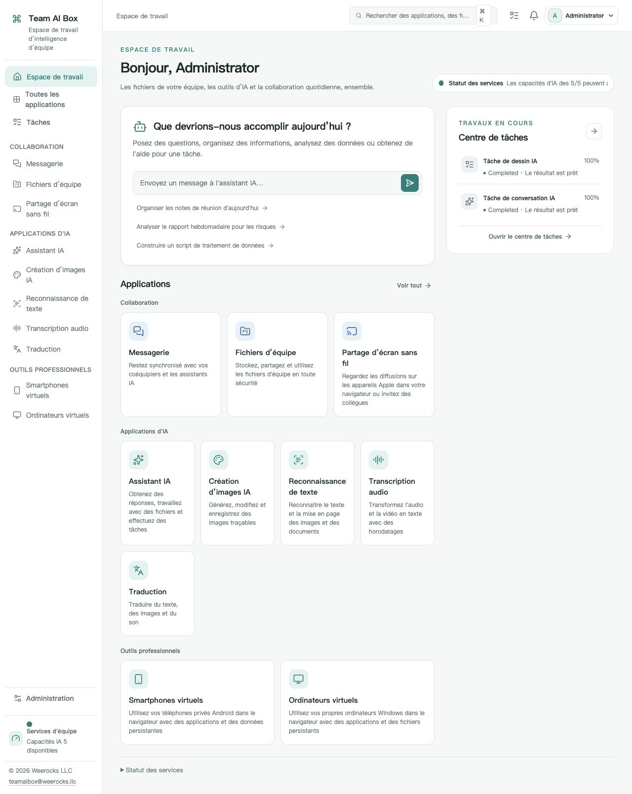

<!-- Generated from docs/readme-locales/fr.json by tools/render-readmes.mjs. -->
# Team AI Box

<p></p>

**Powered by NVIDIA DGX Spark · MIT · Weerocks LLC**

[English](README.fr.md) · [简体中文](README.fr.md) · [繁體中文](README.fr.md) · [日本語](README.fr.md) · [한국어](README.fr.md) · [Français](README.fr.md) · [Deutsch](README.fr.md) · [Español](README.fr.md) · [Português](README.fr.md) · [Русский](README.fr.md) · [العربية](README.fr.md) · [हिन्दी](README.fr.md) · [Bahasa Indonesia](README.fr.md) · [Italiano](README.fr.md) · [Türkçe](README.fr.md) · [Tiếng Việt](README.fr.md) · [ไทย](README.fr.md)

**Votre DGX Spark. L'espace IA de votre équipe.** Team AI Box réunit IA locale, fichiers, messagerie et appareils virtuels sur un seul NVIDIA DGX Spark. Votre équipe y accède dans son navigateur sans installer une pile IA sur chaque poste.

[teamaibox.com](https://teamaibox.com/) · [GitHub](https://github.com/weerocksllc/teamaibox) · [MIT](LICENSE) · [teamaibox@weerocks.llc](mailto:teamaibox@weerocks.llc)

## Pourquoi Team AI Box ?

- **Un espace unifié :** mêmes comptes et interface pour l'IA, la collaboration et les appareils.
- **Local d'abord :** inférence sur votre Spark, API externes facultatives, aucune clé USB matérielle requise.
- **Conçu pour DGX Spark :** Ubuntu ARM64, conteneurs GPU NVIDIA et KVM, sans configuration propre à une machine de développement.
- **Ouvert aux contributions :** code original MIT, 17 langues, thèmes clair/sombre et choix manuels mémorisés. L'anglais est la langue par défaut.

## Le véritable espace de travail

Capture réelle en français, pas une maquette. L'image suit le thème GitHub ; les originaux sont ci-dessous. Aucun fichier client ni identifiant secret. Les sorties des modèles, systèmes invités et noms personnalisés ont leurs propres réglages linguistiques.

<picture>
  <source media="(prefers-color-scheme: dark)" srcset="docs/assets/screenshots/fr/workbench-dark.jpg">
  <source media="(prefers-color-scheme: light)" srcset="docs/assets/screenshots/fr/workbench-light.jpg">
  
</picture>

[Thème clair](docs/assets/screenshots/fr/workbench-light.jpg) · [Thème sombre](docs/assets/screenshots/fr/workbench-dark.jpg)

## Les fonctionnalités

### Assistant IA

Posez des questions, rédigez, révisez et résumez des documents dans une conversation. Utilisez les modèles locaux ou choisissez une intégration externe.

### Création d'images

Générez et modifiez des images à partir de consignes, enregistrez les résultats et retrouvez l'état des tâches.

### Reconnaissance de texte

Extrayez le texte et la mise en page d'images ou de documents, puis vérifiez et réutilisez le contenu.

### Transcription

Transformez les enregistrements audio et vidéo en texte horodaté pour vos comptes rendus et sous-titres.

### Traduction

Traduisez du texte et les fichiers pris en charge. Les langues dépendent du modèle installé ; elles sont distinctes des langues de l'interface.

### Messagerie

Discutez en privé ou en groupe dans le même espace que les fichiers. Gérez les messages et supprimez les conversations depuis les commandes prévues.

### Disque partagé

Importez, classez, partagez et réutilisez les fichiers de l'équipe. Sélectionnez directement un fichier existant dans les applications compatibles.

### Diffusion sans fil

Regardez l'écran et écoutez le son d'appareils Apple compatibles dans un navigateur, avec vos collègues. La découverte nécessite un réseau local adapté.

### Téléphones Android virtuels

Installez des applications et retrouvez l'état de chaque téléphone dans le navigateur. Données et applications sont persistantes ; les services Google conservent leurs conditions de compatibilité et de licence.

### Ordinateurs Windows et Linux virtuels

Importez une ISO ARM64 autorisée ou choisissez-la dans le disque partagé, montez le lecteur virtuel et installez vous-même le système. L'écran virtuel montre le démarrage et les redémarrages, avec audio. Invitez des spectateurs ou opérateurs, transférez ou partagez le contrôle ; le propriétaire peut le reprendre. Le bureau distant est un mode supplémentaire.

### Administration et suivi

Créez les comptes, gérez les accès et consultez la disponibilité des applications et la progression des tâches. Chaque application s'ouvre lorsque ses dépendances sont prêtes ; le premier lancement des modèles peut prendre du temps.

<a id="install"></a>

## Installer sur un DGX Spark neuf

Prévoyez un **DGX Spark vierge sous Ubuntu 24.04 ARM64**, Docker Engine/Compose v2, pilotes et conteneurs NVIDIA opérationnels, KVM, Git et Python 3.10+. Plusieurs centaines de Go temporaires sont nécessaires pour modèles, images et paquet. Ne faites pas une installation neuve sur des données existantes.

```sh
git clone https://github.com/weerocksllc/teamaibox.git
cd teamaibox
sudo bash install/from-source.sh
```

Exécutez ces commandes **sur le Spark**. Le script télécharge les entrées, construit les images, prépare un paquet hors ligne complet puis l'installe. Cette première construction nécessite Internet et du temps ; cloner ne suffit pas. Docker/NVIDIA sont réutilisés, sans copier les comptes, disques ou secrets d'un développeur.

### Vérification et reprise

`--check` vérifie les prérequis. Après interruption, conservez `/var/tmp/teamaibox-source-build` et relancez **la même commande** : téléchargements vérifiés et étapes terminées sont réutilisés. N'effacez pas le cache et ne lancez pas de constructions concurrentes. Les sources officielles sont utilisées par défaut. En cas de blocage réseau, consultez [le guide](install/SOURCE-INSTALL.fr.md) pour les sources alternatives ou le transfert d'un cache/paquet vérifié ; aucun miroir n'est garanti. Un code modifié exige un nouveau `--work-dir`, sans contourner les contrôles.

```sh
sudo bash install/from-source.sh --check
sudo bash install/from-source.sh
```

### Après l'installation

1. Ouvrez `https://<BOX_LAN_IP>/` à l'adresse LAN actuelle et vérifiez le certificat HTTPS généré par votre appareil.
2. Connectez-vous avec `admin` / `admin`, **changez le mot de passe initial**, puis créez les comptes ordinaires. N'exposez pas ces identifiants sur Internet.
3. Attendez la disponibilité des applications et choisissez langue/thème dans le profil. État : `/srv/teamaibox/installation/readiness.json`.
4. Fournissez vos ISO ARM64 Windows/Linux autorisées et licences. Une cible hors ligne nécessite d'abord un paquet complet : suivez [le guide du paquet](install/README.fr.md). La préparation depuis les sources est en ligne.

## Licence et limites

Le code original et la documentation sont MIT, **pas tous les binaires installés**. Composants tiers, modèles, NVIDIA, micrologiciels, Google et Windows gardent leurs conditions. Aucun poids, disque invité installé, session connectée, ISO ou paquet hors ligne n'est dans Git. La compatibilité Google n'est pas une certification Play Protect ; la diffusion ne couvre ni DRM ni certification Apple. Windows 10 ARM64 n'est pas annoncé compatible. Performances et concurrence dépendent de la charge et du matériel. Le site marketing est privé et séparé ; l'interface produit est publique.

## Contribuez avec nous

Rapports de bugs, documentation, traductions, accessibilité, intégrations et code sont bienvenus. Décrivez le problème dans une issue, créez un fork et une branche ciblée, puis une PR avec contrôles et captures pertinents. Un Spark n'est pas indispensable pour la documentation ou les composants isolés ; indiquez honnêtement les validations matérielles. Ne publiez ni secrets, ni fichiers personnels, ni images connectées. Signalez les vulnérabilités en privé via SECURITY.md. Aucun CLA obligatoire ni autorisation payante.

[Issues](https://github.com/weerocksllc/teamaibox/issues) · [Pull requests](https://github.com/weerocksllc/teamaibox/pulls) · [CONTRIBUTING](CONTRIBUTING.fr.md) · [SECURITY](SECURITY.fr.md)

## Pour aller plus loin

- [Installation depuis les sources et reprise](install/SOURCE-INSTALL.fr.md)
- [Paquet hors ligne](install/README.fr.md)
- [Environnement de développement](docs/open-source/BUILDING.fr.md)
- [Contribuer](CONTRIBUTING.fr.md)
- [Signalement privé de sécurité](SECURITY.fr.md)
- [Licences tierces et périmètre de distribution](THIRD_PARTY_NOTICES.fr.md)

`apps/` · `services/` · `packages/` · `install/` · `deploy/` · `docs/`

© 2026 Weerocks LLC. [MIT](LICENSE) · [Licences tierces et périmètre de distribution](docs/open-source/RELEASING.fr.md)
