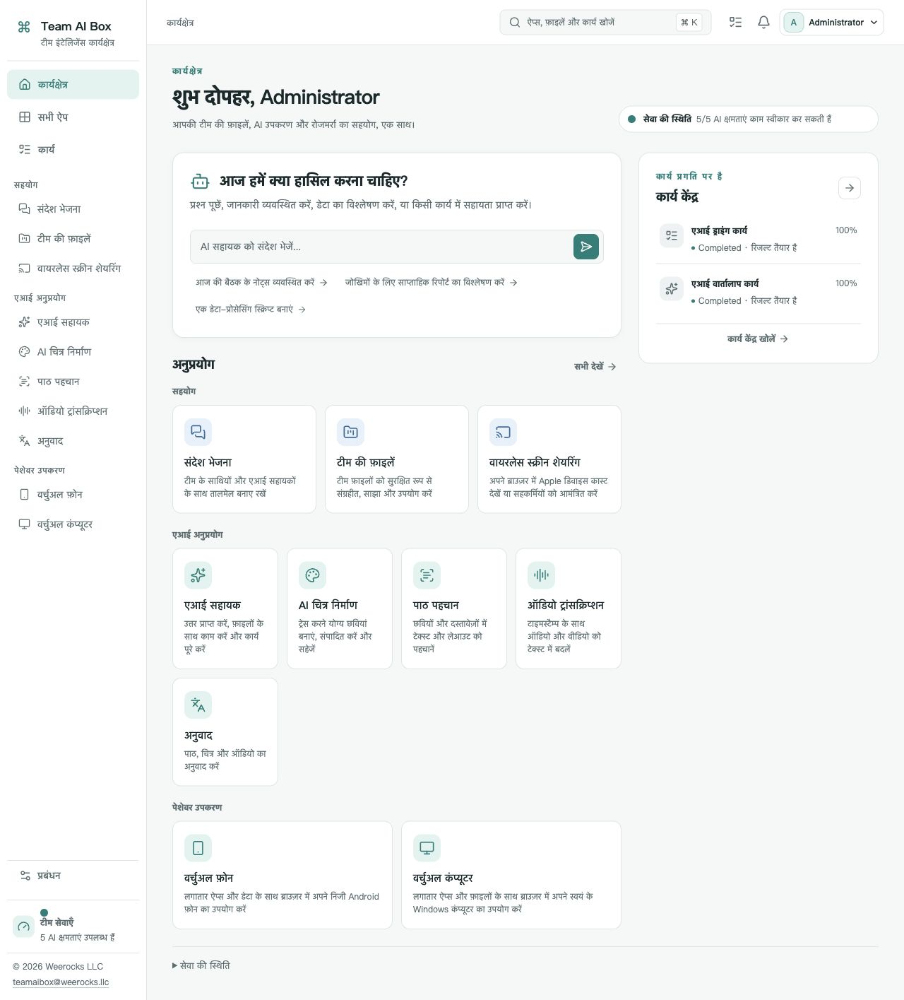

<!-- Generated from docs/readme-locales/hi.json by tools/render-readmes.mjs. -->
# Team AI Box

**Powered by NVIDIA DGX Spark · MIT · Weerocks LLC**

[English](README.md) · [简体中文](README.zh-CN.md) · [繁體中文](README.zh-TW.md) · [日本語](README.ja.md) · [한국어](README.ko.md) · [Français](README.fr.md) · [Deutsch](README.de.md) · [Español](README.es.md) · [Português](README.pt-BR.md) · [Русский](README.ru.md) · [العربية](README.ar.md) · [हिन्दी](README.hi.md) · [Bahasa Indonesia](README.id.md) · [Italiano](README.it.md) · [Türkçe](README.tr.md) · [Tiếng Việt](README.vi.md) · [ไทย](README.th.md)

**आपका DGX Spark, आपकी टीम का AI कार्यक्षेत्र।** Team AI Box एक NVIDIA DGX Spark पर स्थानीय AI, फ़ाइलें, बातचीत और वर्चुअल डिवाइस एक साथ लाता है। हर कंप्यूटर पर अलग AI व्यवस्था बनाने के बजाय टीम ब्राउज़र से काम करती है।

[teamaibox.com](https://teamaibox.com/) · [GitHub](https://github.com/weerocksllc/teamaibox) · [MIT](LICENSE) · [teamaibox@weerocks.llc](mailto:teamaibox@weerocks.llc)

## Team AI Box क्यों?

- **एकीकृत कार्यक्षेत्र:** AI, सहयोग और डिवाइस के लिए समान इंटरफ़ेस और खाते।
- **स्थानीय प्राथमिकता:** Spark पर अनुमान, बाहरी मॉडल API वैकल्पिक और USB कुंजी की आवश्यकता नहीं।
- **DGX Spark के लिए निर्मित:** Ubuntu ARM64, NVIDIA GPU कंटेनर और KVM; डेवलपर की मशीन पर निर्भर नहीं।
- **सुधार में भाग लें:** मूल कोड MIT, 17 भाषाएँ, हल्की/गहरी थीम और याद रखा गया मैन्युअल चयन। डिफ़ॉल्ट अंग्रेज़ी है।

## वास्तविक कार्यक्षेत्र

हिंदी में वास्तविक उत्पाद स्क्रीन, डिज़ाइन मॉकअप नहीं। चित्र GitHub थीम के अनुसार बदलता है; दोनों मूल नीचे हैं। ग्राहक फ़ाइलें या गुप्त पहचान विवरण शामिल नहीं हैं। मॉडल आउटपुट, गेस्ट OS और कस्टम नामों की भाषा अलग हो सकती है।

<picture>
  <source media="(prefers-color-scheme: dark)" srcset="docs/assets/screenshots/hi/workbench-dark.jpg">
  <source media="(prefers-color-scheme: light)" srcset="docs/assets/screenshots/hi/workbench-light.jpg">
  
</picture>

[हल्की थीम](docs/assets/screenshots/hi/workbench-light.jpg) · [गहरी थीम](docs/assets/screenshots/hi/workbench-dark.jpg)

## मुख्य सुविधाएँ

### AI सहायक

बातचीत में प्रश्न पूछें, लेखन तैयार और संशोधित करें, जानकारी का सार निकालें तथा दस्तावेज़ों पर काम करें। स्थानीय मॉडल मूल विकल्प हैं; बाहरी सेवाएँ आपकी पसंद हैं।

### चित्र निर्माण

निर्देशों से चित्र बनाएँ, संपादित करें और परिणाम सहेजें। कार्य की प्रगति और आउटपुट देखें।

### पाठ पहचान

चित्रों और दस्तावेज़ों से पाठ व संरचना निकालें, जाँचें और पुनः उपयोग करें।

### लिप्यंतरण

ऑडियो और वीडियो को समय-चिह्न वाले पाठ में बदलें, ताकि बैठक नोट्स और उपशीर्षक बनाए जा सकें।

### अनुवाद

पाठ और समर्थित फ़ाइलों का अनुवाद करें। भाषाएँ स्थापित मॉडल पर निर्भर हैं और इंटरफ़ेस की भाषाओं से अलग हैं।

### संदेश

टीम फ़ाइलों के साथ निजी और समूह बातचीत करें। स्पष्ट नियंत्रणों से संदेश प्रबंधित और चैट हटाएँ।

### टीम ड्राइव

फ़ाइलें अपलोड, व्यवस्थित और साझा करें; समर्थित ऐप में मौजूदा फ़ाइल सीधे चुनें।

### वायरलेस स्क्रीन साझा करना

संगत Apple डिवाइस का चित्र और ध्वनि ब्राउज़र में सहयोगियों के साथ देखें। रिसीवर खोजने के लिए उचित LAN कनेक्शन चाहिए।

### वर्चुअल Android फ़ोन

ऐप स्थापित करें और ब्राउज़र में प्रत्येक फ़ोन की सहेजी स्थिति पर लौटें। हर डिवाइस का डेटा अलग रहता है; Google सेवाओं की अपनी संगतता और लाइसेंस शर्तें हैं।

### वर्चुअल Windows और Linux कंप्यूटर

अधिकृत ARM64 ISO अपलोड करें या ड्राइव से चुनें, वर्चुअल ऑप्टिकल ड्राइव में लगाएँ और वर्चुअल मॉनिटर से स्वयं OS स्थापित करें। बूट/पुनःआरंभ, ऑडियो, देखने या नियंत्रण के निमंत्रण, नियंत्रण हस्तांतरण और साझा नियंत्रण उपलब्ध हैं; मालिक नियंत्रण वापस ले सकता है। रिमोट डेस्कटॉप अतिरिक्त मोड है।

### टीम प्रबंधन और कार्य

खाते और पहुँच प्रबंधित करें तथा ऐप की तैयारी और कार्य प्रगति देखें। हर ऐप अपनी निर्भरताएँ तैयार होने पर खुलता है; मॉडल का पहला आरंभ समय ले सकता है।

## नए DGX Spark पर स्थापना

**Ubuntu 24.04 ARM64 वाला नया DGX Spark**, कार्यरत Docker Engine/Compose v2, NVIDIA ड्राइवर और कंटेनर समर्थन, KVM, Git तथा Python 3.10+ चाहिए। मॉडल, बिल्ड और पैकेज के लिए कई सौ GB अस्थायी स्थान रखें। मौजूदा व्यावसायिक डेटा के ऊपर नई स्थापना न करें।

```sh
git clone https://github.com/weerocksllc/teamaibox.git
cd teamaibox
sudo bash install/from-source.sh
```

कमांड **Spark पर** चलाएँ। स्क्रिप्ट मॉडल और इनपुट डाउनलोड करती है, इमेज बनाती है, पूरा ऑफ़लाइन पैकेज तैयार करके स्थापित करती है। पहली बिल्ड के लिए इंटरनेट और समय चाहिए; केवल clone करना स्थापना नहीं है। Docker/NVIDIA का पुनः उपयोग होता है, डेवलपर के खाते या डिस्क कॉपी नहीं होते।

### पूर्व-जाँच और फिर से शुरू करना

`--check` आवश्यकताएँ जाँचता है। बाधा आने पर `/var/tmp/teamaibox-source-build` रखें और **वही कमांड** दोहराएँ; सत्यापित डाउनलोड और चरण पुनः उपयोग होंगे। कैश न मिटाएँ और समानांतर प्रतिस्पर्धी बिल्ड न चलाएँ। डिफ़ॉल्ट आधिकारिक स्रोत हैं। पहुँच न मिले तो [गाइड](install/SOURCE-INSTALL.md) के विकल्प या सत्यापित कैश/पूरा पैकेज स्थानांतरित करें; मिरर की उपलब्धता की गारंटी नहीं है। कोड बदलने पर नया `--work-dir` लें, जाँच को न लाँघें।

```sh
sudo bash install/from-source.sh --check
sudo bash install/from-source.sh
```

### स्थापना के बाद

1. वर्तमान LAN IP से `https://<BOX_LAN_IP>/` खोलें और सुनिश्चित करें कि स्थानीय HTTPS प्रमाणपत्र आपके डिवाइस का है।
2. `admin` / `admin` से प्रवेश कर **प्रारंभिक पासवर्ड बदलें**, फिर सामान्य खाते बनाएँ। डिफ़ॉल्ट पहचान विवरण इंटरनेट पर उजागर न करें।
3. ऐप तैयार होने दें और प्रोफ़ाइल में भाषा/थीम चुनें। स्थिति: `/srv/teamaibox/installation/readiness.json`।
4. अपनी अधिकृत Windows/Linux ARM64 ISO और लाइसेंस दें। ऑफ़लाइन लक्ष्य के लिए पहले पूरा पैकेज तैयार करके [गाइड](install/README.md) का पालन करें; स्रोत तैयारी ऑनलाइन होती है।

## लाइसेंस और सीमाएँ

मूल कोड व दस्तावेज़ MIT हैं, **सभी स्थापित बाइनरी नहीं**। तृतीय-पक्ष कोड, मॉडल, NVIDIA, फ़र्मवेयर, Google और Windows की अपनी शर्तें हैं। Git में वज़न, स्थापित गेस्ट डिस्क, लॉगिन स्थिति, ISO या पैकेज नहीं हैं। Google संगतता Play Protect प्रमाणन नहीं है; कास्टिंग में DRM या Apple प्रमाणन शामिल नहीं है। Windows 10 ARM64 समर्थन का दावा नहीं है। प्रदर्शन और समवर्ती कार्य हार्डवेयर व भार पर निर्भर हैं। मार्केटिंग वेबसाइट अलग निजी रिपॉज़िटरी में है; उत्पाद UI सार्वजनिक है।

## हमारे साथ योगदान दें

बग, दस्तावेज़, अनुवाद, सुलभता, एकीकरण और कोड का स्वागत है। issue में समस्या बताएँ, fork और केंद्रित शाखा बनाएँ, संबंधित जाँच व स्क्रीन के साथ PR भेजें। दस्तावेज़ या अलग घटकों के लिए Spark आवश्यक नहीं; हार्डवेयर जाँच ईमानदारी से बताएँ। रहस्य, निजी फ़ाइलें या लॉगिन वाली इमेज न डालें। सुरक्षा समस्या SECURITY.md के अनुसार निजी रूप से बताएँ। अनिवार्य CLA या सशुल्क अनुमति नहीं है।

[Issues](https://github.com/weerocksllc/teamaibox/issues) · [Pull requests](https://github.com/weerocksllc/teamaibox/pulls) · [CONTRIBUTING](CONTRIBUTING.md) · [SECURITY](SECURITY.md)

## अधिक जानकारी

- [स्रोत स्थापना और पुनर्प्राप्ति](install/SOURCE-INSTALL.md)
- [ऑफ़लाइन पैकेज](install/README.md)
- [डेवलपमेंट और बिल्ड](docs/open-source/BUILDING.md)
- [योगदान प्रक्रिया](CONTRIBUTING.md)
- [निजी सुरक्षा रिपोर्ट](SECURITY.md)
- [तृतीय-पक्ष लाइसेंस और वितरण सीमा](THIRD_PARTY_NOTICES.md)

`apps/` · `services/` · `packages/` · `install/` · `deploy/` · `docs/`

© 2026 Weerocks LLC. [MIT](LICENSE) · [तृतीय-पक्ष लाइसेंस और वितरण सीमा](docs/open-source/RELEASING.md)
