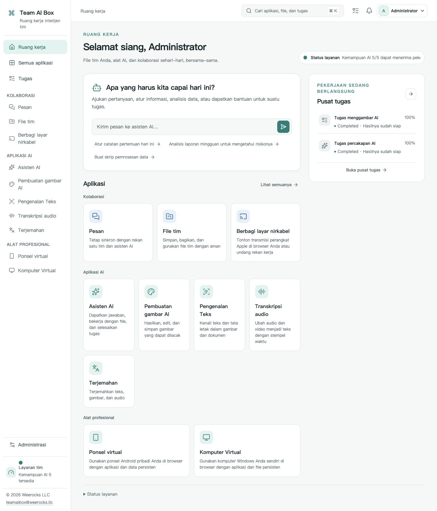

<!-- Generated from docs/readme-locales/id.json by tools/render-readmes.mjs. -->
# Team AI Box

<p></p>

**Powered by NVIDIA DGX Spark · MIT · Weerocks LLC**

[English](README.id.md) · [简体中文](README.id.md) · [繁體中文](README.id.md) · [日本語](README.id.md) · [한국어](README.id.md) · [Français](README.id.md) · [Deutsch](README.id.md) · [Español](README.id.md) · [Português](README.id.md) · [Русский](README.id.md) · [العربية](README.id.md) · [हिन्दी](README.id.md) · [Bahasa Indonesia](README.id.md) · [Italiano](README.id.md) · [Türkçe](README.id.md) · [Tiếng Việt](README.id.md) · [ไทย](README.id.md)

**DGX Spark Anda. Ruang AI untuk tim Anda.** Team AI Box menyatukan AI lokal, berkas, komunikasi, dan perangkat virtual pada satu NVIDIA DGX Spark. Tim mengaksesnya melalui browser tanpa memasang lingkungan AI di setiap komputer.

[teamaibox.com](https://teamaibox.com/) · [GitHub](https://github.com/weerocksllc/teamaibox) · [MIT](LICENSE) · [teamaibox@weerocks.llc](mailto:teamaibox@weerocks.llc)

## Mengapa Team AI Box?

- **Satu ruang kerja:** antarmuka dan akun yang konsisten untuk AI, kolaborasi, dan perangkat.
- **Lokal sebagai dasar:** inferensi pada Spark, API model eksternal opsional, tanpa kunci USB wajib.
- **Khusus DGX Spark:** Ubuntu ARM64, kontainer GPU NVIDIA, dan KVM tanpa ketergantungan pada mesin pengembang.
- **Terbuka untuk kontribusi:** kode asli MIT, 17 bahasa, tema terang/gelap dan pilihan manual tersimpan. Bahasa awal adalah Inggris.

## Ruang kerja sebenarnya

Tangkapan produk dalam Bahasa Indonesia, bukan maket. Gambar mengikuti tema GitHub; kedua aslinya tersedia di bawah. Tidak memuat berkas pelanggan atau kredensial. Keluaran model, OS tamu, dan nama buatan pengguna memiliki pengaturan bahasa tersendiri.

<picture>
  <source media="(prefers-color-scheme: dark)" srcset="docs/assets/screenshots/id/workbench-dark.jpg">
  <source media="(prefers-color-scheme: light)" srcset="docs/assets/screenshots/id/workbench-light.jpg">
  
</picture>

[Tema terang](docs/assets/screenshots/id/workbench-light.jpg) · [Tema gelap](docs/assets/screenshots/id/workbench-dark.jpg)

## Kemampuan produk

### Asisten AI

Bertanya, menulis, menyunting, merangkum informasi, dan mengolah dokumen dalam percakapan. Gunakan model lokal atau hubungkan penyedia eksternal sesuai pilihan.

### Pembuatan gambar

Buat dan sunting gambar dari instruksi, simpan hasil, serta pantau kemajuan tugas.

### Pengenalan teks

Ekstrak teks dan tata letak gambar atau dokumen, tinjau, lalu gunakan kembali.

### Transkripsi

Ubah audio dan video menjadi teks bertanda waktu untuk notulen dan takarir.

### Terjemahan

Terjemahkan teks serta berkas yang didukung. Bahasa mengikuti kemampuan model terpasang, bukan daftar bahasa antarmuka.

### Pesan

Percakapan pribadi dan grup berdampingan dengan berkas tim. Kelola pesan dan hapus percakapan melalui kontrol yang jelas.

### Drive tim

Unggah, tata, bagikan, dan gunakan ulang berkas langsung dalam aplikasi yang mendukungnya.

### Casting nirkabel

Tonton layar dan dengarkan suara perangkat Apple yang kompatibel melalui browser bersama kolega. Penemuan penerima memerlukan koneksi LAN yang sesuai.

### Ponsel Android virtual

Pasang aplikasi dan kembali ke keadaan ponsel yang tersimpan lewat browser. Data tiap perangkat terpisah; layanan Google memiliki syarat kompatibilitas dan lisensi sendiri.

### Komputer Windows dan Linux virtual

Unggah ISO ARM64 berizin atau pilih dari drive, pasang ke drive optik virtual, lalu instal sendiri melalui monitor virtual. Lihat boot dan restart, gunakan audio, undang penonton/pengendali, alihkan atau bagikan kendali dan ambil kembali sebagai pemilik. Desktop jarak jauh merupakan mode tambahan.

### Administrasi dan tugas

Buat akun, atur akses, dan lihat kesiapan aplikasi serta kemajuan tugas. Tiap aplikasi terbuka ketika dependensinya siap; awal pemuatan model bisa membutuhkan waktu.

<a id="install"></a>

## Instal pada DGX Spark baru

Siapkan **DGX Spark kosong dengan Ubuntu 24.04 ARM64**, Docker Engine/Compose v2, driver dan dukungan kontainer NVIDIA, KVM, Git, serta Python 3.10+ yang berfungsi. Sediakan ratusan GB ruang sementara untuk model, build, dan paket. Jangan lakukan instalasi baru di atas data yang ada.

```sh
git clone https://github.com/weerocksllc/teamaibox.git
cd teamaibox
sudo bash install/from-source.sh
```

Jalankan perintah **pada Spark**. Skrip mengunduh input dan model, membangun image, membuat paket offline lengkap, lalu memasangnya. Build pertama memerlukan Internet dan waktu; clone saja belum menginstal produk. Docker/NVIDIA dipakai kembali tanpa menyalin akun, disk, atau rahasia pengembang.

### Pemeriksaan dan melanjutkan

`--check` memeriksa prasyarat. Jika terputus, simpan `/var/tmp/teamaibox-source-build` dan jalankan **perintah yang sama** untuk menggunakan ulang unduhan dan tahap terverifikasi. Jangan hapus cache atau menjalankan build bersamaan. Sumber resmi digunakan secara bawaan. Jika tidak terjangkau, lihat [panduan](install/SOURCE-INSTALL.id.md) untuk sumber alternatif atau transfer cache/paket terverifikasi; mirror tidak dijamin tersedia. Kode berubah memerlukan `--work-dir` baru, bukan melewati pemeriksaan.

```sh
sudo bash install/from-source.sh --check
sudo bash install/from-source.sh
```

### Setelah instalasi

1. Buka `https://<BOX_LAN_IP>/` dengan alamat LAN terkini dan pastikan sertifikat HTTPS lokal milik perangkat Anda.
2. Masuk dengan `admin` / `admin`, **ubah kata sandi awal**, lalu buat akun biasa. Jangan paparkan kredensial awal ke Internet.
3. Tunggu tiap aplikasi siap dan pilih bahasa/tema melalui profil. Status: `/srv/teamaibox/installation/readiness.json`.
4. Sediakan ISO ARM64 Windows/Linux dan lisensi yang sah. Untuk target offline, siapkan paket lengkap dahulu lalu ikuti [panduan paket](install/README.id.md); persiapan sumber tetap online.

## Lisensi dan batasan

Kode asli serta dokumentasi berlisensi MIT, **bukan semua biner instalasi**. Komponen pihak ketiga, model, NVIDIA, firmware, Google, dan Windows mempertahankan syarat masing-masing. Git tidak menyertakan bobot, disk tamu terinstal, sesi login, ISO, atau paket. Kompatibilitas Google bukan sertifikasi Play Protect; casting tidak mencakup DRM maupun sertifikasi Apple. Dukungan Windows 10 ARM64 tidak diklaim. Kinerja dan konkurensi bergantung pada beban dan perangkat keras. Situs pemasaran terpisah dan privat; UI produk terbuka.

## Mari berkontribusi

Laporan bug, dokumentasi, terjemahan, aksesibilitas, integrasi, dan kode sangat diterima. Jelaskan masalah dalam issue, buat fork dan branch terfokus, lalu PR dengan pemeriksaan dan gambar terkait. Spark tidak wajib untuk dokumen atau komponen terisolasi; jelaskan bukti perangkat keras dengan jujur. Jangan unggah rahasia, berkas pribadi, atau image yang sudah login. Laporkan kerentanan secara privat sesuai SECURITY.md. Tidak ada CLA wajib atau izin berbayar.

[Issues](https://github.com/weerocksllc/teamaibox/issues) · [Pull requests](https://github.com/weerocksllc/teamaibox/pulls) · [CONTRIBUTING](CONTRIBUTING.id.md) · [SECURITY](SECURITY.id.md)

## Pelajari lebih lanjut

- [Instalasi sumber dan pemulihan](install/SOURCE-INSTALL.id.md)
- [Paket offline](install/README.id.md)
- [Pengembangan dan build](docs/open-source/BUILDING.id.md)
- [Alur kontribusi](CONTRIBUTING.id.md)
- [Pelaporan keamanan privat](SECURITY.id.md)
- [Lisensi pihak ketiga dan cakupan rilis](THIRD_PARTY_NOTICES.id.md)

`apps/` · `services/` · `packages/` · `install/` · `deploy/` · `docs/`

© 2026 Weerocks LLC. [MIT](LICENSE) · [Lisensi pihak ketiga dan cakupan rilis](docs/open-source/RELEASING.id.md)
