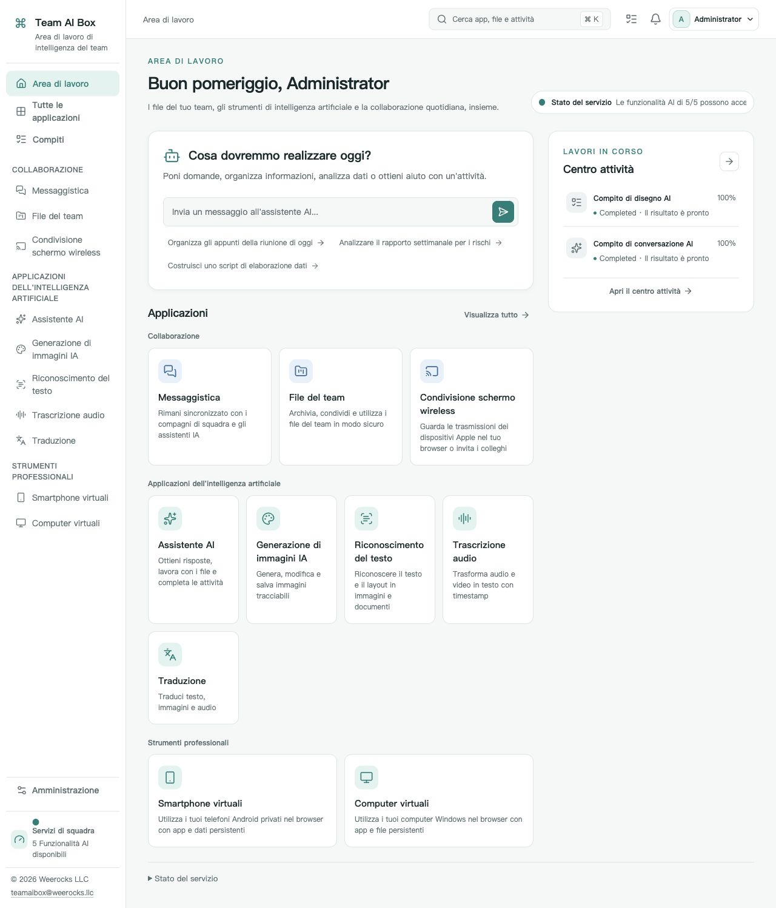

<!-- Generated from docs/readme-locales/it.json by tools/render-readmes.mjs. -->
# Team AI Box

**Powered by NVIDIA DGX Spark · MIT · Weerocks LLC**

[English](README.md) · [简体中文](README.zh-CN.md) · [繁體中文](README.zh-TW.md) · [日本語](README.ja.md) · [한국어](README.ko.md) · [Français](README.fr.md) · [Deutsch](README.de.md) · [Español](README.es.md) · [Português](README.pt-BR.md) · [Русский](README.ru.md) · [العربية](README.ar.md) · [हिन्दी](README.hi.md) · [Bahasa Indonesia](README.id.md) · [Italiano](README.it.md) · [Türkçe](README.tr.md) · [Tiếng Việt](README.vi.md) · [ไทย](README.th.md)

**Il tuo DGX Spark. Lo spazio IA del tuo team.** Team AI Box riunisce IA locale, file, comunicazione e dispositivi virtuali su un solo NVIDIA DGX Spark. Il team accede dal browser senza installare un ambiente IA su ogni computer.

[teamaibox.com](https://teamaibox.com/) · [GitHub](https://github.com/weerocksllc/teamaibox) · [MIT](LICENSE) · [teamaibox@weerocks.llc](mailto:teamaibox@weerocks.llc)

## Perché Team AI Box?

- **Uno spazio integrato:** interfaccia e account coerenti per IA, collaborazione e dispositivi.
- **Prima il locale:** inferenza sullo Spark, API esterne facoltative, nessuna chiave USB obbligatoria.
- **Progettato per DGX Spark:** Ubuntu ARM64, container GPU NVIDIA e KVM, senza dipendere dal computer dello sviluppatore.
- **Aperto ai contributi:** codice originale MIT, 17 lingue, temi chiaro/scuro e scelte manuali salvate. La lingua iniziale è inglese.

## Lo spazio di lavoro reale

Schermata reale in italiano, non un mockup. Segue il tema di GitHub; entrambi gli originali sono sotto. Non contiene file clienti o credenziali. Output dei modelli, sistemi ospiti e nomi personalizzati hanno impostazioni linguistiche proprie.

<picture>
  <source media="(prefers-color-scheme: dark)" srcset="docs/assets/screenshots/it/workbench-dark.jpg">
  <source media="(prefers-color-scheme: light)" srcset="docs/assets/screenshots/it/workbench-light.jpg">
  
</picture>

[Tema chiaro](docs/assets/screenshots/it/workbench-light.jpg) · [Tema scuro](docs/assets/screenshots/it/workbench-dark.jpg)

## Cosa puoi fare

### Assistente IA

Fai domande, scrivi e revisiona testi, riassumi informazioni e lavora sui documenti in una conversazione. Modelli locali di base, servizi esterni a scelta.

### Generazione immagini

Genera e modifica immagini con istruzioni, salva i risultati e segui l'avanzamento delle attività.

### Riconoscimento testo

Estrai testo e struttura da immagini e documenti, controlla e riutilizza il contenuto.

### Trascrizione

Converti audio e video in testo con riferimenti temporali per verbali e sottotitoli.

### Traduzione

Traduci testo e file supportati. Le lingue dipendono dal modello installato e non coincidono con quelle dell'interfaccia.

### Messaggi

Conversazioni private e di gruppo accanto ai file del team. Gestisci messaggi ed elimina chat con comandi visibili.

### Drive del team

Carica, organizza, condividi e riutilizza i file, selezionandoli direttamente nelle applicazioni compatibili.

### Trasmissione wireless

Guarda lo schermo e ascolta l'audio dei dispositivi Apple compatibili dal browser, insieme ai colleghi. La scoperta richiede una connessione LAN adatta.

### Telefoni Android virtuali

Installa app e riprendi lo stato salvato di ogni telefono dal browser. I dati dei dispositivi sono separati; Google mantiene condizioni proprie di compatibilità e licenza.

### Computer Windows e Linux virtuali

Carica una ISO ARM64 autorizzata o sceglila dal drive, monta il lettore ottico virtuale e installa il sistema dal monitor virtuale. Visualizza avvio e riavvio, usa l'audio, invita spettatori o operatori, passa o condividi il controllo e riprendilo come proprietario. Desktop remoto è una modalità aggiuntiva.

### Amministrazione e attività

Crea account, gestisci accessi e osserva disponibilità e avanzamento. Ogni app si abilita quando le sue dipendenze sono pronte; il primo avvio dei modelli può richiedere tempo.

## Installazione su un DGX Spark nuovo

Serve un **DGX Spark senza installazioni precedenti con Ubuntu 24.04 ARM64**, Docker Engine/Compose v2, driver e container NVIDIA funzionanti, KVM, Git e Python 3.10+. Riserva diverse centinaia di GB temporanei per modelli, build e pacchetto. Non installare da zero sopra dati esistenti.

```sh
git clone https://github.com/weerocksllc/teamaibox.git
cd teamaibox
sudo bash install/from-source.sh
```

Esegui i comandi **sullo Spark**. Lo script scarica input e modelli, costruisce immagini, prepara un pacchetto offline completo e installa. La prima build richiede Internet e tempo; clonare non equivale a installare. Riutilizza Docker/NVIDIA senza copiare account, dischi o segreti dello sviluppatore.

### Controlli e ripresa

`--check` verifica i prerequisiti. In caso di interruzione conserva `/var/tmp/teamaibox-source-build` e ripeti **lo stesso comando**, riutilizzando download verificati e fasi completate. Non cancellare la cache né avviare build concorrenti. Le fonti ufficiali sono predefinite. Se irraggiungibili, usa [la guida](install/SOURCE-INSTALL.md) per alternative o trasferire cache/pacchetti verificati; i mirror non sono garantiti. Codice modificato richiede un nuovo `--work-dir`, senza aggirare i controlli.

```sh
sudo bash install/from-source.sh --check
sudo bash install/from-source.sh
```

### Dopo l'installazione

1. Apri `https://<BOX_LAN_IP>/` all'indirizzo LAN corrente e verifica che il certificato HTTPS locale appartenga al tuo dispositivo.
2. Accedi con `admin` / `admin`, **cambia la password iniziale** e crea account normali. Non esporre le credenziali iniziali su Internet.
3. Attendi le app pronte e scegli lingua/tema nel profilo. Stato: `/srv/teamaibox/installation/readiness.json`.
4. Fornisci ISO ARM64 Windows/Linux autorizzate e licenze. Per una destinazione offline prepara il pacchetto completo e segui [la guida](install/README.md); la preparazione sorgente è online.

## Licenza e limiti

Codice originale e documentazione sono MIT, **non tutti i binari installati**. Terze parti, modelli, NVIDIA, firmware, Google e Windows conservano i propri termini. Git non include pesi, dischi ospiti installati, sessioni, ISO o pacchetti. Compatibilità Google non significa certificazione Play Protect; casting non include DRM o certificazione Apple. Non si dichiara supporto Windows 10 ARM64. Prestazioni e concorrenza dipendono dal carico e dall'hardware. Il sito commerciale resta privato e separato; la UI del prodotto è pubblica.

## Costruiamolo insieme

Sono benvenuti bug, documentazione, traduzioni, accessibilità, integrazioni e codice. Descrivi il problema in una issue, crea fork e branch mirato, invia una PR con controlli e immagini pertinenti. Spark non è necessario per documentazione o componenti isolati; dichiara le verifiche hardware reali. Non pubblicare segreti, file personali o immagini con accesso effettuato. Segnala vulnerabilità privatamente secondo SECURITY.md. Nessun CLA obbligatorio o permesso a pagamento.

[Issues](https://github.com/weerocksllc/teamaibox/issues) · [Pull requests](https://github.com/weerocksllc/teamaibox/pulls) · [CONTRIBUTING](CONTRIBUTING.md) · [SECURITY](SECURITY.md)

## Approfondimenti

- [Installazione sorgente e ripristino](install/SOURCE-INSTALL.md)
- [Pacchetto offline](install/README.md)
- [Ambiente di sviluppo](docs/open-source/BUILDING.md)
- [Come contribuire](CONTRIBUTING.md)
- [Segnalazione privata di sicurezza](SECURITY.md)
- [Licenze terze e ambito di distribuzione](THIRD_PARTY_NOTICES.md)

`apps/` · `services/` · `packages/` · `install/` · `deploy/` · `docs/`

© 2026 Weerocks LLC. [MIT](LICENSE) · [Licenze terze e ambito di distribuzione](docs/open-source/RELEASING.md)
