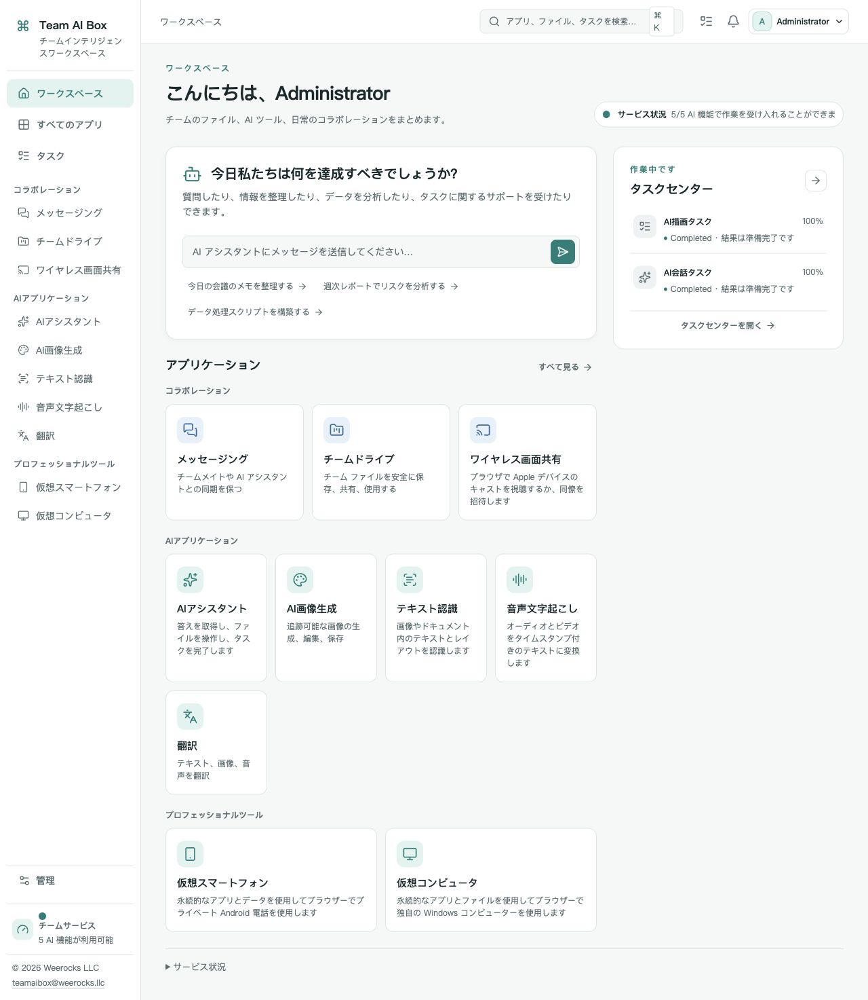

<!-- Generated from docs/readme-locales/ and docs/readme-features/ja.json by tools/render-readmes.mjs. -->
# Team AI Box — NVIDIA DGX Spark 向けオープンソースソフトウェア

<p></p>

**Powered by NVIDIA DGX Spark · MIT · Weerocks LLC**

[English](README.md) · [简体中文](README.zh-CN.md) · [繁體中文](README.zh-TW.md) · [日本語](README.ja.md) · [한국어](README.ko.md) · [Français](README.fr.md) · [Deutsch](README.de.md) · [Español](README.es.md) · [Português](README.pt-BR.md) · [Русский](README.ru.md) · [العربية](README.ar.md) · [हिन्दी](README.hi.md) · [Bahasa Indonesia](README.id.md) · [Italiano](README.it.md) · [Türkçe](README.tr.md) · [Tiếng Việt](README.vi.md) · [ไทย](README.th.md)

**NVIDIA DGX Spark をチームの AI ワークスペースに。** NVIDIA DGX Spark でローカル AI、画像生成、文書ツールを利用。Team AI Box は共有ファイル、メッセージ、仮想デバイスをブラウザーから使えるオープンソースのワークスペースにまとめます。

[teamaibox.com](https://teamaibox.com/) · [GitHub](https://github.com/weerocksllc/teamaibox) · [MIT](LICENSE) · [teamaibox@weerocks.llc](mailto:teamaibox@weerocks.llc)

[全機能チェックリスト](#features) · [新しい DGX Spark にインストール](#install) · [一緒に育てましょう](#contribute)

## Team AI Box を選ぶ理由

- **1 台に集約。** AI、共同作業、仮想デバイスを共通の UI とアカウントで利用できます。
- **ローカル AI を中心に。** Spark 上でモデル推論を実行し、必要に応じて外部モデル API を接続できます。
- **DGX Spark 向けに設計。** Ubuntu ARM64、NVIDIA GPU コンテナー、KVM 仮想化を利用してインストールできます。
- **改良に参加できます。** 自社コードは MIT。UI は 17 言語とライト/ダークテーマに対応し、手動の選択を保存します。初期言語は英語です。

## 実際のワークスペース

<picture>
  <source media="(prefers-color-scheme: dark)" srcset="docs/assets/screenshots/ja/workbench-dark.jpg">
  <source media="(prefers-color-scheme: light)" srcset="docs/assets/screenshots/ja/workbench-light.jpg">
  
</picture>

[ライト表示](docs/assets/screenshots/ja/workbench-light.jpg) · [ダーク表示](docs/assets/screenshots/ja/workbench-dark.jpg)

<a id="features"></a>

## 全機能チェックリスト

**機能別に見る**

- [ワークスペースと日常の操作](#feature-workspace)
- [AI アシスタントと権限を管理できる Agent](#feature-assistant)
- [AI 画像生成](#feature-drawing)
- [文字認識と校正](#feature-ocr)
- [録音とリアルタイム音声の文字起こし](#feature-transcription)
- [テキスト・ファイル・メディアの翻訳](#feature-translation)
- [チームメッセージ](#feature-messaging)
- [チームドライブとファイル共有](#feature-drive)
- [AirPlay 互換のワイヤレス画面共有](#feature-casting)
- [データを保持する仮想 Android スマートフォン](#feature-phones)
- [Windows と Linux の仮想コンピューター](#feature-computers)
- [管理・権限・セキュリティ](#feature-administration)
- [ソースからのインストールと保守](#feature-installation)
- [オープンソース開発と拡張](#feature-developers)

<a id="feature-workspace"></a>

### ワークスペースと日常の操作

- 1 台の DGX Spark 上で、ローカル AI、チームの共同作業、仮想デバイスをブラウザの共通ワークスペースから利用できます。
- アプリをカテゴリ別に閲覧し、アプリ一覧を検索して、サイドバーから開けます。
- 各アプリの読み込み状況、利用可否、サービスの状態を確認できます。
- タスクセンターで待機中、実行中、完了、失敗、キャンセル済みの作業を追跡し、利用可能な結果を開けます。
- 通知メニューで未回答の画面共有への招待を確認し、画面共有アプリを開いて回答できます。
- 右から左に表示するアラビア語を含む 17 の表示言語から選べます。別の言語を選ぶまでは英語が既定です。
- ライト、ダーク、システム設定に合わせた外観を選べます。手動で選んだ言語とテーマは、再読み込み、再ログイン、各アプリへの移動後も維持されます。

<a id="feature-assistant"></a>

### AI アシスタントと権限を管理できる Agent

- 会話を開始して履歴を保存し、以前のやり取りを再び開けます。
- リクエストごとに自動、回答、Agent のモードを選べます。
- リクエストに複数のファイルを添付し、送信前に添付を取り除けます。
- 生成中の回答を順次表示し、実行を停止したり、再接続後にイベントの受信を再開したりできます。
- 返されたモデル情報、ツールの動作、参照元、使用量を確認し、実行によってファイルが生成された場合はダウンロードできます。
- 確認が必要な Agent 操作の対象範囲を確認し、その操作を許可または拒否できます。
- Agent の作業は、永続ワークスペースを持つユーザー別サンドボックスで実行されます。ツールとネットワークへのアクセスは管理者のポリシーに従います。

<a id="feature-drawing"></a>

### AI 画像生成

- 利用可能な画像モデルを使い、テキストの指示から画像を生成できます。現在のアプリは画像編集やインペインティング用のエディターではありません。
- 利用可能なモデル設定が対応している場合、自動または高速の生成方針を選べます。
- 正方形、横長、縦長の比率、対応する出力サイズ、ランダムまたは固定のシード値を選べます。
- PNG、WebP、JPEG での出力を指定し、結果をプレビューして画像をダウンロードできます。
- キューと生成の進行状況を確認し、作業をキャンセルしたり、ページを開き直して現在のタスクを復元したりできます。
- 結果に記録された、実際に使用したモデルと生成パラメーターを確認できます。

<a id="feature-ocr"></a>

### 文字認識と校正

- PNG、JPEG、WebP、PDF をアップロードするか、チームドライブの既存ファイルを選べます。
- 言語のヒントを指定し、選択したモデルが対応する範囲でテキスト、Markdown の表、LaTeX の数式を認識できます。
- 認識結果をページとテキストブロックごとに確認し、認識された文字を手動で修正できます。
- 確認・修正した内容をテキスト、Markdown、JSON として書き出せます。
- 保存済みの認識結果を翻訳に渡せます。元ファイルの再アップロードや再認識は不要です。
- 認識タスクの進行状況を確認し、キャンセルできます。現在のモデルは領域の座標や信頼度スコアを提供しません。

<a id="feature-transcription"></a>

### 録音とリアルタイム音声の文字起こし

- ローカルまたはチームドライブから、WAV、FLAC、OGG、WebM、MP3、M4A、AIFF、MP4 の音声・動画を選べます。
- 元のメディアをプレビューし、言語の自動検出または対応する言語ヒントを利用できます。
- タイムスタンプ付きの文字起こし区間を確認し、内容を編集できます。
- テキスト、JSON、SRT、WebVTT 字幕として書き出せます。
- 保存済みの文字起こしを翻訳に渡し、現在の文字起こしタスクを追跡またはキャンセルできます。
- HTTPS、ブラウザの許可、MediaRecorder、リアルタイムサービスが利用できる場合、マイク音声をリアルタイムに文字起こしできます。
- 単語単位のタイムスタンプや話者分離は、対応するプロファイルでのみ利用できます。実験的な話者分離の処理には WAV 入力が必要です。

<a id="feature-translation"></a>

### テキスト・ファイル・メディアの翻訳

- モデルに基づく 60 言語の一覧から選択し、原文の言語を自動検出したり、翻訳元と翻訳先を指定・入れ替えたりできます。すべての言語の組み合わせで同等の品質を保証するものではありません。
- 入力または貼り付けた文章を翻訳し、原文と訳文を区間ごとに比較できます。
- 画像や PDF をアップロードするか、チームドライブから選べます。OCR の準備が整っていれば、文字を認識してから翻訳します。
- 文字起こしサービスの準備が整っていれば、対応する音声・動画を文字起こし経由で翻訳し、区間の時刻を保持できます。
- 保存済みの OCR・文字起こし結果を再利用し、利用可能な中間結果をダウンロードできます。
- 訳文を編集し、テキスト、Markdown、JSON として書き出せます。音声・動画の結果は SRT と WebVTT にも対応します。
- 抽出、文字起こし、翻訳の各段階を確認し、作業をキャンセルしたり、開き直したページで現在のタスクを復元したりできます。
- 翻訳の対応言語は、画面表示や OCR・音声認識の対応言語とは別です。PDF 翻訳はテキストベースであり、元のレイアウトの再現や汎用的な DOCX・XLSX 編集ではありません。

<a id="feature-messaging"></a>

### チームメッセージ

- チームメンバーを探して個別の会話を始めたり、メンバーを選んで名前付きのグループチャットを作成したりできます。
- すべて、未読、グループでチャットを絞り込み、アクセス権のある会話やメッセージを検索できます。
- テキストと添付ファイルを送信し、添付時のファイルのバージョンをダウンロードできます。
- メッセージをリアルタイムで受信し、再接続後に履歴を復元して、未読・既読の位置やメンバーの在席状況を確認できます。
- Enter で送信、Shift+Enter で改行できます。狭い画面では会話一覧とチャットを切り替えられます。
- 自分の表示からメッセージを削除したり、自分のチャット履歴を消去したりできます。他の参加者の記録は削除されません。
- グループから退出せず、自分の会話一覧からチャットを削除できます。新しいメッセージが届くと再表示されることがあります。

<a id="feature-drive"></a>

### チームドライブとファイル共有

- 個人用・チーム用のファイル領域をフォルダーで整理し、パンくずリストで移動できます。
- 一覧・グリッド表示を切り替え、ファイルの詳細、ファイル・フォルダーの検索、最近の変更を確認できます。
- 複数のファイルをアップロードし、進行状況を確認して、アップロードをキャンセルできます。
- 同じファイルを再び選ぶと、大容量ファイルの分割アップロードを再開できます。アップロード済みの部分はサーバーで検証されます。
- フォルダーを作成し、ファイルやフォルダーの名前変更、移動、コピーができます。
- 対応する画像、音声、動画、テキスト、PDF をプレビューし、ファイルをダウンロードできます。メディアの再生可否はブラウザに依存します。
- ファイルの新しいバージョンをアップロードし、バージョン履歴の確認と以前のバージョンのダウンロードができます。
- 項目をごみ箱に移し、復元できます。
- 閲覧・編集権限と任意の有効期限を設定し、メンバーやチームと内部共有できます。匿名の公開リンクによる共有ではありません。
- 自分と共有されたファイルやフォルダーを閲覧できます。アクセス時には現在の権限とメンバーシップが再確認されます。

<a id="feature-casting"></a>

### AirPlay 互換のワイヤレス画面共有

- 同じ LAN 上の対応する Apple デバイス向けに、専用の受信名と PIN を持つ一時的な受信先を開始・停止できます。
- 受信先の有効時間を 15・30・60・120 分から選べます。停止または期限切れになると、受信先の公開と視聴アクセスが終了します。
- 視聴者を自分だけ、指定メンバー、またはチームに制限できます。招待された人は承諾・辞退できます。
- ブラウザで画面と音声を視聴できます。ブラウザの自動再生ルールにより、音声を有効にするクリックが必要な場合があります。
- 接続中の視聴者を確認し、退出させられます。管理者は非公開の内容を見る権限を得ずにセッションを停止できます。
- 切断・再接続の状態を確認できます。再参加時には視聴権限が再確認されます。
- メディア実行環境の準備、LAN 内のデバイス検出、対応するブラウザ・デバイスのバージョンが必要です。ブラウザでの視聴は HDMI 出力、DRM・FairPlay 再生、Apple 認証を提供するものではありません。

<a id="feature-phones"></a>

### データを保持する仮想 Android スマートフォン

- インストール済みのシステムプロファイルから独立した Android スマートフォンを作成できます。各端末のアプリとデータはセッションをまたいで保持されます。
- 端末ごとに起動、シャットダウン、再起動、名前変更、明示的な削除ができます。
- キーボードとポインター、および戻る、ホーム、最近使ったアプリ、音量のボタンで Android を操作できます。
- 音声と全画面表示を利用し、再接続したり、使用中の端末接続を別のページへ移したりできます。
- 端末にファイルをアップロードし、端末の Team AI Box 転送フォルダーからファイルをダウンロードできます。
- 確認後に自分の APK ファイルをインストールできます。Android アプリの権限を無断で付与することはありません。
- 対応している場合、画像、動画、ブラウザのカメラを仮想カメラの入力にできます。物理 USB カメラやネットワーク入力には、さらに管理者の設定と許可が必要です。
- 標準の ADB ツールと Node.js リレークライアントを使い、有効期間の短い中継経由で、対象端末に限定した ADB デバッグを一時的に許可できます。
- 必要に応じてフレームレート、パケット損失、接続の往復時間を確認できます。これらはエンドツーエンドの遅延保証ではありません。
- 必要なリソースがある場合に限り、Google Play システムプロファイルを選べます。利用可能であることは Play Protect 認証や、すべての Android アプリの動作保証を意味しません。

<a id="feature-computers"></a>

### Windows と Linux の仮想コンピューター

- CPU、メモリ、ディスク容量を選び、独立した ARM64 Windows・Linux コンピューターを作成できます。
- コンピューターを起動して正常にシャットダウンし、明示的に確認したうえで停止中のコンピューターを削除できます。
- リモートデスクトップへ先にログインすることなく、ブラウザの仮想モニターでファームウェア、起動、インストール、OS の画面を確認できます。
- キーボード、ポインター、音声、全画面表示、再接続の操作を利用できます。
- 同じ仮想コンピューターを複数のブラウザータブやウィンドウで開けます。
- チームメンバーをモニターの視聴や操作に招待し、アクセス権を取り消せます。
- 別の参加者に操作権を渡したり、手放したり、所有者として取り戻したりできます。単独操作と共同操作のモードを選べます。
- 一時停止・再開・キャンセルに対応したインストール ISO のアップロード、または個人・チームドライブにある ISO の選択ができます。
- 仮想光学メディアの挿入・取り出しと、次回 1 回だけのディスク起動を設定できます。メディアの変更だけで自動的に再起動することはありません。
- 利用権のある ARM64 OS を自分でインストールし、必要に応じてリモートデスクトップを別途利用できます。Windows のライセンスは利用者の責任です。認証済み Windows や汎用的な x86 ゲストのサポートは含まれません。

<a id="feature-administration"></a>

### 管理・権限・セキュリティ

- ロールで許可される範囲で、ローカルメンバーの作成、アカウント状態の管理、パスワードのリセットができます。
- 組み込みロールの割り当て、権限の確認、チームメンバーの管理ができます。所有者に関する重要な操作には保護措置があります。
- 監査イベントをドメインや相関 ID で絞り込み、詳細を確認して、監査履歴の完全性検証を要求できます。
- 管理ワークスペースで、ボックス本体、アプリ、ストレージ、実行サービスの状態を確認できます。
- 外部 AI プロバイダーとモデル・操作の対応付けを設定し、認証情報を更新して、プロバイダーを有効・無効にできます。
- 外部での処理を明示的に承認したうえで、ローカル・外部への許可ルーティングを設定できます。ローカル AI に外部 API キーは不要です。
- インストール済みモデルのプロファイル、ランタイムのバージョン、準備状況、検証の詳細を確認できます。
- 検証済みのプラグインパッケージを取り込み、対象プラグインのインストール、更新、有効化・無効化、削除を管理できます。保護された公式プラグインには制限があります。
- 実行キューとジョブを確認し、許可されたスケジュール設定を調整して、対象の作業をキャンセルできます。
- 暗号化ストレージと起動保護の設定を確認できます。自動解除にはローカルキーを使用し、起動時のパスフレーズを有効にするには復旧の検証と確認が必要です。

<a id="feature-installation"></a>

### ソースからのインストールと保守

- 公開 Git リポジトリをクローンし、対応する未導入の DGX Spark に、ドキュメント記載のソースインストールコマンド 1 つで導入できます。
- 既存の Docker・NVIDIA 環境を再利用しながら、ビルドツールの準備、モデル・実行環境資材のダウンロード、アプリイメージのビルド、パッケージ化、インストールを行います。
- 同じコマンドと作業ディレクトリで中断した準備を再開し、検証済みのダウンロードと完了済みの工程を再利用できます。
- 前提条件の確認、ダウンロードのみの準備、ビルドのみのパッケージ作成を実行できます。
- オフライン環境へインストールするための完全な持ち運び用パッケージを準備できます。ソースからの準備自体にはネットワーク接続が必要です。
- 固定された入力資材を検証し、必要に応じて文書化された代替配布元や検証済みの持ち運び用キャッシュを利用できます。第三者ミラーの利用可否は保証しません。
- 新しいボックス固有の認証情報と、文書化された admin/admin アカウントを初期化します。その後、パスワードを変更してください。別のボックスのアカウントやゲストディスクはコピーしません。
- 保守候補、互換性の確認結果、明示的な実行計画とその履歴を確認できます。対象を限定したロールバック・復旧手順を提供するもので、OS やドライバーを無制限に自動更新するものではありません。

<a id="feature-developers"></a>

### オープンソース開発と拡張

- 独自に開発した製品コードとドキュメントは MIT ライセンスのもとで閲覧、変更、再配布できます。第三者のコンポーネントにはそれぞれのライセンスが適用されます。
- 公開 SDK の仕様と同梱のサンプルプラグインを使い、ApplicationPlugin または ComputePlugin の拡張を開発できます。
- プラグインの取り込み時に、署名付きパッケージマニフェスト、完全性検証、権限確認を利用できます。公開プラグインマーケットプレイスがあることを意味するものではありません。
- Issue やプルリクエストで、不具合修正、翻訳、ドキュメント、連携機能の開発に参加できます。脆弱性は非公開のセキュリティ報告窓口へお知らせください。

## NVIDIA DGX Spark とは？

NVIDIA DGX Spark は GB10 Grace Blackwell Superchip を搭載した小型デスクトップ AI システムです。128 GB 構成は、20 コア Arm CPU、Blackwell GPU、128 GB の統合システムメモリを備え、メモリ帯域幅は 273 GB/s です。NVIDIA の公称理論 AI 演算性能は、スパース性を利用した FP4 精度で最大 1 PFLOP です。

統合メモリは共有システムメモリであり、専用 VRAM ではありません。仕様は構成によって異なり、理論演算性能はアプリの実速度や同時利用人数を保証しません。

DGX Spark が演算能力を提供し、Team AI Box がローカル推論、画像生成、OCR、文字起こし、翻訳、共同作業の共通インターフェースを提供します。ソースからの初回インストールでは依存関係をダウンロードし、実行環境をビルドします。

[NVIDIA DGX Spark の公式ハードウェア仕様](https://docs.nvidia.com/dgx/dgx-spark/hardware.html)

Team AI Box は Weerocks LLC の独立したプロジェクトであり、NVIDIA 製品や NVIDIA による認証・推奨を意味しません。本プロジェクトの対応ハードウェアは以下のインストール要件で定義されます。

<a id="install"></a>

## 新しい DGX Spark にインストール

**Ubuntu 24.04 ARM64 の未導入 DGX Spark**、動作する Docker Engine / Compose v2、NVIDIA ドライバーとコンテナー対応、KVM、Git、Python 3.10+ が必要です。モデル・ビルド・パッケージ用に数百 GB の一時空き容量を確保してください。既存の業務データを上書きしないでください。

```sh
git clone https://github.com/weerocksllc/teamaibox.git
cd teamaibox
sudo bash install/from-source.sh
```

上記を **Spark 上で**実行します。スクリプトはモデルと入力を取得し、ランタイムイメージをビルド、完全なオフラインパッケージを作成してインストールします。初回は通信と時間が必要で、clone だけでは使えません。Docker/NVIDIA 環境は再利用します。

### 事前確認と再開

`--check` で事前確認できます。中断したら `/var/tmp/teamaibox-source-build` を残し、**同じコマンド**を再実行してください。確認済みのダウンロードと工程を再利用します。キャッシュ削除や並行ビルドは避けてください。既定は公式配布元です。接続できない場合は[インストール説明](install/SOURCE-INSTALL.ja.md)の代替配布元、または検証済みキャッシュ/完全パッケージの転送を使います。ミラーの可用性は保証しません。コード変更後は新しい `--work-dir` を使い、チェックポイントを回避しないでください。

```sh
sudo bash install/from-source.sh --check
sudo bash install/from-source.sh
```

### インストール後

1. 現在の LAN IP で `https://<BOX_LAN_IP>/` を開き、ローカル生成された証明書が自分の機器のものか確認します。
2. `admin` / `admin` でログインし、**初期パスワードを変更**して一般アカウントを作成します。初期認証情報を公開しないでください。
3. 各 AI アプリの準備完了を待ち、プロフィールから言語とテーマを選びます。
4. 仮想 OS 用の正規 ARM64 ISO とライセンスは各自で用意します。オフライン機には先に完全パッケージを準備し、[パッケージ説明](install/README.ja.md)に従います。ソース準備自体はオンラインです。

## ライセンスと制約

独自コードと文書は MIT ですが、**すべてのバイナリーが MIT ではありません**。モデル、第三者コード、NVIDIA、ファームウェア、Google、Windows は個別条件に従います。重み、導入済みゲストディスク、ログイン状態、ISO、インストール包は Git に含みません。Google 互換性は Play Protect 認証ではなく、画面共有は DRM や Apple 認証を含みません。Windows 10 ARM64 の対応は表明しません。性能と同時実行数は負荷と機器次第です。

<a id="contribute"></a>

## 一緒に育てましょう

不具合報告、文書、翻訳、アクセシビリティ、連携、コードを歓迎します。Issue で課題を説明し、fork と作業ブランチを作って関連チェック・画面付きの PR を送ってください。文書や単体部品の改善に Spark は必須ではありません。実機未確認は明記し、秘密情報や個人ファイル、ログイン済みイメージは添付しないでください。脆弱性は SECURITY.md の非公開窓口へ。必須 CLA や有料の参加許可はありません。

[Issues](https://github.com/weerocksllc/teamaibox/issues) · [Pull requests](https://github.com/weerocksllc/teamaibox/pulls) · [CONTRIBUTING](CONTRIBUTING.ja.md) · [SECURITY](SECURITY.ja.md)

## 詳しい資料

- [ソース導入と復旧](install/SOURCE-INSTALL.ja.md)
- [オフラインパッケージ](install/README.ja.md)
- [開発環境とビルド](docs/open-source/BUILDING.ja.md)
- [貢献手順](CONTRIBUTING.ja.md)
- [非公開の安全報告](SECURITY.ja.md)
- [第三者ライセンスと配布範囲](THIRD_PARTY_NOTICES.ja.md)

`apps/` · `services/` · `packages/` · `install/` · `deploy/` · `docs/`

© 2026 Weerocks LLC. [MIT](LICENSE) · [第三者ライセンスと配布範囲](docs/open-source/RELEASING.ja.md)
