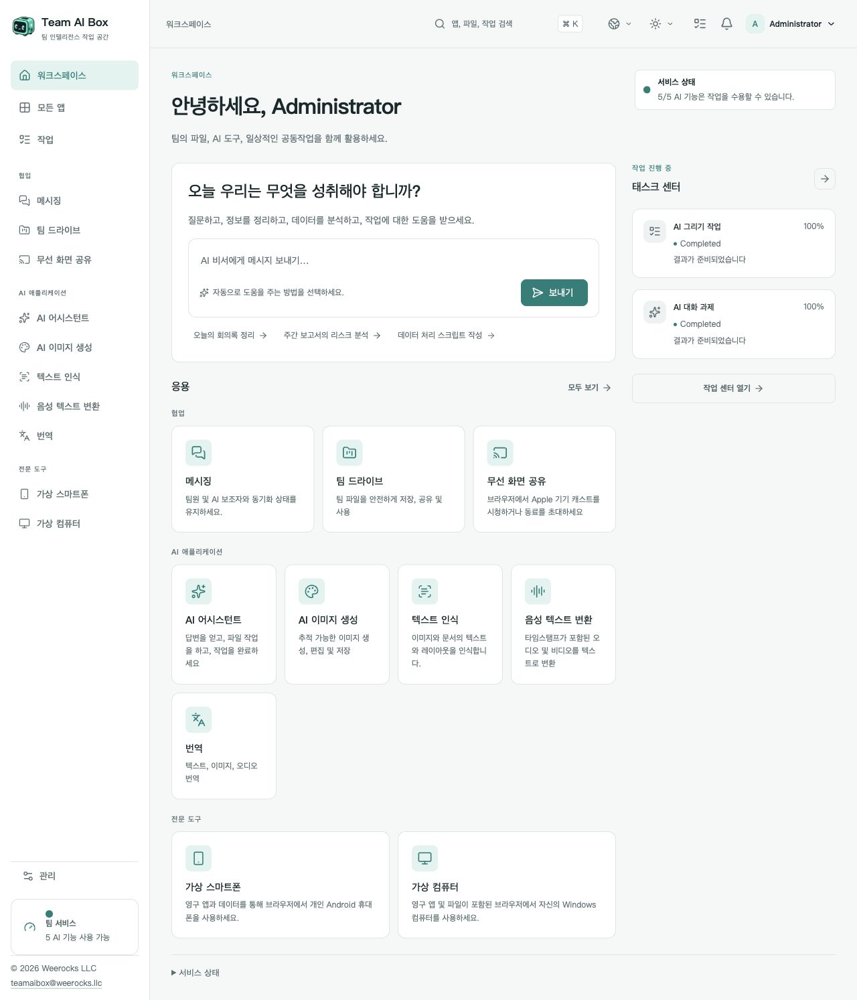

<!-- Generated from docs/readme-locales/ko.json by tools/render-readmes.mjs. -->
# Team AI Box

<p></p>

**Powered by NVIDIA DGX Spark · MIT · Weerocks LLC**

[English](README.ko.md) · [简体中文](README.ko.md) · [繁體中文](README.ko.md) · [日本語](README.ko.md) · [한국어](README.ko.md) · [Français](README.ko.md) · [Deutsch](README.ko.md) · [Español](README.ko.md) · [Português](README.ko.md) · [Русский](README.ko.md) · [العربية](README.ko.md) · [हिन्दी](README.ko.md) · [Bahasa Indonesia](README.ko.md) · [Italiano](README.ko.md) · [Türkçe](README.ko.md) · [Tiếng Việt](README.ko.md) · [ไทย](README.ko.md)

**여러분의 DGX Spark를 팀의 AI 작업 공간으로.** Team AI Box는 NVIDIA DGX Spark 한 대에 로컬 AI, 파일 공유, 대화, 가상 기기를 통합합니다. 팀원이 각자 AI 환경을 설치할 필요 없이 브라우저에서 직접 운영하는 환경에 접속합니다.

[teamaibox.com](https://teamaibox.com/) · [GitHub](https://github.com/weerocksllc/teamaibox) · [MIT](LICENSE) · [teamaibox@weerocks.llc](mailto:teamaibox@weerocks.llc)

## Team AI Box의 특징

- **한 대의 통합 작업 공간.** AI, 협업, 가상 기기를 일관된 UI와 계정으로 이용합니다.
- **로컬 우선.** Spark에서 추론하며 외부 모델 API는 선택 사항입니다. USB 키가 필요하지 않습니다.
- **DGX Spark 전용.** Ubuntu ARM64, NVIDIA GPU 컨테이너, KVM을 대상으로 하며 개발 장비 설정에 의존하지 않습니다.
- **함께 개선하는 MIT 코드.** UI는 17개 언어와 밝은/어두운 테마를 지원하고 수동 선택을 기억합니다. 기본 언어는 영어입니다.

## 실제 작업 공간

디자인 시안이 아닌 한국어 제품 화면입니다. GitHub 테마에 따라 이미지가 바뀌며 원본은 아래에 있습니다. 고객 파일이나 자격 증명은 포함하지 않습니다. 모델 출력, 게스트 OS, 사용자 지정 이름은 별도 언어 설정을 따릅니다.

<picture>
  <source media="(prefers-color-scheme: dark)" srcset="docs/assets/screenshots/ko/workbench-dark.jpg">
  <source media="(prefers-color-scheme: light)" srcset="docs/assets/screenshots/ko/workbench-light.jpg">
  
</picture>

[밝은 화면](docs/assets/screenshots/ko/workbench-light.jpg) · [어두운 화면](docs/assets/screenshots/ko/workbench-dark.jpg)

## 주요 기능

### AI 도우미

대화로 질문하고 글을 작성·수정하며 정보를 정리하고 문서를 처리합니다. 로컬 추론이 기본이며 외부 제공자는 선택할 때 연결합니다.

### AI 이미지 생성

프롬프트로 이미지를 생성·편집하고 결과를 저장합니다. 작업 진행 상황과 출력도 확인할 수 있습니다.

### 문자 인식

이미지와 문서에서 텍스트 및 레이아웃을 추출하고 검토하여 재사용합니다.

### 음성 전사

오디오·동영상을 시간 정보가 포함된 텍스트로 변환하여 회의록이나 자막 작성에 활용합니다.

### 번역

텍스트와 지원 파일을 번역합니다. 번역 언어는 설치 모델의 기능에 따르며 UI 언어 목록과는 별개입니다.

### 메시지

개인 대화와 그룹 토론을 팀 파일과 같은 공간에서 진행합니다. 메시지를 관리하고 채팅을 삭제할 수 있습니다.

### 팀 드라이브

파일을 업로드·정리·공유하고 지원 앱에서 기존 파일을 선택하여 재사용합니다.

### 무선 화면 공유

호환 Apple 기기의 화면과 소리를 브라우저에서 보고 동료와 공유합니다. 수신기 검색에는 올바른 LAN 연결이 필요합니다.

### 가상 Android 휴대폰

브라우저에서 앱을 설치하고 기기 상태를 계속 사용합니다. 휴대폰마다 앱과 데이터를 별도로 저장하며 Google 서비스에는 별도 호환성·라이선스 조건이 적용됩니다.

### Windows·Linux 가상 컴퓨터

허가된 ARM64 ISO를 업로드하거나 드라이브에서 선택해 가상 광학 드라이브로 연결하고 가상 모니터에서 직접 설치합니다. 부팅·재시작 화면, 오디오, 보기·제어 초대, 제어권 전달과 공동 제어를 지원하며 소유자는 제어권을 회수할 수 있습니다. 원격 데스크톱은 추가 모드입니다.

### 팀 관리와 작업 상태

일반 계정과 접근 권한을 관리하고 앱 준비 상태와 진행률을 확인합니다. 각 앱은 자체 종속 서비스가 준비되면 사용할 수 있으며 최초 모델 시작에는 시간이 걸릴 수 있습니다.

<a id="install"></a>

## 새 DGX Spark에 설치

**Ubuntu 24.04 ARM64 기반의 미설치 DGX Spark**, 정상 작동하는 Docker Engine·Compose v2, NVIDIA 드라이버·컨테이너 지원, KVM, Git, Python 3.10+가 필요합니다. 모델·빌드·패키지용 임시 공간 수백 GB를 확보하세요. 기존 업무 데이터 위에 새로 설치하지 마세요.

```sh
git clone https://github.com/weerocksllc/teamaibox.git
cd teamaibox
sudo bash install/from-source.sh
```

위 명령은 **Spark에서** 실행합니다. 모델과 빌드 입력을 다운로드하고 런타임 이미지를 빌드한 뒤 완전한 오프라인 패키지를 만들어 설치합니다. 첫 소스 빌드는 인터넷과 상당한 시간이 필요하며 clone만으로 설치되지 않습니다. 기존 Docker/NVIDIA를 재사용하고 개발자의 계정·디스크·자격 증명을 복사하지 않습니다.

### 사전 점검과 재개

`--check`로 사전 점검합니다. 중단되면 `/var/tmp/teamaibox-source-build`를 유지하고 **동일한 명령**을 다시 실행하여 검증된 다운로드와 단계를 재사용하세요. 캐시 삭제나 중복 빌드는 피하세요. 기본은 공식 소스이며 연결이 안 되면 [설치 안내](install/SOURCE-INSTALL.ko.md)의 대체 소스 또는 검증된 캐시/완전한 패키지 전송을 이용합니다. 미러의 가용성은 보장하지 않습니다. 소스 변경 시 새 `--work-dir`를 쓰고 체크포인트를 우회하지 마세요.

```sh
sudo bash install/from-source.sh --check
sudo bash install/from-source.sh
```

### 설치 후

1. 현재 LAN 주소로 `https://<BOX_LAN_IP>/`를 열고 자체 생성 HTTPS 인증서가 본인 기기의 것인지 확인합니다.
2. `admin` / `admin`으로 로그인해 **초기 비밀번호를 변경**하고 일반 계정을 만드세요. 기본 자격 증명을 인터넷에 노출하지 마세요.
3. 각 AI 앱의 준비 완료를 기다리고 프로필 메뉴에서 언어와 테마를 고릅니다. 상태 기록은 `/srv/teamaibox/installation/readiness.json`입니다.
4. 가상 OS에는 적법한 Windows/Linux ARM64 ISO와 라이선스를 직접 준비합니다. 오프라인 대상에는 완전한 패키지를 먼저 준비하고 [패키지 안내](install/README.ko.md)를 따릅니다. 소스 준비 자체는 온라인 과정입니다.

## 라이선스와 범위

자체 코드와 문서는 MIT이지만 **설치된 모든 바이너리가 MIT은 아닙니다**. 타사 코드, 모델, NVIDIA, 펌웨어, Google, Windows는 각자의 조건을 유지합니다. 저장소에는 모델 가중치, 설치된 게스트 디스크, 로그인 상태, ISO, 설치 패키지가 없습니다. Google 호환은 Play Protect 인증이 아니며 화면 공유는 DRM이나 Apple 인증을 포함하지 않습니다. Windows 10 ARM64 지원을 주장하지 않습니다. 성능·동시 실행은 하드웨어와 작업 부하에 따라 달라집니다. 마케팅 사이트는 별도 비공개 저장소이며 제품 UI는 공개됩니다.

## 함께 만들어 주세요

버그 보고, 문서, 번역, 접근성, 통합과 코드를 환영합니다. Issue에 사용자 문제를 설명하고 fork·작업 브랜치를 만든 뒤 관련 확인 결과와 화면을 첨부해 PR을 보내세요. 문서나 독립 구성 요소 개선에는 Spark가 필수는 아닙니다. 실제 장비 검증 여부를 명시하고 비밀키·개인 파일·로그인된 이미지를 올리지 마세요. 취약점은 SECURITY.md의 비공개 경로로 알리세요. 필수 CLA나 유료 기여 허가는 없습니다.

[Issues](https://github.com/weerocksllc/teamaibox/issues) · [Pull requests](https://github.com/weerocksllc/teamaibox/pulls) · [CONTRIBUTING](CONTRIBUTING.ko.md) · [SECURITY](SECURITY.ko.md)

## 자세한 자료

- [소스 설치와 복구](install/SOURCE-INSTALL.ko.md)
- [오프라인 패키지](install/README.ko.md)
- [개발 환경과 빌드](docs/open-source/BUILDING.ko.md)
- [기여 절차](CONTRIBUTING.ko.md)
- [비공개 보안 신고](SECURITY.ko.md)
- [타사 라이선스와 배포 범위](THIRD_PARTY_NOTICES.ko.md)

`apps/` · `services/` · `packages/` · `install/` · `deploy/` · `docs/`

© 2026 Weerocks LLC. [MIT](LICENSE) · [타사 라이선스와 배포 범위](docs/open-source/RELEASING.ko.md)
