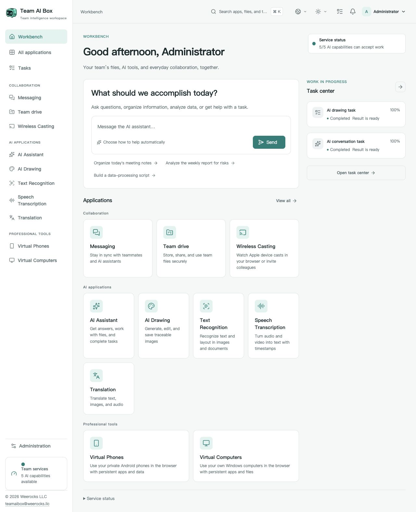

<!-- Generated from docs/readme-locales/ and docs/readme-features/en.json by tools/render-readmes.mjs. -->
# Team AI Box — Open-Source Software for NVIDIA DGX Spark

<p></p>

**Powered by NVIDIA DGX Spark · MIT · Weerocks LLC**

[English](README.md) · [简体中文](README.zh-CN.md) · [繁體中文](README.zh-TW.md) · [日本語](README.ja.md) · [한국어](README.ko.md) · [Français](README.fr.md) · [Deutsch](README.de.md) · [Español](README.es.md) · [Português](README.pt-BR.md) · [Русский](README.ru.md) · [العربية](README.ar.md) · [हिन्दी](README.hi.md) · [Bahasa Indonesia](README.id.md) · [Italiano](README.it.md) · [Türkçe](README.tr.md) · [Tiếng Việt](README.vi.md) · [ไทย](README.th.md)

**Turn your NVIDIA DGX Spark into your team’s AI workspace.** Run local AI, image generation and document tools on NVIDIA DGX Spark. Team AI Box brings team files, messaging and virtual devices into one open-source, browser-based workspace.

[teamaibox.com](https://teamaibox.com/) · [GitHub](https://github.com/weerocksllc/teamaibox) · [MIT](LICENSE) · [teamaibox@weerocks.llc](mailto:teamaibox@weerocks.llc)

[Complete feature checklist](#features) · [Install on a fresh DGX Spark](#install) · [Build it with us](#contribute)

## Why Team AI Box?

- **One appliance, one workspace.** AI tools, collaboration and virtual devices share a consistent interface and account system.
- **Local-first AI.** Run model inference on your Spark and optionally connect external model APIs.
- **Built for DGX Spark.** Install on Ubuntu ARM64 with NVIDIA GPU containers and KVM virtualization.
- **Yours to improve.** Original code is MIT licensed. The interface supports 17 languages, light/dark themes and persistent manual language choices; English is the default.

## See the real workspace

<picture>
  <source media="(prefers-color-scheme: dark)" srcset="docs/assets/screenshots/en/workbench-dark.jpg">
  <source media="(prefers-color-scheme: light)" srcset="docs/assets/screenshots/en/workbench-light.jpg">
  
</picture>

[Light screenshot](docs/assets/screenshots/en/workbench-light.jpg) · [Dark screenshot](docs/assets/screenshots/en/workbench-dark.jpg)

<a id="features"></a>

## Complete feature checklist

**Jump to a module**

- [Workspace and everyday navigation](#feature-workspace)
- [AI assistant and controlled Agent workflows](#feature-assistant)
- [AI image generation](#feature-drawing)
- [Text recognition and correction](#feature-ocr)
- [Recorded and live speech transcription](#feature-transcription)
- [Text, file and media translation](#feature-translation)
- [Team messaging](#feature-messaging)
- [Team drive and file collaboration](#feature-drive)
- [AirPlay-compatible wireless casting](#feature-casting)
- [Persistent virtual Android phones](#feature-phones)
- [Virtual Windows and Linux computers](#feature-computers)
- [Administration, permissions and security](#feature-administration)
- [Source installation and maintenance](#feature-installation)
- [Open-source development and extensions](#feature-developers)

<a id="feature-workspace"></a>

### Workspace and everyday navigation

- Use one browser workspace for local AI, team collaboration and virtual devices on a single DGX Spark.
- Browse applications by category, search the application catalog and open an app from the sidebar.
- See each application's loading, availability and service status.
- Track queued, running, completed, failed and cancelled work in the task center; open available results.
- See pending casting invitations in the notification menu and open the casting app to respond.
- Choose among 17 interface languages, including right-to-left Arabic; English is the default until you choose another language.
- Use light, dark or system appearance; keep manual language/theme choices across refreshes, sign-ins and application views.

<a id="feature-assistant"></a>

### AI assistant and controlled Agent workflows

- Start conversations, save their history and reopen earlier discussions.
- Choose Automatic, Answer or Agent mode for the current request.
- Attach multiple files to a request and remove attachments before sending.
- Read streamed replies, stop an active run and resume its event stream after reconnecting.
- Inspect returned model details, tool activity, sources and usage; download artifacts when a run produces them.
- Review the scope of an Agent action that requires confirmation, then approve or deny that action.
- Run Agent work in a per-user sandbox with a persistent workspace; tools and network access follow administrator policy.

<a id="feature-drawing"></a>

### AI image generation

- Generate an image from a text prompt using the available image model; the current app is not an image-editing or inpainting editor.
- Choose Automatic or Fast generation intent when supported by the available model configuration.
- Select square, landscape or portrait proportions, supported output dimensions and a random or fixed seed.
- Request PNG, WebP or JPEG output, preview the result and download the image.
- Follow queue and generation progress, cancel work and recover the current task after reopening the page.
- Inspect the actual model and generation parameters recorded with the result.

<a id="feature-ocr"></a>

### Text recognition and correction

- Upload PNG, JPEG, WebP or PDF input, or choose an existing file from team drive.
- Provide a language hint and recognize text, Markdown tables or LaTeX formulas within the selected model's capabilities.
- Review recognition results by page and text block, then manually correct the recognized text.
- Export reviewed content as text, Markdown or JSON.
- Send a stored recognition result to Translation without uploading and recognizing the source again.
- Track and cancel recognition jobs. The current model does not provide bounding-box coordinates or confidence scores.

<a id="feature-transcription"></a>

### Recorded and live speech transcription

- Choose local or team-drive audio/video: WAV, FLAC, OGG, WebM, MP3, M4A, AIFF or MP4.
- Preview the source media and use automatic language detection or a supported language hint.
- Review timestamped transcript segments and edit their text.
- Export text, JSON, SRT or WebVTT subtitles.
- Hand a stored transcript to Translation and track or cancel the current transcription task.
- Transcribe microphone input live when HTTPS, browser permission, MediaRecorder and the realtime service are available.
- Use word timestamps or speaker separation only with supported profiles; the experimental speaker-separation path requires WAV input.

<a id="feature-translation"></a>

### Text, file and media translation

- Select from the model-backed 60-language catalog, detect the source language automatically, or choose and swap source/target languages. This does not promise equal quality for every language pair.
- Translate typed or pasted text and compare source and translated segments.
- Upload an image or PDF, or select it from team drive; recognize its text before translation when OCR is ready.
- Translate supported audio/video through transcription, preserving segment timing when the transcription service is ready.
- Reuse stored OCR/transcription results and download available intermediate results.
- Edit translated text and export text, Markdown or JSON; audio/video results also support SRT and WebVTT.
- Follow extraction, transcription and translation stages, cancel work and recover the current task after reopening.
- Translation languages are separate from UI and OCR/ASR language coverage. PDF translation is text-based, not original-layout recreation or general DOCX/XLSX editing.

<a id="feature-messaging"></a>

### Team messaging

- Find teammates, start direct conversations and create named group chats with selected members.
- Filter all, unread or group chats and search conversations/messages you are allowed to access.
- Send text and file attachments; download an attachment's original file version.
- Receive live messages, reconnect to chat history, track unread/read positions and see member presence.
- Send with Enter, insert a new line with Shift+Enter and switch between the conversation list and chat on narrow screens.
- Delete a message from your own view or clear your own chat history; other participants' records are not deleted.
- Delete a chat from your own conversation list without leaving the group; a new message can make it reappear.

<a id="feature-drive"></a>

### Team drive and file collaboration

- Organize personal and team file spaces with folders and breadcrumb navigation.
- Switch list/grid views, inspect file details, search files/folders and view recent changes.
- Upload multiple files, follow upload progress and cancel an upload.
- Resume a multipart large-file upload by selecting the same file again; uploaded parts are verified by the server.
- Create folders and rename, move or copy files and folders.
- Preview supported images, audio, video, text and PDFs, and download files; media playback depends on the browser.
- Upload a new file version, inspect version history and download earlier versions.
- Move items to the recycle bin and restore them.
- Share internally with members or teams using view/edit permissions and optional expiry; this is not anonymous public-link sharing.
- Browse files and folders shared with you, with access rechecked against current permissions and membership.

<a id="feature-casting"></a>

### AirPlay-compatible wireless casting

- Start and stop a temporary receiver for compatible Apple devices on the same LAN, with its own receiver name and PIN.
- Choose a 15-, 30-, 60- or 120-minute receiver lifetime; stopping or expiry ends its broadcast and viewing access.
- Limit viewing to yourself, selected members or a team; invite viewers who can accept or decline.
- Watch the screen and play audio in a browser; browser autoplay rules may require a click to enable sound.
- View and remove connected viewers; an administrator can stop a session without gaining permission to watch private content.
- See disconnect/reconnect states and recheck viewing permission when joining again.
- Requires a ready media runtime, reachable LAN discovery and compatible browser/device versions. Browser viewing does not provide HDMI output, DRM/FairPlay playback or Apple certification.

<a id="feature-phones"></a>

### Persistent virtual Android phones

- Create independent Android phones from installed system profiles, keeping each phone's apps and data across sessions.
- Start, shut down, restart, rename and explicitly delete individual phones.
- Control Android with keyboard/pointer input and Back, Home, Recent Apps and volume buttons.
- Use audio and full-screen display, reconnect, or move the active phone connection to another page.
- Upload files to a phone and download files from its Team AI Box transfer folder.
- Install your own APK files after confirmation; Android app permissions are not silently granted.
- Feed an image, video or browser camera into the virtual camera when supported; physical USB cameras and network inputs additionally require administrator setup and permissions.
- Temporarily authorize device-scoped ADB debugging through a short-lived relay, using standard ADB tools and the Node.js relay client.
- Inspect frame rate, packet loss and connection round-trip statistics on demand; these are not an end-to-end latency guarantee.
- Choose a Google Play system profile only when its resources are available; availability is not Play Protect certification or a guarantee that every Android app works.

<a id="feature-computers"></a>

### Virtual Windows and Linux computers

- Create independent ARM64 Windows/Linux computers with selected CPU, memory and disk sizes.
- Start a computer, shut it down normally and delete a stopped computer after explicit confirmation.
- Open a browser virtual monitor to see firmware, boot, installation and operating-system screens without first signing into remote desktop.
- Use keyboard, pointer, sound, full-screen display and reconnection controls.
- Open the same virtual computer in multiple browser tabs or windows.
- Invite teammates to view or control a monitor and revoke their access.
- Hand control to another participant, release it or reclaim it as the owner; select single-controller or shared-control mode.
- Upload an installation ISO with pause/resume/cancel controls or select an existing ISO from personal/team drive.
- Mount or eject virtual optical media and select a one-time disc boot; changing media does not automatically restart the computer.
- Install your own authorized ARM64 operating system and use optional remote desktop separately. Windows licensing remains your responsibility; no preactivated Windows or general x86-guest support is included.

<a id="feature-administration"></a>

### Administration, permissions and security

- Create local members, manage account status and reset passwords where your role permits.
- Assign built-in roles, inspect permissions and manage team membership with protected owner-operation safeguards.
- Filter audit events by domain or correlation ID, inspect details and request audit-history integrity verification.
- Inspect appliance, application, storage and execution-service status from the administration workspace.
- Configure external AI providers and model/operation mappings, rotate credentials and enable or disable providers.
- Set permitted local/external routing policies with explicit approval for external processing; local AI does not require an external API key.
- View installed model profiles, runtime versions, readiness and validation details.
- Import verified plugin packages and manage eligible plugins' installation, upgrades, enable/disable and removal; protected official plugins have restrictions.
- Inspect execution queues and jobs, adjust permitted scheduling policies and cancel eligible work.
- View encrypted storage and startup protection settings. Automatic unlock uses a local key; enabling a startup passphrase requires recovery verification and confirmation.

<a id="feature-installation"></a>

### Source installation and maintenance

- Install from a public Git clone with one documented source-install command on a compatible fresh DGX Spark.
- Prepare build tools, download model/runtime inputs, build application images, package them and install while reusing the existing Docker/NVIDIA environment.
- Resume interrupted preparation with the same command and work directory, reusing verified downloads and completed stages.
- Run prerequisite checks, download-only preparation or build-only package creation.
- Prepare a complete portable package for installation on an offline target; source preparation itself needs network access.
- Verify pinned inputs and use documented alternate sources or verified portable caches when needed; no third-party mirror is guaranteed.
- Initialize fresh appliance-specific credentials and the documented admin/admin account, then change its password; do not copy another box's accounts or guest disks.
- Review maintenance candidates, compatibility findings, explicit execution plans and plan history, with scoped rollback/recovery instructions—not arbitrary automatic OS or driver upgrades.

<a id="feature-developers"></a>

### Open-source development and extensions

- Read, modify and redistribute original product code and documentation under MIT; third-party components retain their own licenses.
- Build ApplicationPlugin or ComputePlugin extensions using public SDK contracts and the included example plugins.
- Use signed package manifests, integrity and permission checks for plugin imports; this does not imply a public plugin marketplace is available.
- Contribute fixes, translations, documentation and integrations through issues and pull requests; use private security reporting for vulnerabilities.

## What is NVIDIA DGX Spark?

NVIDIA DGX Spark is a compact desktop AI system powered by the GB10 Grace Blackwell Superchip. The 128 GB configuration combines a 20-core Arm CPU, a Blackwell GPU and 128 GB of unified system memory with 273 GB/s memory bandwidth. NVIDIA specifies up to 1 PFLOP of theoretical AI compute at FP4 precision with sparsity.

Unified memory is shared system memory, not dedicated VRAM. Specifications vary by configuration; theoretical compute does not establish application speed or concurrent-user capacity.

DGX Spark supplies the compute. Team AI Box adds a shared interface for local inference, image generation, OCR, transcription, translation and collaboration. The first source installation downloads dependencies and builds the runtime before setup.

[NVIDIA DGX Spark hardware specifications](https://docs.nvidia.com/dgx/dgx-spark/hardware.html)

Team AI Box is an independent project by Weerocks LLC, not an NVIDIA product, certification or endorsement. Hardware support in this project is defined by the installation requirements below.

<a id="install"></a>

## Install on a fresh DGX Spark

Use a **fresh DGX Spark with Ubuntu 24.04 ARM64**, working Docker Engine + Compose v2, NVIDIA drivers/container support, KVM, Git and Python 3.10+. Allow several hundred GB of temporary free space for models, container builds and the package. Do not run a fresh installation over existing business data.

```sh
git clone https://github.com/weerocksllc/teamaibox.git
cd teamaibox
sudo bash install/from-source.sh
```

Run these commands **on the Spark**, not on a desktop laptop. The installer downloads model/build inputs, builds runtime images, creates a complete offline package and installs it. This first source build requires internet access and substantial download/build time; clone alone does not install the product. Docker and the NVIDIA environment are reused, not replaced.

### Preflight, download problems and resume

`--check` performs preflight. If interrupted, keep `/var/tmp/teamaibox-source-build` and rerun the **same command**: verified downloads and completed stages are reused. Do not start competing builds or delete the cache. Official sources are the default. Where upstream access is unavailable, use the documented alternate-source options or transfer a verified cache/complete offline package from a connected machine; no mirror guarantees availability. See [source installation](install/SOURCE-INSTALL.md) for logs, `--cache-dir`, `--work-dir` and recovery. A changed source tree needs a separate work directory, not a bypassed checkpoint.

```sh
sudo bash install/from-source.sh --check
sudo bash install/from-source.sh
```

### After installation

1. Open `https://<BOX_LAN_IP>/` using the Spark's current LAN address. Verify that its locally generated HTTPS certificate belongs to your device.
2. Sign in as `admin` / `admin`, **change the initial password**, then create ordinary accounts. Do not expose the initial credentials to the public internet.
3. Wait for each AI application to become ready, select a language/theme in the profile menu and begin from the workbench.
4. For virtual computers, provide your own authorized Windows/Linux ARM64 ISO and OS license. For an offline target, first prepare the complete package, then follow [the package installation guide](install/README.md); source preparation itself is not offline.

## Open source, with clear boundaries

Original code and documentation are MIT licensed, **not every binary in an installation**. Third-party code, model weights, NVIDIA components, firmware, Google services and Windows retain their own terms. The repository does not ship model weights, installed Android/Windows disks, signed-in accounts, ISOs or offline packages. Google compatibility is not Play Protect certification; casting does not cover DRM-protected content or Apple certification. Windows 10 ARM64 is not claimed as supported. Performance and concurrency depend on workloads and hardware.

<a id="contribute"></a>

## Build it with us

We welcome bug reports, documentation, translations, accessibility improvements, application integrations and code. Start with an issue describing the user problem, fork the repository, create a focused branch and submit a pull request with relevant checks and screenshots. You do not need to own a Spark to improve docs or isolated components; label hardware-dependent results honestly. Never attach secrets, personal files or signed-in device images. Report vulnerabilities privately through SECURITY.md, not a public issue. No mandatory CLA or paid contributor permission is required.

[Issues](https://github.com/weerocksllc/teamaibox/issues) · [Pull requests](https://github.com/weerocksllc/teamaibox/pulls) · [CONTRIBUTING](CONTRIBUTING.md) · [SECURITY](SECURITY.md)

## Go deeper

- [Source installation, prerequisites and recovery](install/SOURCE-INSTALL.md)
- [Offline package building and installation](install/README.md)
- [Development environment and source build](docs/open-source/BUILDING.md)
- [Contribution workflow](CONTRIBUTING.md)
- [Private security reporting](SECURITY.md)
- [Third-party licenses and release scope](THIRD_PARTY_NOTICES.md)

`apps/` · `services/` · `packages/` · `install/` · `deploy/` · `docs/`

© 2026 Weerocks LLC. [MIT](LICENSE) · [Third-party licenses and release scope](docs/open-source/RELEASING.md)
