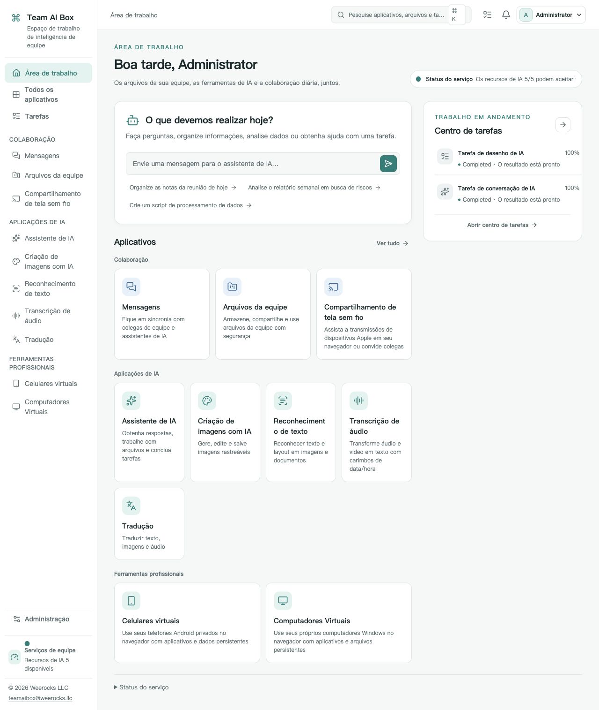

<!-- Generated from docs/readme-locales/pt-BR.json by tools/render-readmes.mjs. -->
# Team AI Box

**Powered by NVIDIA DGX Spark · MIT · Weerocks LLC**

[English](README.md) · [简体中文](README.zh-CN.md) · [繁體中文](README.zh-TW.md) · [日本語](README.ja.md) · [한국어](README.ko.md) · [Français](README.fr.md) · [Deutsch](README.de.md) · [Español](README.es.md) · [Português](README.pt-BR.md) · [Русский](README.ru.md) · [العربية](README.ar.md) · [हिन्दी](README.hi.md) · [Bahasa Indonesia](README.id.md) · [Italiano](README.it.md) · [Türkçe](README.tr.md) · [Tiếng Việt](README.vi.md) · [ไทย](README.th.md)

**Seu DGX Spark. O espaço de IA da sua equipe.** O Team AI Box reúne IA local, arquivos, comunicação e dispositivos virtuais em um único NVIDIA DGX Spark. A equipe usa o navegador, sem instalar uma pilha de IA em cada computador.

[teamaibox.com](https://teamaibox.com/) · [GitHub](https://github.com/weerocksllc/teamaibox) · [MIT](LICENSE) · [teamaibox@weerocks.llc](mailto:teamaibox@weerocks.llc)

## Por que Team AI Box?

- **Um espaço integrado:** interface e contas consistentes para IA, colaboração e dispositivos.
- **Local em primeiro lugar:** inferência no Spark, APIs externas opcionais, sem chave USB obrigatória.
- **Feito para DGX Spark:** Ubuntu ARM64, contêineres GPU NVIDIA e KVM, sem depender da máquina do desenvolvedor.
- **Aberto a melhorias:** código próprio MIT, 17 idiomas, temas claro/escuro e escolhas manuais persistentes. O padrão é inglês.

## O espaço de trabalho real

Captura real em português, não um mockup. A imagem acompanha o tema do GitHub; os originais estão abaixo. Sem arquivos de clientes ou credenciais. Saídas dos modelos, sistemas convidados e nomes personalizados têm configurações próprias de idioma.

<picture>
  <source media="(prefers-color-scheme: dark)" srcset="docs/assets/screenshots/pt-BR/workbench-dark.jpg">
  <source media="(prefers-color-scheme: light)" srcset="docs/assets/screenshots/pt-BR/workbench-light.jpg">
  
</picture>

[Tema claro](docs/assets/screenshots/pt-BR/workbench-light.jpg) · [Tema escuro](docs/assets/screenshots/pt-BR/workbench-dark.jpg)

## O que você pode fazer

### Assistente de IA

Faça perguntas, redija e revise textos, resuma informações e trabalhe com documentos em uma conversa. Modelos locais são a base; provedores externos são opcionais.

### Criação de imagens

Gere e edite imagens por instruções, salve resultados e acompanhe o progresso das tarefas.

### Reconhecimento de texto

Extraia texto e estrutura de imagens e documentos, revise e reutilize o conteúdo.

### Transcrição

Converta áudio e vídeo em texto com marcações de tempo para atas, legendas e organização posterior.

### Tradução

Traduza textos e arquivos compatíveis. Os idiomas dependem do modelo instalado e não são a mesma lista dos idiomas da interface.

### Mensagens

Converse em particular ou em grupos no mesmo espaço dos arquivos. Gerencie mensagens e exclua conversas com controles visíveis.

### Drive da equipe

Envie, organize, compartilhe e reutilize arquivos, escolhendo-os diretamente nos aplicativos compatíveis.

### Transmissão sem fio

Veja a tela e ouça o áudio de dispositivos Apple compatíveis no navegador, com colegas. A descoberta exige conexão LAN adequada.

### Celulares Android virtuais

Instale aplicativos e retome o estado de cada celular pelo navegador. Dados e aplicativos são independentes; serviços Google mantêm condições próprias de compatibilidade e licença.

### Computadores Windows e Linux virtuais

Envie uma ISO ARM64 autorizada ou escolha no drive, monte a unidade óptica virtual e instale o sistema. O monitor mostra inicialização e reinícios, com áudio. Convide espectadores ou operadores, transfira ou compartilhe o controle e retome-o como proprietário. Área de trabalho remota é um modo adicional.

### Administração e tarefas

Crie contas, gerencie acessos e acompanhe a disponibilidade e o progresso. Cada aplicativo abre quando suas dependências ficam prontas; a primeira inicialização de modelos pode demorar.

## Instalar em um DGX Spark novo

Use um **DGX Spark sem instalação prévia, com Ubuntu 24.04 ARM64**, Docker Engine/Compose v2, drivers e contêineres NVIDIA funcionando, KVM, Git e Python 3.10+. Reserve centenas de GB temporários para modelos, builds e pacote. Não instale do zero sobre dados existentes.

```sh
git clone https://github.com/weerocksllc/teamaibox.git
cd teamaibox
sudo bash install/from-source.sh
```

Execute os comandos **no Spark**. O script baixa modelos e entradas, constrói imagens, prepara um pacote offline completo e instala. O primeiro build exige Internet e tempo; clonar não instala o produto. Reutiliza Docker/NVIDIA sem copiar contas, discos ou segredos de desenvolvimento.

### Pré-verificação e retomada

`--check` verifica pré-requisitos. Após interrupção, preserve `/var/tmp/teamaibox-source-build` e repita **o mesmo comando** para reutilizar downloads verificados e etapas concluídas. Não apague o cache nem inicie builds concorrentes. O padrão usa fontes oficiais. Se inacessíveis, veja [o guia](install/SOURCE-INSTALL.md) para alternativas ou transferência de cache/pacote verificado; espelhos não têm disponibilidade garantida. Código alterado exige novo `--work-dir`, sem ignorar verificações.

```sh
sudo bash install/from-source.sh --check
sudo bash install/from-source.sh
```

### Depois da instalação

1. Abra `https://<BOX_LAN_IP>/` no IP LAN atual e confirme que o certificado HTTPS local é do seu dispositivo.
2. Entre com `admin` / `admin`, **troque a senha inicial** e crie contas comuns. Não exponha essas credenciais na Internet.
3. Aguarde cada aplicativo ficar pronto e escolha idioma/tema no perfil. Estado: `/srv/teamaibox/installation/readiness.json`.
4. Forneça ISOs ARM64 e licenças autorizadas de Windows/Linux. Para instalação offline, prepare primeiro o pacote completo e siga [o guia](install/README.md). A preparação do código é online.

## Licença e limites

Código próprio e documentação são MIT, **não todos os binários da instalação**. Terceiros, modelos, NVIDIA, firmware, Google e Windows mantêm seus termos. Git não inclui pesos, discos convidados instalados, sessões, ISOs ou pacotes. Compatibilidade Google não é certificação Play Protect; transmissão não cobre DRM nem certificação Apple. Não se declara suporte a Windows 10 ARM64. Desempenho e concorrência dependem da carga e do hardware. O site comercial é privado e separado; a interface do produto é pública.

## Construa com a gente

Recebemos relatos de bugs, documentação, traduções, acessibilidade, integrações e código. Explique o problema em uma issue, faça fork e uma branch focada e envie PR com verificações e capturas relevantes. Não precisa de Spark para documentação ou componentes isolados; informe os testes reais de hardware. Não publique segredos, arquivos pessoais ou imagens com login. Vulnerabilidades devem ser relatadas em privado conforme SECURITY.md. Sem CLA obrigatório ou autorização paga.

[Issues](https://github.com/weerocksllc/teamaibox/issues) · [Pull requests](https://github.com/weerocksllc/teamaibox/pulls) · [CONTRIBUTING](CONTRIBUTING.md) · [SECURITY](SECURITY.md)

## Saiba mais

- [Instalação do código e recuperação](install/SOURCE-INSTALL.md)
- [Pacote offline](install/README.md)
- [Ambiente de desenvolvimento](docs/open-source/BUILDING.md)
- [Como contribuir](CONTRIBUTING.md)
- [Relato privado de segurança](SECURITY.md)
- [Licenças de terceiros e distribuição](THIRD_PARTY_NOTICES.md)

`apps/` · `services/` · `packages/` · `install/` · `deploy/` · `docs/`

© 2026 Weerocks LLC. [MIT](LICENSE) · [Licenças de terceiros e distribuição](docs/open-source/RELEASING.md)
