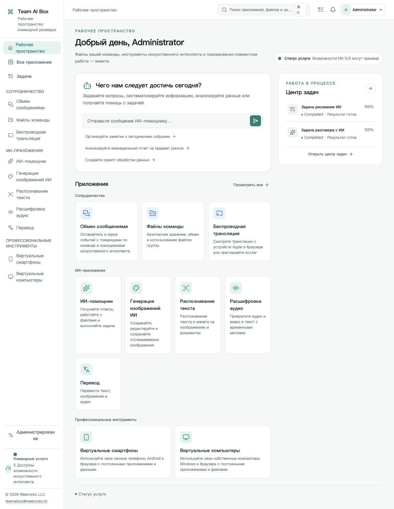

<!-- Generated from docs/readme-locales/ru.json by tools/render-readmes.mjs. -->
# Team AI Box

<p></p>

**Powered by NVIDIA DGX Spark · MIT · Weerocks LLC**

[English](README.md) · [简体中文](README.zh-CN.md) · [繁體中文](README.zh-TW.md) · [日本語](README.ja.md) · [한국어](README.ko.md) · [Français](README.fr.md) · [Deutsch](README.de.md) · [Español](README.es.md) · [Português](README.pt-BR.md) · [Русский](README.ru.md) · [العربية](README.ar.md) · [हिन्दी](README.hi.md) · [Bahasa Indonesia](README.id.md) · [Italiano](README.it.md) · [Türkçe](README.tr.md) · [Tiếng Việt](README.vi.md) · [ไทย](README.th.md)

**Ваш DGX Spark — ИИ-пространство всей команды.** Team AI Box объединяет локальный ИИ, файлы, общение и виртуальные устройства на одном NVIDIA DGX Spark. Команда работает через браузер без отдельной ИИ-среды на каждом компьютере.

[teamaibox.com](https://teamaibox.com/) · [GitHub](https://github.com/weerocksllc/teamaibox) · [MIT](LICENSE) · [teamaibox@weerocks.llc](mailto:teamaibox@weerocks.llc)

## Почему Team AI Box

- **Единое пространство:** общий интерфейс и учётные записи для ИИ, совместной работы и устройств.
- **Локальная обработка:** вывод моделей на Spark, внешние API необязательны, USB-ключ не требуется.
- **Создан для DGX Spark:** Ubuntu ARM64, GPU-контейнеры NVIDIA и KVM без привязки к компьютеру разработчика.
- **Открыт для улучшений:** собственный код MIT, 17 языков, светлая/тёмная тема, сохранение ручного выбора. По умолчанию — английский.

## Настоящий интерфейс

Реальный снимок на русском, не макет. Изображение следует теме GitHub; оригиналы ниже. Нет файлов клиентов и секретных учётных данных. Вывод моделей, гостевые ОС и заданные пользователем имена имеют отдельные языковые настройки.

<picture>
  <source media="(prefers-color-scheme: dark)" srcset="docs/assets/screenshots/ru/workbench-dark.jpg">
  <source media="(prefers-color-scheme: light)" srcset="docs/assets/screenshots/ru/workbench-light.jpg">
  
</picture>

[Светлая тема](docs/assets/screenshots/ru/workbench-light.jpg) · [Тёмная тема](docs/assets/screenshots/ru/workbench-dark.jpg)

## Возможности

### ИИ-помощник

Задавайте вопросы, пишите и редактируйте тексты, обобщайте информацию и документы в диалоге. Локальные модели — основа, внешние провайдеры подключаются по выбору.

### Создание изображений

Генерируйте и редактируйте изображения по описанию, сохраняйте результаты и отслеживайте задачи.

### Распознавание текста

Извлекайте текст и структуру из изображений и документов, проверяйте и используйте их повторно.

### Транскрибация

Преобразуйте аудио и видео в текст с временными метками для протоколов и субтитров.

### Перевод

Переводите текст и поддерживаемые файлы. Языки зависят от установленной модели и не равны списку языков интерфейса.

### Сообщения

Личные и групповые беседы рядом с файлами команды. Управляйте сообщениями и удаляйте чаты через явные элементы управления.

### Командный диск

Загружайте, упорядочивайте и делитесь файлами, выбирайте существующие материалы в совместимых приложениях.

### Беспроводная трансляция

Смотрите экран и слушайте звук совместимых устройств Apple в браузере вместе с коллегами. Для обнаружения приёмника нужна подходящая локальная сеть.

### Виртуальные Android-телефоны

Устанавливайте приложения и возвращайтесь к сохранённому состоянию телефона в браузере. Данные устройств независимы; у сервисов Google собственные условия совместимости и лицензирования.

### Виртуальные Windows и Linux

Загрузите разрешённый ARM64 ISO или выберите его на командном диске, подключите виртуальный привод и установите ОС через виртуальный монитор. Доступны загрузка, перезапуск и звук, приглашение зрителей/операторов, передача и совместное управление с возвратом владельцу. Удалённый рабочий стол — дополнительный режим.

### Управление командой и задачами

Создавайте аккаунты, назначайте доступ, следите за готовностью приложений и прогрессом. Каждое приложение открывается после готовности своих зависимостей; первый запуск моделей может занять время.

## Установка на новый DGX Spark

Нужен **чистый DGX Spark с Ubuntu 24.04 ARM64**, рабочими Docker Engine/Compose v2, драйверами и контейнерами NVIDIA, KVM, Git и Python 3.10+. Оставьте несколько сотен ГБ временного места для моделей, сборки и пакета. Не устанавливайте заново поверх рабочих данных.

```sh
git clone https://github.com/weerocksllc/teamaibox.git
cd teamaibox
sudo bash install/from-source.sh
```

Выполните команды **на Spark**. Скрипт загрузит исходные материалы и модели, соберёт образы, создаст полный автономный пакет и установит его. Первая сборка требует Интернета и времени; clone не означает установку. Docker/NVIDIA используются повторно, аккаунты и диски разработчика не копируются.

### Проверка и продолжение

`--check` проверяет условия. После прерывания сохраните `/var/tmp/teamaibox-source-build` и повторите **ту же команду**: проверенные загрузки и этапы используются повторно. Не удаляйте кэш и не запускайте конкурирующие сборки. По умолчанию источники официальные. При недоступности используйте варианты из [инструкции](install/SOURCE-INSTALL.md) либо перенесите проверенный кэш/полный пакет. Доступность зеркал не гарантируется. Для изменённого кода нужен новый `--work-dir`, а не обход проверок.

```sh
sudo bash install/from-source.sh --check
sudo bash install/from-source.sh
```

### После установки

1. Откройте `https://<BOX_LAN_IP>/` по текущему LAN-адресу и проверьте, что локальный HTTPS-сертификат принадлежит вашему устройству.
2. Войдите как `admin` / `admin`, **смените начальный пароль**, создайте обычные аккаунты. Не выставляйте исходные данные входа в Интернет.
3. Дождитесь готовности приложений и выберите язык/тему в профиле. Статус: `/srv/teamaibox/installation/readiness.json`.
4. Предоставьте законные ARM64 ISO и лицензии Windows/Linux. Для автономной машины сначала подготовьте полный пакет по [инструкции](install/README.md); подготовка из исходников требует сети.

## Лицензия и ограничения

Собственный код и документация — MIT, **но не все установленные бинарные компоненты**. Сторонний код, модели, NVIDIA, прошивки, Google и Windows сохраняют свои условия. В Git нет весов, установленных гостевых дисков, сеансов входа, ISO и пакетов. Совместимость Google не означает сертификацию Play Protect; трансляция не включает DRM и сертификацию Apple. Поддержка Windows 10 ARM64 не заявлена. Производительность зависит от нагрузки и оборудования. Маркетинговый сайт отдельно и закрыт; интерфейс продукта открыт.

## Присоединяйтесь

Приветствуются ошибки, документация, переводы, доступность, интеграции и код. Опишите проблему в issue, создайте fork и отдельную ветку, отправьте PR с относящимися к изменению проверками и снимками. Для документов и изолированных компонентов Spark необязателен; честно указывайте аппаратную проверку. Не публикуйте секреты, личные файлы или авторизованные образы. Уязвимости сообщайте приватно по SECURITY.md. Обязательного CLA и платного разрешения нет.

[Issues](https://github.com/weerocksllc/teamaibox/issues) · [Pull requests](https://github.com/weerocksllc/teamaibox/pulls) · [CONTRIBUTING](CONTRIBUTING.md) · [SECURITY](SECURITY.md)

## Документация

- [Установка из исходников и восстановление](install/SOURCE-INSTALL.md)
- [Автономный пакет](install/README.md)
- [Среда разработки](docs/open-source/BUILDING.md)
- [Участие в проекте](CONTRIBUTING.md)
- [Приватное сообщение об уязвимостях](SECURITY.md)
- [Сторонние лицензии и состав выпуска](THIRD_PARTY_NOTICES.md)

`apps/` · `services/` · `packages/` · `install/` · `deploy/` · `docs/`

© 2026 Weerocks LLC. [MIT](LICENSE) · [Сторонние лицензии и состав выпуска](docs/open-source/RELEASING.md)
