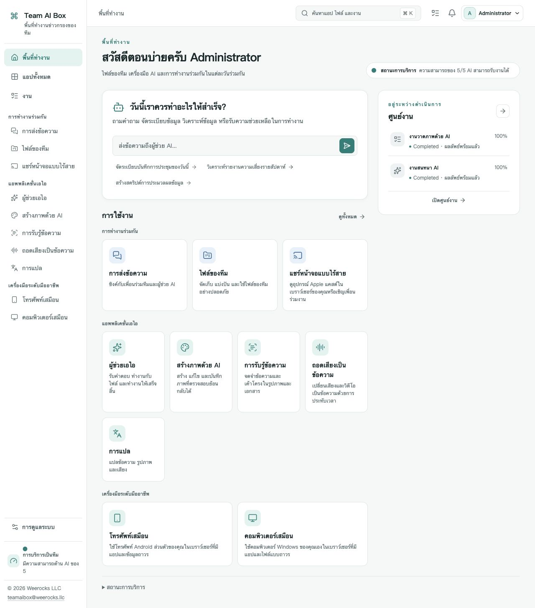

<!-- Generated from docs/readme-locales/th.json by tools/render-readmes.mjs. -->
# Team AI Box

<p></p>

**Powered by NVIDIA DGX Spark · MIT · Weerocks LLC**

[English](README.md) · [简体中文](README.zh-CN.md) · [繁體中文](README.zh-TW.md) · [日本語](README.ja.md) · [한국어](README.ko.md) · [Français](README.fr.md) · [Deutsch](README.de.md) · [Español](README.es.md) · [Português](README.pt-BR.md) · [Русский](README.ru.md) · [العربية](README.ar.md) · [हिन्दी](README.hi.md) · [Bahasa Indonesia](README.id.md) · [Italiano](README.it.md) · [Türkçe](README.tr.md) · [Tiếng Việt](README.vi.md) · [ไทย](README.th.md)

**DGX Spark ของคุณ พื้นที่ AI ของทั้งทีม** Team AI Box รวม AI ภายในเครื่อง ไฟล์ การสื่อสาร และอุปกรณ์เสมือนไว้บน NVIDIA DGX Spark เครื่องเดียว ทีมเข้าถึงผ่านเบราว์เซอร์โดยไม่ต้องติดตั้งระบบ AI แยกทุกเครื่อง

[teamaibox.com](https://teamaibox.com/) · [GitHub](https://github.com/weerocksllc/teamaibox) · [MIT](LICENSE) · [teamaibox@weerocks.llc](mailto:teamaibox@weerocks.llc)

## ทำไมต้อง Team AI Box?

- **พื้นที่ทำงานเดียว:** อินเทอร์เฟซและบัญชีสอดคล้องกันสำหรับ AI การทำงานร่วมกัน และอุปกรณ์
- **เน้นประมวลผลในเครื่อง:** รันโมเดลบน Spark ส่วน API ภายนอกเป็นทางเลือก ไม่ต้องใช้ USB Key
- **สร้างสำหรับ DGX Spark:** Ubuntu ARM64 คอนเทนเนอร์ NVIDIA GPU และ KVM ไม่ผูกกับเครื่องผู้พัฒนา
- **เปิดให้ร่วมปรับปรุง:** โค้ดต้นฉบับใช้ MIT รองรับ 17 ภาษา ธีมสว่าง/มืด และจำการเลือกด้วยตนเอง ค่าเริ่มต้นเป็นภาษาอังกฤษ

## พื้นที่ทำงานจริง

ภาพหน้าจอผลิตภัณฑ์ภาษาไทยจริง ไม่ใช่ภาพจำลอง เปลี่ยนตามธีม GitHub และมีต้นฉบับทั้งสองแบบด้านล่าง ไม่มีไฟล์ลูกค้าหรือข้อมูลรับรอง ผลลัพธ์โมเดล ระบบผู้เยี่ยมชม และชื่อที่ตั้งเองมีการเลือกภาษาต่างหาก

<picture>
  <source media="(prefers-color-scheme: dark)" srcset="docs/assets/screenshots/th/workbench-dark.jpg">
  <source media="(prefers-color-scheme: light)" srcset="docs/assets/screenshots/th/workbench-light.jpg">
  
</picture>

[ธีมสว่าง](docs/assets/screenshots/th/workbench-light.jpg) · [ธีมมืด](docs/assets/screenshots/th/workbench-dark.jpg)

## ความสามารถของผลิตภัณฑ์

### ผู้ช่วย AI

ถามคำถาม เขียนและแก้ไขข้อความ สรุปข้อมูล และทำงานกับเอกสารผ่านบทสนทนา ใช้โมเดลในเครื่องเป็นหลักและเลือกเชื่อมบริการภายนอกได้

### สร้างภาพ

สร้างและแก้ไขภาพจากคำสั่ง บันทึกผลลัพธ์และดูความคืบหน้าของงาน

### รู้จำข้อความ

ดึงข้อความและโครงสร้างจากรูปภาพหรือเอกสาร ตรวจสอบแล้วนำไปใช้ต่อ

### ถอดเสียง

แปลงเสียงและวิดีโอเป็นข้อความพร้อมเวลา สำหรับบันทึกประชุมและคำบรรยาย

### แปลภาษา

แปลข้อความและไฟล์ที่รองรับ ภาษาขึ้นอยู่กับโมเดลที่ติดตั้ง ไม่ใช่รายการเดียวกับภาษาอินเทอร์เฟซ

### ข้อความ

สนทนาส่วนตัวหรือกลุ่มในพื้นที่เดียวกับไฟล์ทีม จัดการข้อความและลบแชตผ่านปุ่มที่ชัดเจน

### ไดรฟ์ทีม

อัปโหลด จัดระเบียบ แชร์ และนำไฟล์กลับมาใช้โดยตรงในแอปที่รองรับ

### แชร์หน้าจอไร้สาย

ดูภาพและฟังเสียงจากอุปกรณ์ Apple ที่เข้ากันได้ผ่านเบราว์เซอร์ร่วมกับเพื่อนร่วมงาน การค้นหาตัวรับต้องเชื่อม LAN อย่างเหมาะสม

### โทรศัพท์ Android เสมือน

ติดตั้งแอปและกลับมาใช้สถานะที่บันทึกของแต่ละเครื่องผ่านเบราว์เซอร์ ข้อมูลแยกกัน และบริการ Google มีเงื่อนไขความเข้ากันได้และสิทธิ์ใช้งานของตน

### คอมพิวเตอร์ Windows และ Linux เสมือน

อัปโหลด ISO ARM64 ที่มีสิทธิ์หรือเลือกจากไดรฟ์ เชื่อมไดรฟ์แสงเสมือนแล้วติดตั้งระบบผ่านจอเสมือน ดูขั้นตอนบูตและรีสตาร์ตพร้อมเสียง เชิญผู้ดูหรือผู้ควบคุม ส่งต่อหรือควบคุมร่วมกัน และเจ้าของเรียกคืนการควบคุมได้ Remote Desktop เป็นโหมดเพิ่มเติม

### การจัดการทีมและงาน

สร้างบัญชี จัดการสิทธิ์ และดูความพร้อมของแอปกับความคืบหน้า แต่ละแอปเปิดเมื่อบริการที่ต้องใช้พร้อม การเริ่มโมเดลครั้งแรกอาจใช้เวลา

## ติดตั้งบน DGX Spark ใหม่

ใช้ **DGX Spark ที่ยังไม่ติดตั้งผลิตภัณฑ์ พร้อม Ubuntu 24.04 ARM64** มี Docker Engine/Compose v2 ไดรเวอร์และคอนเทนเนอร์ NVIDIA KVM Git และ Python 3.10+ ที่ทำงานได้ เตรียมพื้นที่ชั่วคราวหลายร้อย GB สำหรับโมเดล การสร้าง และแพ็กเกจ ห้ามติดตั้งใหม่ทับข้อมูลเดิม

```sh
git clone https://github.com/weerocksllc/teamaibox.git
cd teamaibox
sudo bash install/from-source.sh
```

รันคำสั่ง **บน Spark** สคริปต์ดาวน์โหลดโมเดลและอินพุต สร้างอิมเมจและแพ็กเกจออฟไลน์ฉบับเต็ม แล้วติดตั้ง การสร้างครั้งแรกต้องใช้อินเทอร์เน็ตและเวลา clone อย่างเดียวยังไม่พร้อมใช้ ระบบใช้ Docker/NVIDIA เดิมและไม่คัดลอกบัญชี ดิสก์ หรือความลับของผู้พัฒนา

### ตรวจสอบก่อนและทำต่อ

`--check` ตรวจข้อกำหนด หากหยุดกลางทางให้เก็บ `/var/tmp/teamaibox-source-build` แล้วรัน **คำสั่งเดิม** เพื่อใช้ไฟล์และขั้นตอนที่ตรวจแล้วต่อ อย่าลบแคชหรือสร้างซ้ำพร้อมกัน ค่าเริ่มต้นเป็นแหล่งทางการ หากเข้าถึงไม่ได้ให้อ่าน [คู่มือ](install/SOURCE-INSTALL.md) เรื่องแหล่งอื่นหรือย้ายแคช/แพ็กเกจที่ตรวจสอบแล้ว มิเรอร์ไม่รับประกันความพร้อม หากโค้ดเปลี่ยนให้ใช้ `--work-dir` ใหม่ ไม่ข้ามการตรวจสอบ

```sh
sudo bash install/from-source.sh --check
sudo bash install/from-source.sh
```

### หลังติดตั้ง

1. เปิด `https://<BOX_LAN_IP>/` ด้วย IP ใน LAN ปัจจุบัน และยืนยันว่าใบรับรอง HTTPS ภายในเป็นของอุปกรณ์ตนเอง
2. เข้าสู่ระบบด้วย `admin` / `admin` แล้ว **เปลี่ยนรหัสผ่านเริ่มต้น** และสร้างบัญชีทั่วไป อย่าเปิดข้อมูลเริ่มต้นนี้สู่อินเทอร์เน็ต
3. รอแต่ละแอปพร้อม แล้วเลือกภาษา/ธีมในโปรไฟล์ สถานะอยู่ที่ `/srv/teamaibox/installation/readiness.json`
4. จัดเตรียม ISO ARM64 Windows/Linux และสิทธิ์ใช้งานเอง สำหรับเครื่องออฟไลน์ต้องเตรียมแพ็กเกจครบก่อนและทำตาม [คู่มือ](install/README.md) การเตรียมจากซอร์สต้องออนไลน์

## สิทธิ์ใช้งานและข้อจำกัด

โค้ดและเอกสารต้นฉบับใช้ MIT **ไม่ใช่ไบนารีทั้งหมดที่ติดตั้ง** โค้ดภายนอก โมเดล NVIDIA เฟิร์มแวร์ Google และ Windows มีเงื่อนไขของตน Git ไม่รวมค่าน้ำหนัก ดิสก์ระบบที่ติดตั้งแล้ว สถานะล็อกอิน ISO หรือแพ็กเกจ ความเข้ากันได้กับ Google ไม่เท่ากับการรับรอง Play Protect การแชร์หน้าจอไม่รวม DRM หรือการรับรอง Apple ไม่อ้างว่ารองรับ Windows 10 ARM64 ประสิทธิภาพและการทำงานพร้อมกันขึ้นอยู่กับฮาร์ดแวร์และภาระงาน เว็บไซต์การตลาดแยกเป็นส่วนตัว ส่วน UI ผลิตภัณฑ์เป็นสาธารณะ

## มาร่วมพัฒนากัน

ยินดีรับรายงานบั๊ก เอกสาร คำแปล การเข้าถึง การเชื่อมต่อ และโค้ด อธิบายปัญหาใน issue ทำ fork และสาขาที่เน้นประเด็น แล้วส่ง PR พร้อมการตรวจและภาพที่เกี่ยวข้อง งานเอกสารหรือองค์ประกอบแยกไม่ต้องมี Spark แต่ต้องบอกการตรวจฮาร์ดแวร์ตามจริง ห้ามส่งความลับ ไฟล์ส่วนตัว หรืออิมเมจที่ล็อกอินแล้ว แจ้งช่องโหว่เป็นส่วนตัวตาม SECURITY.md ไม่มี CLA บังคับหรือค่าอนุญาตร่วมพัฒนา

[Issues](https://github.com/weerocksllc/teamaibox/issues) · [Pull requests](https://github.com/weerocksllc/teamaibox/pulls) · [CONTRIBUTING](CONTRIBUTING.md) · [SECURITY](SECURITY.md)

## อ่านเพิ่มเติม

- [ติดตั้งจากซอร์สและกู้คืน](install/SOURCE-INSTALL.md)
- [แพ็กเกจออฟไลน์](install/README.md)
- [พัฒนาและสร้างซอร์ส](docs/open-source/BUILDING.md)
- [ขั้นตอนร่วมพัฒนา](CONTRIBUTING.md)
- [แจ้งปัญหาความปลอดภัยส่วนตัว](SECURITY.md)
- [สิทธิ์บุคคลที่สามและขอบเขตแจกจ่าย](THIRD_PARTY_NOTICES.md)

`apps/` · `services/` · `packages/` · `install/` · `deploy/` · `docs/`

© 2026 Weerocks LLC. [MIT](LICENSE) · [สิทธิ์บุคคลที่สามและขอบเขตแจกจ่าย](docs/open-source/RELEASING.md)
