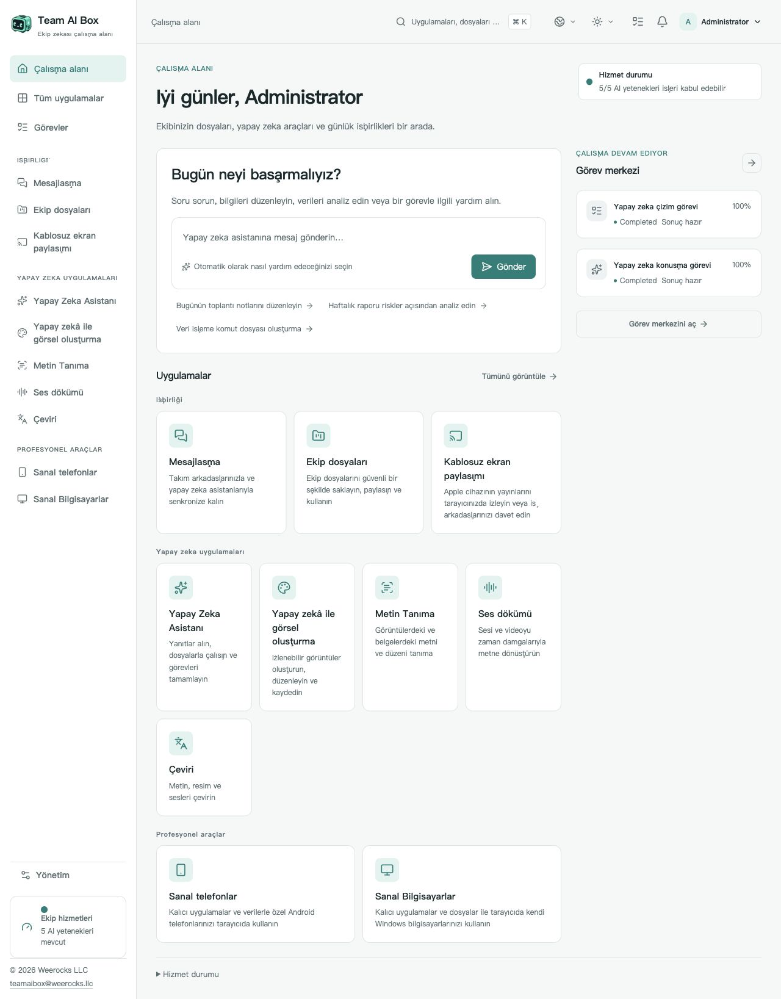

<!-- Generated from docs/readme-locales/ and docs/readme-features/tr.json by tools/render-readmes.mjs. -->
# Team AI Box — NVIDIA DGX Spark için açık kaynak yazılım

<p></p>

**Powered by NVIDIA DGX Spark · MIT · Weerocks LLC**

[English](README.md) · [简体中文](README.zh-CN.md) · [繁體中文](README.zh-TW.md) · [日本語](README.ja.md) · [한국어](README.ko.md) · [Français](README.fr.md) · [Deutsch](README.de.md) · [Español](README.es.md) · [Português](README.pt-BR.md) · [Русский](README.ru.md) · [العربية](README.ar.md) · [हिन्दी](README.hi.md) · [Bahasa Indonesia](README.id.md) · [Italiano](README.it.md) · [Türkçe](README.tr.md) · [Tiếng Việt](README.vi.md) · [ไทย](README.th.md)

**NVIDIA DGX Spark’ınızı ekibinizin yapay zekâ çalışma alanına dönüştürün.** NVIDIA DGX Spark üzerinde yerel yapay zekâ, görsel üretimi ve belge araçlarını çalıştırın. Team AI Box, ekip dosyalarını, mesajlaşmayı ve sanal cihazları açık kaynaklı bir tarayıcı çalışma alanında birleştirir.

[teamaibox.com](https://teamaibox.com/) · [GitHub](https://github.com/weerocksllc/teamaibox) · [MIT](LICENSE) · [teamaibox@weerocks.llc](mailto:teamaibox@weerocks.llc)

[Tüm özelliklerin kontrol listesi](#features) · [Yeni DGX Spark üzerine kurulum](#install) · [Birlikte geliştirelim](#contribute)

## Neden Team AI Box?

- **Birleşik alan:** yapay zekâ, iş birliği ve cihazlar için tutarlı arayüz ve hesaplar.
- **Öncelik yerel yapay zekâda.** Model çıkarımını Spark üzerinde çalıştırın ve ihtiyaç duyduğunuzda haricî model API’lerini bağlayın.
- **DGX Spark için tasarlandı.** Ubuntu ARM64 üzerinde NVIDIA GPU konteynerleri ve KVM sanallaştırmasıyla kurun.
- **Katkıya açık:** özgün kod MIT, 17 dil, açık/koyu tema ve kaydedilen elle seçimler. Varsayılan dil İngilizcedir.

## Gerçek çalışma alanı

<picture>
  <source media="(prefers-color-scheme: dark)" srcset="docs/assets/screenshots/tr/workbench-dark.jpg">
  <source media="(prefers-color-scheme: light)" srcset="docs/assets/screenshots/tr/workbench-light.jpg">
  
</picture>

[Açık tema](docs/assets/screenshots/tr/workbench-light.jpg) · [Koyu tema](docs/assets/screenshots/tr/workbench-dark.jpg)

<a id="features"></a>

## Tüm özelliklerin kontrol listesi

**Bir modüle git**

- [Çalışma alanı ve günlük gezinme](#feature-workspace)
- [Yapay zekâ asistanı ve kontrollü Agent iş akışları](#feature-assistant)
- [Yapay zekâ ile görsel üretimi](#feature-drawing)
- [Metin tanıma ve düzeltme](#feature-ocr)
- [Kayıttan ve canlı konuşma dökümü](#feature-transcription)
- [Metin, dosya ve medya çevirisi](#feature-translation)
- [Ekip mesajlaşması](#feature-messaging)
- [Ekip sürücüsü ve dosyalarda iş birliği](#feature-drive)
- [AirPlay uyumlu kablosuz ekran yansıtma](#feature-casting)
- [Kalıcı sanal Android telefonlar](#feature-phones)
- [Sanal Windows ve Linux bilgisayarlar](#feature-computers)
- [Yönetim, izinler ve güvenlik](#feature-administration)
- [Kaynak koddan kurulum ve bakım](#feature-installation)
- [Açık kaynak geliştirme ve uzantılar](#feature-developers)

<a id="feature-workspace"></a>

### Çalışma alanı ve günlük gezinme

- Tek bir DGX Spark üzerinde yerel yapay zekâ, ekip iş birliği ve sanal cihazlar için tek bir tarayıcı çalışma alanı kullanın.
- Uygulamalara kategorilerine göre göz atın, uygulama kataloğunda arama yapın ve yan çubuktan uygulama açın.
- Her uygulamanın yükleme ilerlemesini, kullanılabilirliğini ve hizmet durumunu görün.
- Görev merkezinde sıradaki, çalışan, tamamlanan, başarısız ve iptal edilen işleri takip edin; mevcut sonuçları açın.
- Bildirim menüsünde bekleyen ekran yansıtma davetlerini görün ve yanıtlamak için ekran yansıtma uygulamasını açın.
- Sağdan sola yazılan Arapça dâhil 17 arayüz dili arasından seçim yapın; başka bir dil seçene kadar varsayılan dil İngilizcedir.
- Açık, koyu veya sistem görünümünü kullanın; elle seçtiğiniz dil ve tema sayfa yenilemelerinde, yeniden girişlerde ve uygulama görünümlerinde korunur.

<a id="feature-assistant"></a>

### Yapay zekâ asistanı ve kontrollü Agent iş akışları

- Sohbet başlatın, geçmişini kaydedin ve önceki görüşmeleri yeniden açın.
- Geçerli istek için Otomatik, Yanıt veya Agent modunu seçin.
- Bir isteğe birden fazla dosya ekleyin ve göndermeden önce ekleri kaldırın.
- Yanıtları oluştukça okuyun, etkin bir çalışmayı durdurun ve yeniden bağlandıktan sonra olay akışını sürdürün.
- Döndürülen model ayrıntılarını, araç etkinliğini, kaynakları ve kullanım bilgilerini inceleyin; çalışma dosya ürettiğinde bunları indirin.
- Onay gerektiren bir Agent eyleminin kapsamını inceleyin, ardından bu eylemi onaylayın veya reddedin.
- Agent işlerini, kalıcı çalışma alanına sahip kullanıcıya özel bir sanal alanda yürütün; araçlar ve ağ erişimi yönetici politikasına uyar.

<a id="feature-drawing"></a>

### Yapay zekâ ile görsel üretimi

- Mevcut görsel modelini kullanarak bir metin isteminden görsel üretin; mevcut uygulama bir görsel düzenleme veya bölgesel doldurma (inpainting) editörü değildir.
- Mevcut model yapılandırması destekliyorsa Otomatik veya Hızlı üretim seçeneğini kullanın.
- Kare, yatay veya dikey oranları, desteklenen çıktı boyutlarını ve rastgele ya da sabit bir seed değerini seçin.
- PNG, WebP veya JPEG çıktısı isteyin, sonucu önizleyin ve görseli indirin.
- Kuyruk ve üretim ilerlemesini takip edin, işi iptal edin ve sayfayı yeniden açtığınızda geçerli görevi geri yükleyin.
- Sonuçla birlikte kaydedilen gerçek modeli ve üretim parametrelerini inceleyin.

<a id="feature-ocr"></a>

### Metin tanıma ve düzeltme

- PNG, JPEG, WebP veya PDF yükleyin ya da ekip sürücüsünden mevcut bir dosya seçin.
- Dil ipucu verin ve seçilen modelin yetenekleri kapsamında metin, Markdown tabloları veya LaTeX formüllerini tanıyın.
- Tanıma sonuçlarını sayfa ve metin bloğu bazında inceleyin, ardından tanınan metni elle düzeltin.
- Gözden geçirilen içeriği metin, Markdown veya JSON olarak dışa aktarın.
- Kaynağı yeniden yükleyip tanımadan, kayıtlı bir tanıma sonucunu Çeviri uygulamasına gönderin.
- Tanıma işlerini takip edin ve iptal edin. Mevcut model, sınırlayıcı kutu koordinatları veya güven puanları sağlamaz.

<a id="feature-transcription"></a>

### Kayıttan ve canlı konuşma dökümü

- Yerel veya ekip sürücüsündeki ses/video dosyalarını seçin: WAV, FLAC, OGG, WebM, MP3, M4A, AIFF veya MP4.
- Kaynak medyayı önizleyin ve otomatik dil algılamayı ya da desteklenen bir dil ipucunu kullanın.
- Zaman damgalı döküm bölümlerini inceleyin ve metinlerini düzenleyin.
- Metin, JSON, SRT veya WebVTT altyazıları dışa aktarın.
- Kayıtlı bir dökümü Çeviri uygulamasına aktarın ve geçerli döküm görevini takip edin veya iptal edin.
- HTTPS, tarayıcı izni, MediaRecorder ve gerçek zamanlı hizmet kullanılabilir olduğunda mikrofon girişini canlı olarak metne dönüştürün.
- Sözcük zaman damgalarını veya konuşmacı ayrımını yalnızca desteklenen profillerle kullanın; deneysel konuşmacı ayrımı akışı WAV girdisi gerektirir.

<a id="feature-translation"></a>

### Metin, dosya ve medya çevirisi

- Modelin desteklediği 60 dilli katalogdan seçim yapın, kaynak dili otomatik algılayın ya da kaynak/hedef dilleri seçip yer değiştirin. Bu, her dil çifti için eşit kalite vaat etmez.
- Yazılan veya yapıştırılan metni çevirin ve kaynak bölümlerle çevrilen bölümleri karşılaştırın.
- Bir görsel veya PDF yükleyin ya da ekip sürücüsünden seçin; OCR hazır olduğunda çeviriden önce metnini tanıyın.
- Döküm hizmeti hazır olduğunda desteklenen ses/videoyu metne dönüştürerek çevirin ve bölüm zamanlarını koruyun.
- Kayıtlı OCR/döküm sonuçlarını yeniden kullanın ve mevcut ara sonuçları indirin.
- Çevrilen metni düzenleyin ve metin, Markdown veya JSON olarak dışa aktarın; ses/video sonuçları SRT ve WebVTT'yi de destekler.
- Çıkarma, döküm ve çeviri aşamalarını takip edin, işi iptal edin ve yeniden açtığınızda geçerli görevi geri yükleyin.
- Çeviri dilleri, arayüz dillerinden ve OCR/ASR dil kapsamından ayrıdır. PDF çevirisi metin tabanlıdır; özgün sayfa düzenini yeniden oluşturmaz ve genel DOCX/XLSX düzenleme sunmaz.

<a id="feature-messaging"></a>

### Ekip mesajlaşması

- Ekip arkadaşlarınızı bulun, doğrudan sohbetler başlatın ve seçtiğiniz üyelerle adlandırılmış grup sohbetleri oluşturun.
- Tüm, okunmamış veya grup sohbetlerini filtreleyin ve erişim izniniz olan sohbetlerde/mesajlarda arama yapın.
- Metin ve dosya ekleri gönderin; ekin özgün dosya sürümünü indirin.
- Mesajları anlık alın, yeniden bağlanınca sohbet geçmişine erişin, okunmuş/okunmamış konumlarını takip edin ve üyelerin çevrimiçi durumunu görün.
- Enter ile gönderin, Shift+Enter ile yeni satır ekleyin ve dar ekranlarda sohbet listesi ile sohbet arasında geçiş yapın.
- Bir mesajı yalnızca kendi görünümünüzden silin veya kendi sohbet geçmişinizi temizleyin; diğer katılımcıların kayıtları silinmez.
- Gruptan ayrılmadan bir sohbeti kendi sohbet listenizden silin; yeni bir mesaj geldiğinde sohbet yeniden görünebilir.

<a id="feature-drive"></a>

### Ekip sürücüsü ve dosyalarda iş birliği

- Kişisel ve ekip dosya alanlarını klasörler ve yol gezintisiyle düzenleyin.
- Liste/ızgara görünümleri arasında geçiş yapın, dosya ayrıntılarını inceleyin, dosya/klasör arayın ve son değişiklikleri görün.
- Birden fazla dosya yükleyin, ilerlemeyi takip edin ve bir yüklemeyi iptal edin.
- Aynı dosyayı yeniden seçerek çok parçalı büyük dosya yüklemesine devam edin; yüklenmiş parçalar sunucu tarafından doğrulanır.
- Klasör oluşturun; dosya ve klasörleri yeniden adlandırın, taşıyın veya kopyalayın.
- Desteklenen görselleri, sesleri, videoları, metinleri ve PDF'leri önizleyin ve dosyaları indirin; medya oynatımı tarayıcıya bağlıdır.
- Bir dosyanın yeni sürümünü yükleyin, sürüm geçmişini inceleyin ve önceki sürümleri indirin.
- Öğeleri geri dönüşüm kutusuna taşıyın ve geri yükleyin.
- Üyeler veya ekiplerle görüntüleme/düzenleme izinleri ve isteğe bağlı süre sonu belirleyerek kurum içinde paylaşın; bu, anonim herkese açık bağlantı paylaşımı değildir.
- Sizinle paylaşılan dosya ve klasörlere göz atın; erişim güncel izinlere ve üyeliğe göre yeniden denetlenir.

<a id="feature-casting"></a>

### AirPlay uyumlu kablosuz ekran yansıtma

- Aynı LAN üzerindeki uyumlu Apple cihazları için kendine ait alıcı adı ve PIN'i olan geçici bir alıcıyı başlatın ve durdurun.
- Alıcı için 15, 30, 60 veya 120 dakikalık süre seçin; durdurma veya süre dolumu yayını ve izleme erişimini sona erdirir.
- İzlemeyi yalnızca kendinizle, seçili üyelerle veya bir ekiple sınırlandırın; daveti kabul ya da reddedebilen izleyiciler davet edin.
- Ekranı izleyin ve sesi tarayıcıda dinleyin; tarayıcının otomatik oynatma kuralları sesi etkinleştirmek için tıklama gerektirebilir.
- Bağlı izleyicileri görün ve çıkarın; bir yönetici, özel içeriği izleme izni kazanmadan oturumu durdurabilir.
- Bağlantı kesilmesi/yeniden bağlanma durumlarını görün; yeniden katılırken izleme izni tekrar kontrol edilir.
- Hazır bir medya çalışma ortamı, erişilebilir LAN keşfi ve uyumlu tarayıcı/cihaz sürümleri gerektirir. Tarayıcıdan izleme; HDMI çıkışı, DRM/FairPlay oynatımı veya Apple sertifikasyonu sağlamaz.

<a id="feature-phones"></a>

### Kalıcı sanal Android telefonlar

- Yüklü sistem profillerinden bağımsız Android telefonlar oluşturun; her telefonun uygulamaları ve verileri oturumlar arasında korunur.
- Telefonları ayrı ayrı başlatın, kapatın, yeniden başlatın, yeniden adlandırın ve açık onayla silin.
- Android'i klavye/işaretçi girişi ve Geri, Ana Ekran, Son Uygulamalar ile ses düğmeleriyle kontrol edin.
- Ses ve tam ekranı kullanın, yeniden bağlanın veya etkin telefon bağlantısını başka bir sayfaya taşıyın.
- Telefona dosya yükleyin ve telefonun Team AI Box aktarım klasöründen dosya indirin.
- Onay verdikten sonra kendi APK dosyalarınızı kurun; Android uygulama izinleri sessizce verilmez.
- Desteklendiğinde sanal kameraya görsel, video veya tarayıcı kamerası aktarın; fiziksel USB kameralar ve ağ girdileri ayrıca yönetici kurulumu ve izinleri gerektirir.
- Standart ADB araçlarını ve Node.js relay istemcisini kullanarak kısa ömürlü bir aktarım üzerinden cihaza özel ADB hata ayıklamasına geçici izin verin.
- İstediğinizde kare hızını, paket kaybını ve bağlantının gidiş-dönüş istatistiklerini inceleyin; bunlar uçtan uca gecikme garantisi değildir.
- Google Play sistem profilini yalnızca kaynakları kullanılabilir olduğunda seçin; kullanılabilirlik Play Protect sertifikasyonu veya her Android uygulamasının çalışacağı garantisi değildir.

<a id="feature-computers"></a>

### Sanal Windows ve Linux bilgisayarlar

- Seçtiğiniz CPU, bellek ve disk boyutlarıyla bağımsız ARM64 Windows/Linux bilgisayarlar oluşturun.
- Bir bilgisayarı başlatın, normal şekilde kapatın ve kapalı bilgisayarı açık onaydan sonra silin.
- Önce uzak masaüstünde oturum açmadan firmware, önyükleme, kurulum ve işletim sistemi ekranlarını görmek için tarayıcıda sanal monitör açın.
- Klavye, işaretçi, ses, tam ekran ve yeniden bağlanma denetimlerini kullanın.
- Aynı sanal bilgisayarı birden fazla tarayıcı sekmesinde veya penceresinde açın.
- Ekip arkadaşlarınızı monitörü izlemeye veya kontrol etmeye davet edin ve erişimlerini kaldırın.
- Kontrolü başka bir katılımcıya devredin, bırakın veya sahip olarak geri alın; tek denetleyici ya da ortak kontrol modunu seçin.
- Duraklat/devam et/iptal denetimleriyle kurulum ISO'su yükleyin veya kişisel/ekip sürücüsünden mevcut bir ISO seçin.
- Sanal optik ortamı takın ya da çıkarın ve tek seferlik diskten önyüklemeyi seçin; ortamı değiştirmek bilgisayarı otomatik yeniden başlatmaz.
- Kullanma yetkiniz olan kendi ARM64 işletim sisteminizi kurun ve isteğe bağlı uzak masaüstünü ayrı kullanın. Windows lisansı sizin sorumluluğunuzdadır; önceden etkinleştirilmiş Windows veya genel x86 konuk desteği dâhil değildir.

<a id="feature-administration"></a>

### Yönetim, izinler ve güvenlik

- Yerel üyeler oluşturun, hesap durumunu yönetin ve rolünüzün izin verdiği hesapların parolalarını sıfırlayın.
- Yerleşik rolleri atayın, izinleri inceleyin ve sahip işlemlerini koruyan önlemlerle ekip üyeliğini yönetin.
- Denetim olaylarını alan veya korelasyon kimliğine göre filtreleyin, ayrıntıları inceleyin ve denetim geçmişinin bütünlük doğrulamasını isteyin.
- Yönetim çalışma alanından cihazın, uygulamaların, depolamanın ve yürütme hizmetlerinin durumunu inceleyin.
- Haricî yapay zekâ sağlayıcılarını ve model/işlem eşlemelerini yapılandırın, kimlik bilgilerini yenileyin ve sağlayıcıları etkinleştirin veya devre dışı bırakın.
- Haricî işleme için açık onayla izin verilen yerel/haricî yönlendirme politikalarını belirleyin; yerel yapay zekâ haricî API anahtarı gerektirmez.
- Yüklü model profillerini, çalışma ortamı sürümlerini, hazır olma durumunu ve doğrulama ayrıntılarını inceleyin.
- Doğrulanmış eklenti paketlerini içe aktarın ve uygun eklentilerin kurulumunu, yükseltmesini, etkinleştirilmesini/devre dışı bırakılmasını ve kaldırılmasını yönetin; korunan resmî eklentilerde kısıtlamalar vardır.
- Yürütme kuyruklarını ve işleri inceleyin, izin verilen zamanlama politikalarını ayarlayın ve uygun işleri iptal edin.
- Şifreli depolama ve başlangıç koruması ayarlarını inceleyin. Otomatik kilit açma yerel anahtar kullanır; başlangıç parolasını etkinleştirmek kurtarma doğrulaması ve onay gerektirir.

<a id="feature-installation"></a>

### Kaynak koddan kurulum ve bakım

- Uyumlu, yeni bir DGX Spark üzerinde herkese açık Git klonundan belgelenmiş tek bir kaynak kurulum komutuyla yükleyin.
- Mevcut Docker/NVIDIA ortamını yeniden kullanarak derleme araçlarını hazırlayın, model/çalışma ortamı girdilerini indirin, uygulama imajlarını derleyin, paketleyin ve kurun.
- Aynı komut ve çalışma diziniyle kesilen hazırlığa devam edin; doğrulanmış indirmeleri ve tamamlanan aşamaları yeniden kullanın.
- Ön koşul kontrollerini, yalnızca indirme hazırlığını veya yalnızca derleyerek paket oluşturmayı çalıştırın.
- Çevrimdışı hedefe kurulum için eksiksiz taşınabilir paket hazırlayın; kaynak koddan hazırlık aşamasının kendisi ağ erişimi gerektirir.
- Sabitlenmiş girdileri doğrulayın ve gerektiğinde belgelenmiş alternatif kaynakları ya da doğrulanmış taşınabilir önbellekleri kullanın; hiçbir üçüncü taraf ayna garanti edilmez.
- Cihaza özel yeni kimlik bilgilerini ve belgelenmiş admin/admin hesabını oluşturun, ardından parolasını değiştirin; başka bir kutunun hesaplarını veya konuk disklerini kopyalamayın.
- Bakım adaylarını, uyumluluk bulgularını, açık yürütme planlarını ve plan geçmişini, kapsamı belirli geri alma/kurtarma talimatlarıyla inceleyin; bu, rastgele otomatik işletim sistemi veya sürücü yükseltmeleri anlamına gelmez.

<a id="feature-developers"></a>

### Açık kaynak geliştirme ve uzantılar

- Ürünün özgün kodunu ve belgelerini MIT kapsamında okuyun, değiştirin ve yeniden dağıtın; üçüncü taraf bileşenler kendi lisanslarını korur.
- Herkese açık SDK sözleşmelerini ve dâhil edilen örnek eklentileri kullanarak ApplicationPlugin veya ComputePlugin uzantıları geliştirin.
- Eklenti içe aktarımlarında imzalı paket manifestlerini, bütünlük ve izin kontrollerini kullanın; bu, herkese açık bir eklenti mağazasının bulunduğu anlamına gelmez.
- Issue ve pull request üzerinden düzeltme, çeviri, belge ve entegrasyon katkıları yapın; güvenlik açıklarını özel güvenlik bildirim kanalıyla iletin.

## NVIDIA DGX Spark nedir?

NVIDIA DGX Spark, GB10 Grace Blackwell Superchip kullanan kompakt bir masaüstü yapay zekâ sistemidir. 128 GB yapılandırma; 20 çekirdekli Arm CPU, Blackwell GPU ve 273 GB/s bant genişliğine sahip 128 GB birleşik sistem belleğini bir araya getirir. NVIDIA, seyreklik ile FP4 hassasiyetinde 1 PFLOP’a kadar teorik yapay zekâ işlem gücü belirtir.

Birleşik bellek, paylaşılan sistem belleğidir; ayrılmış VRAM değildir. Özellikler yapılandırmaya göre değişir; teorik işlem gücü uygulama hızını veya eşzamanlı kullanıcı sayısını garanti etmez.

DGX Spark işlem gücünü sağlar. Team AI Box; yerel çıkarım, görsel üretimi, OCR, transkripsiyon, çeviri ve iş birliği için ortak bir arayüz ekler. Kaynaktan ilk kurulum, bağımlılıkları indirir ve kurulumdan önce çalışma ortamını derler.

[NVIDIA DGX Spark resmî donanım özellikleri](https://docs.nvidia.com/dgx/dgx-spark/hardware.html)

Team AI Box, Weerocks LLC’nin bağımsız projesidir; NVIDIA ürünü, sertifikası veya onayı değildir. Desteklenen donanım aşağıdaki kurulum gereksinimleriyle tanımlanır.

<a id="install"></a>

## Yeni DGX Spark üzerine kurulum

**Ubuntu 24.04 ARM64 çalıştıran temiz DGX Spark**, çalışan Docker Engine/Compose v2, NVIDIA sürücüsü ve konteyner desteği, KVM, Git ve Python 3.10+ gerekir. Model, derleme ve paket için birkaç yüz GB geçici alan ayırın. Mevcut iş verileri üzerine yeni kurulum yapmayın.

```sh
git clone https://github.com/weerocksllc/teamaibox.git
cd teamaibox
sudo bash install/from-source.sh
```

Komutları **Spark üzerinde** çalıştırın. Betik modelleri ve girdileri indirir, imajları derler, tam çevrimdışı paket oluşturur ve kurar. İlk derleme internet ve zaman gerektirir; clone tek başına kurulum değildir. Docker/NVIDIA yeniden kullanılır.

### Ön kontrol ve devam

`--check` gereksinimleri denetler. Kesinti olursa `/var/tmp/teamaibox-source-build` dizinini koruyup **aynı komutu** çalıştırın; doğrulanan indirmeler ve aşamalar yeniden kullanılır. Önbelleği silmeyin, eşzamanlı rakip derlemeler başlatmayın. Varsayılan resmî kaynaklardır. Ulaşılamıyorsa [kılavuzdaki](install/SOURCE-INSTALL.tr.md) seçenekleri veya doğrulanmış önbellek/tam paket aktarımını kullanın; aynaların erişilebilirliği garanti edilmez. Değişen kod için yeni `--work-dir` gerekir; kontrolleri atlamayın.

```sh
sudo bash install/from-source.sh --check
sudo bash install/from-source.sh
```

### Kurulumdan sonra

1. Güncel LAN adresiyle `https://<BOX_LAN_IP>/` açın ve yerel HTTPS sertifikasının cihazınıza ait olduğunu doğrulayın.
2. `admin` / `admin` ile girin, **ilk parolayı değiştirin**, normal hesapları oluşturun. Varsayılan bilgileri internete açmayın.
3. Uygulamaların hazır olmasını bekleyip profilden dil/tema seçin.
4. İzinli Windows/Linux ARM64 ISO ve lisanslarını kendiniz sağlayın. Çevrimdışı hedef için önce tam paketi hazırlayıp [kılavuzu](install/README.tr.md) izleyin; kaynak hazırlığı çevrimiçidir.

## Lisans ve sınırlar

Özgün kod ve belgeler MIT'dir, **kurulan tüm ikililer değil**. Üçüncü taraflar, modeller, NVIDIA, firmware, Google ve Windows kendi koşullarını korur. Git; ağırlık, kurulu konuk diski, giriş oturumu, ISO veya paket içermez. Google uyumluluğu Play Protect sertifikası değildir; yayın DRM veya Apple sertifikası içermez. Windows 10 ARM64 desteği iddia edilmez. Performans ve eşzamanlılık yük ve donanıma bağlıdır.

<a id="contribute"></a>

## Birlikte geliştirelim

Hata raporu, belge, çeviri, erişilebilirlik, entegrasyon ve kod katkıları bekliyoruz. Issue ile kullanıcı sorununu anlatın, fork ve odaklı dal oluşturup ilgili kontrol ve görsellerle PR gönderin. Belgeler veya bağımsız bileşenler için Spark gerekmez; donanım doğrulamasını dürüstçe belirtin. Sırları, kişisel dosyaları ve giriş yapılmış imajları yüklemeyin. Açıkları SECURITY.md uyarınca özel bildirin. Zorunlu CLA veya ücretli katkı izni yoktur.

[Issues](https://github.com/weerocksllc/teamaibox/issues) · [Pull requests](https://github.com/weerocksllc/teamaibox/pulls) · [CONTRIBUTING](CONTRIBUTING.tr.md) · [SECURITY](SECURITY.tr.md)

## Ayrıntılı kaynaklar

- [Kaynak kurulumu ve kurtarma](install/SOURCE-INSTALL.tr.md)
- [Çevrimdışı paket](install/README.tr.md)
- [Geliştirme ve derleme](docs/open-source/BUILDING.tr.md)
- [Katkı süreci](CONTRIBUTING.tr.md)
- [Özel güvenlik bildirimi](SECURITY.tr.md)
- [Üçüncü taraf lisansları ve dağıtım kapsamı](THIRD_PARTY_NOTICES.tr.md)

`apps/` · `services/` · `packages/` · `install/` · `deploy/` · `docs/`

© 2026 Weerocks LLC. [MIT](LICENSE) · [Üçüncü taraf lisansları ve dağıtım kapsamı](docs/open-source/RELEASING.tr.md)
