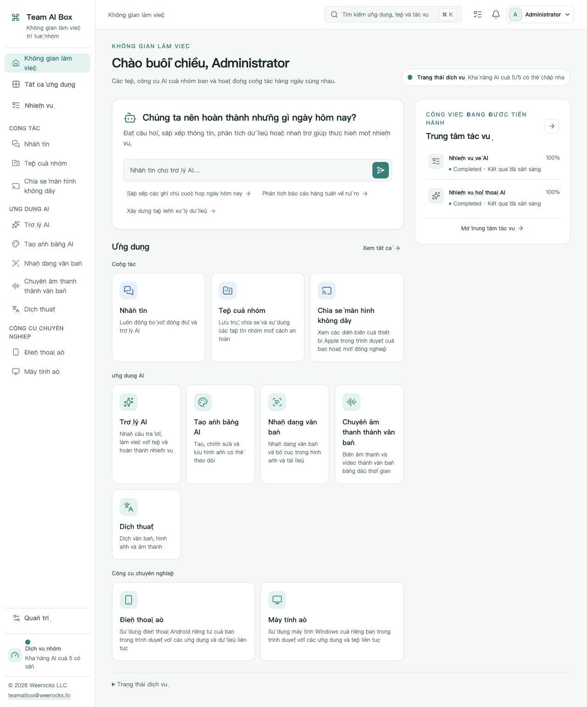

<!-- Generated from docs/readme-locales/vi.json by tools/render-readmes.mjs. -->
# Team AI Box

**Powered by NVIDIA DGX Spark · MIT · Weerocks LLC**

[English](README.md) · [简体中文](README.zh-CN.md) · [繁體中文](README.zh-TW.md) · [日本語](README.ja.md) · [한국어](README.ko.md) · [Français](README.fr.md) · [Deutsch](README.de.md) · [Español](README.es.md) · [Português](README.pt-BR.md) · [Русский](README.ru.md) · [العربية](README.ar.md) · [हिन्दी](README.hi.md) · [Bahasa Indonesia](README.id.md) · [Italiano](README.it.md) · [Türkçe](README.tr.md) · [Tiếng Việt](README.vi.md) · [ไทย](README.th.md)

**DGX Spark của bạn. Không gian AI của cả nhóm.** Team AI Box kết hợp AI cục bộ, tệp, trao đổi và thiết bị ảo trên một NVIDIA DGX Spark. Nhóm làm việc qua trình duyệt, không cần cài riêng môi trường AI trên từng máy tính.

[teamaibox.com](https://teamaibox.com/) · [GitHub](https://github.com/weerocksllc/teamaibox) · [MIT](LICENSE) · [teamaibox@weerocks.llc](mailto:teamaibox@weerocks.llc)

## Vì sao chọn Team AI Box?

- **Không gian thống nhất:** giao diện và tài khoản chung cho AI, cộng tác và thiết bị.
- **Ưu tiên cục bộ:** suy luận trên Spark, API mô hình bên ngoài là tùy chọn, không cần khóa USB.
- **Dành cho DGX Spark:** Ubuntu ARM64, container GPU NVIDIA và KVM, không lệ thuộc máy của nhà phát triển.
- **Mở để cùng cải tiến:** mã gốc MIT, 17 ngôn ngữ, giao diện sáng/tối và ghi nhớ lựa chọn thủ công. Mặc định là tiếng Anh.

## Không gian làm việc thực tế

Ảnh chụp sản phẩm bằng tiếng Việt, không phải bản dựng thiết kế. Ảnh theo chủ đề GitHub; hai bản gốc ở dưới. Không chứa tệp khách hàng hay thông tin xác thực. Đầu ra mô hình, hệ điều hành khách và tên tùy đặt có ngôn ngữ riêng.

<picture>
  <source media="(prefers-color-scheme: dark)" srcset="docs/assets/screenshots/vi/workbench-dark.jpg">
  <source media="(prefers-color-scheme: light)" srcset="docs/assets/screenshots/vi/workbench-light.jpg">
  
</picture>

[Giao diện sáng](docs/assets/screenshots/vi/workbench-light.jpg) · [Giao diện tối](docs/assets/screenshots/vi/workbench-dark.jpg)

## Các khả năng

### Trợ lý AI

Hỏi đáp, soạn và sửa nội dung, tóm tắt thông tin và xử lý tài liệu qua hội thoại. Mô hình cục bộ là nền tảng; dịch vụ bên ngoài do bạn chọn.

### Tạo ảnh

Tạo và chỉnh ảnh bằng yêu cầu, lưu kết quả và theo dõi tiến độ tác vụ.

### Nhận dạng văn bản

Trích xuất chữ và bố cục từ ảnh hoặc tài liệu, kiểm tra rồi sử dụng lại.

### Chép lời

Chuyển âm thanh và video thành văn bản có mốc thời gian cho biên bản và phụ đề.

### Dịch thuật

Dịch văn bản và các tệp được hỗ trợ. Ngôn ngữ tùy mô hình đã cài, khác với danh sách ngôn ngữ giao diện.

### Tin nhắn

Trao đổi riêng hoặc theo nhóm bên cạnh tệp chung. Quản lý tin nhắn và xóa hội thoại qua các nút rõ ràng.

### Ổ đĩa nhóm

Tải lên, tổ chức, chia sẻ và dùng lại tệp trực tiếp trong ứng dụng tương thích.

### Trình chiếu không dây

Xem hình và nghe tiếng từ thiết bị Apple tương thích trong trình duyệt cùng đồng nghiệp. Việc tìm bộ nhận cần kết nối LAN phù hợp.

### Điện thoại Android ảo

Cài ứng dụng và tiếp tục trạng thái đã lưu của từng điện thoại trong trình duyệt. Dữ liệu độc lập; dịch vụ Google có điều kiện tương thích và giấy phép riêng.

### Máy tính Windows và Linux ảo

Tải ISO ARM64 hợp lệ hoặc chọn từ ổ nhóm, gắn ổ quang ảo và tự cài hệ điều hành qua màn hình ảo. Xem khởi động, khởi động lại và dùng âm thanh; mời người xem/điều khiển, chuyển hoặc cùng điều khiển và thu hồi với tư cách chủ sở hữu. Máy tính từ xa là chế độ bổ sung.

### Quản trị và tác vụ

Tạo tài khoản, quản lý quyền truy cập, xem trạng thái sẵn sàng và tiến độ. Mỗi ứng dụng mở khi phụ thuộc của nó sẵn sàng; lần nạp mô hình đầu có thể mất thời gian.

## Cài trên DGX Spark mới

Cần **DGX Spark chưa cài sản phẩm với Ubuntu 24.04 ARM64**, Docker Engine/Compose v2, trình điều khiển và hỗ trợ container NVIDIA hoạt động, KVM, Git, Python 3.10+. Dành vài trăm GB tạm cho mô hình, bản dựng và gói. Không cài mới đè lên dữ liệu đang có.

```sh
git clone https://github.com/weerocksllc/teamaibox.git
cd teamaibox
sudo bash install/from-source.sh
```

Chạy lệnh **trên Spark**. Tập lệnh tải mô hình và đầu vào, dựng image, tạo gói ngoại tuyến đầy đủ rồi cài đặt. Lần dựng đầu cần Internet và thời gian; clone chưa phải cài xong. Docker/NVIDIA được dùng lại, không sao chép tài khoản, đĩa hoặc bí mật của nhà phát triển.

### Kiểm tra trước và tiếp tục

`--check` kiểm tra điều kiện. Nếu gián đoạn, giữ `/var/tmp/teamaibox-source-build` và chạy lại **cùng lệnh** để dùng lại tải xuống và giai đoạn đã xác minh. Không xóa bộ nhớ đệm hoặc chạy các bản dựng cạnh tranh. Mặc định là nguồn chính thức. Nếu không truy cập được, xem [hướng dẫn](install/SOURCE-INSTALL.md) về nguồn thay thế hoặc chuyển bộ nhớ đệm/gói đã xác minh; mirror không được bảo đảm. Mã thay đổi cần `--work-dir` mới, không bỏ kiểm tra.

```sh
sudo bash install/from-source.sh --check
sudo bash install/from-source.sh
```

### Sau khi cài

1. Mở `https://<BOX_LAN_IP>/` bằng địa chỉ LAN hiện tại và xác minh chứng chỉ HTTPS cục bộ thuộc thiết bị của bạn.
2. Đăng nhập `admin` / `admin`, **đổi mật khẩu ban đầu**, rồi tạo tài khoản thường. Không phơi thông tin mặc định ra Internet.
3. Chờ từng ứng dụng sẵn sàng, chọn ngôn ngữ/chủ đề trong hồ sơ. Trạng thái: `/srv/teamaibox/installation/readiness.json`.
4. Tự cung cấp ISO ARM64 Windows/Linux và giấy phép hợp lệ. Máy ngoại tuyến cần gói hoàn chỉnh trước, rồi theo [hướng dẫn](install/README.md); chuẩn bị mã nguồn cần mạng.

## Giấy phép và giới hạn

Mã gốc và tài liệu theo MIT, **không phải mọi tệp nhị phân cài đặt**. Bên thứ ba, mô hình, NVIDIA, firmware, Google và Windows giữ điều khoản riêng. Git không có trọng số, đĩa khách đã cài, phiên đăng nhập, ISO hay gói. Tương thích Google không phải chứng nhận Play Protect; trình chiếu không gồm DRM hay chứng nhận Apple. Không tuyên bố hỗ trợ Windows 10 ARM64. Hiệu năng và đồng thời phụ thuộc tải và phần cứng. Website tiếp thị riêng tư và tách biệt; UI sản phẩm là công khai.

## Cùng đóng góp

Chào đón báo lỗi, tài liệu, bản dịch, khả năng tiếp cận, tích hợp và mã. Mô tả vấn đề trong issue, fork và tạo nhánh tập trung, gửi PR kèm kiểm tra và ảnh liên quan. Tài liệu hay thành phần độc lập không cần Spark; ghi rõ xác minh phần cứng thực tế. Không đưa bí mật, tệp cá nhân hay image đã đăng nhập. Báo lỗ hổng riêng theo SECURITY.md. Không bắt buộc CLA hoặc giấy phép đóng góp trả phí.

[Issues](https://github.com/weerocksllc/teamaibox/issues) · [Pull requests](https://github.com/weerocksllc/teamaibox/pulls) · [CONTRIBUTING](CONTRIBUTING.md) · [SECURITY](SECURITY.md)

## Tìm hiểu thêm

- [Cài mã nguồn và khôi phục](install/SOURCE-INSTALL.md)
- [Gói ngoại tuyến](install/README.md)
- [Phát triển và dựng mã](docs/open-source/BUILDING.md)
- [Quy trình đóng góp](CONTRIBUTING.md)
- [Báo cáo bảo mật riêng](SECURITY.md)
- [Giấy phép bên thứ ba và phạm vi phát hành](THIRD_PARTY_NOTICES.md)

`apps/` · `services/` · `packages/` · `install/` · `deploy/` · `docs/`

© 2026 Weerocks LLC. [MIT](LICENSE) · [Giấy phép bên thứ ba và phạm vi phát hành](docs/open-source/RELEASING.md)
