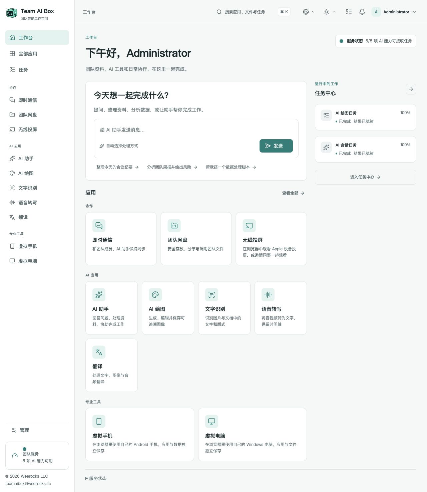

<!-- Generated from docs/readme-locales/zh-CN.json by tools/render-readmes.mjs. -->
# Team AI Box

<p></p>

**Powered by NVIDIA DGX Spark · MIT · Weerocks LLC**

[English](README.zh-CN.md) · [简体中文](README.zh-CN.md) · [繁體中文](README.zh-CN.md) · [日本語](README.zh-CN.md) · [한국어](README.zh-CN.md) · [Français](README.zh-CN.md) · [Deutsch](README.zh-CN.md) · [Español](README.zh-CN.md) · [Português](README.zh-CN.md) · [Русский](README.zh-CN.md) · [العربية](README.zh-CN.md) · [हिन्दी](README.zh-CN.md) · [Bahasa Indonesia](README.zh-CN.md) · [Italiano](README.zh-CN.md) · [Türkçe](README.zh-CN.md) · [Tiếng Việt](README.zh-CN.md) · [ไทย](README.zh-CN.md)

**你的 DGX Spark，整个团队的 AI 工作空间。** Team AI Box 将一台 NVIDIA DGX Spark 变成集本地 AI、文件协作、即时通信和虚拟设备于一体的浏览器工作空间。团队可以拥有自己的部署，从不同电脑访问，不必为每位成员重复搭建 AI 环境。

[teamaibox.com](https://teamaibox.com/) · [GitHub](https://github.com/weerocksllc/teamaibox) · [MIT](LICENSE) · [teamaibox@weerocks.llc](mailto:teamaibox@weerocks.llc)

## 为什么选择 Team AI Box？

- **一台盒子，一个工作空间。** AI、协作和虚拟设备使用统一界面与账户体系。
- **本地优先，不依赖云端模型。** 本地推理在 Spark 上完成，外部模型 API 是可选集成，不需要 USB Key。
- **专为 DGX Spark 打造。** 安装流程面向 Ubuntu ARM64、NVIDIA GPU 容器和 KVM 虚拟化，不依赖开发者的机器配置。
- **可以共同改进。** 自研代码采用 MIT 协议；界面支持 17 种语言、明暗主题并记住手动选择，默认英文。

## 真实工作空间截图

这是简体中文产品实拍，不是设计稿。图片跟随 GitHub 明暗偏好，下方提供两个原图。截图仅含演示状态，不含客户文件或凭据；模型输出、虚拟机系统和用户自定义名称有各自的语言设置。

<picture>
  <source media="(prefers-color-scheme: dark)" srcset="docs/assets/screenshots/zh-CN/workbench-dark.jpg">
  <source media="(prefers-color-scheme: light)" srcset="docs/assets/screenshots/zh-CN/workbench-light.jpg">
  
</picture>

[浅色截图](docs/assets/screenshots/zh-CN/workbench-light.jpg) · [深色截图](docs/assets/screenshots/zh-CN/workbench-dark.jpg)

## 可以用它完成什么？

### AI 助手

在对话中提问、撰写和修改内容、整理信息、处理文档。本地推理保留核心工作流，只有主动配置时才使用外部模型服务。

### AI 绘图

通过提示词生成图像、编辑图片并保存结果，适合视觉探索和内容准备；任务进度和生成结果可在工作空间中查看。

### 文字识别

从图片与文档中识别文字和版式，检查结果后直接复用，减少手工录入。

### 语音转写

把音频或视频转换为带时间信息的文字，为会议纪要、字幕和后续整理提供素材。

### 翻译

翻译文本及支持的文件，源语言和目标语言来自已安装模型的实际能力。界面语种与模型翻译语种是两套不同清单。

### 即时通信

在同一工作空间里进行单聊、群组讨论和文件协作，通过可见入口管理消息、删除聊天。

### 团队网盘

上传、整理、共享和复用团队文件；在支持的应用中直接选择网盘文件，不必重复上传。

### 无线投屏

接收兼容 Apple 设备的投屏，在浏览器中观看画面并播放声音，支持同事一起观看；发现接收器需要正确的局域网连接。

### 虚拟 Android 手机

在浏览器中使用持久化 Android 设备、安装应用并保留设备状态。每部手机独立保存应用与数据；Google 服务仍受自身兼容性与许可条件约束。

### 虚拟 Windows 与 Linux 电脑

上传合法的 ARM64 ISO 或从网盘选择，挂载虚拟光驱后通过虚拟显示器自行安装。可观看开机与重启过程、使用声音、邀请观看或控制、交接或共同控制，主人可收回控制权；远程桌面是附加模式，不是打开显示器的前提。

### 团队管理与任务状态

创建普通账户、管理访问权限、查看应用就绪状态和任务进度。各应用按自身依赖就绪后开放，首次模型启动可能需要等待。

<a id="install"></a>

## 在全新 DGX Spark 上安装

准备一台运行 **Ubuntu 24.04 ARM64 的全新 DGX Spark**，具备正常的 Docker Engine、Compose v2、NVIDIA 驱动及容器支持、KVM、Git 和 Python 3.10+。模型、容器构建与安装包需要数百 GB 临时空间。不要在已有业务数据上执行全新安装。

```sh
git clone https://github.com/weerocksllc/teamaibox.git
cd teamaibox
sudo bash install/from-source.sh
```

在 **Spark 本机**运行上述命令，不是在普通笔记本上运行。脚本下载模型和构建输入、构建运行镜像、生成完整离线包并安装。首次源码构建需要联网和较长下载、构建时间；clone 并不等于安装完成。复用现有 Docker 与 NVIDIA 环境，不复制开发者账户、虚拟磁盘或凭据。

### 预检、下载问题与断点续跑

`--check` 执行预检。中断后保留 `/var/tmp/teamaibox-source-build`，重跑**相同命令**，复用校验通过的下载与已完成阶段。不要并行启动重复构建或清空缓存。默认使用官方源；上游无法连接时，可按文档选择替代源，或从能联网的机器转移经校验的缓存/完整离线包，镜像站不保证可用。日志、`--cache-dir`、`--work-dir` 见[源码安装说明](install/SOURCE-INSTALL.zh-CN.md)。源码变化后使用新的工作目录，不绕过检查点。

```sh
sudo bash install/from-source.sh --check
sudo bash install/from-source.sh
```

### 安装完成后

1. 使用 Spark 当前局域网地址打开 `https://<BOX_LAN_IP>/`，确认本机生成的 HTTPS 证书确实属于自己的设备。
2. 使用 `admin` / `admin` 登录，**立即修改初始密码**，再创建普通账户；不要将初始凭据暴露到公网。
3. 等待各 AI 应用分别就绪，在个人菜单选择语言与主题，从工作台开始。就绪记录位于 `/srv/teamaibox/installation/readiness.json`。
4. 虚拟电脑由用户提供合法 Windows/Linux ARM64 ISO 与系统许可。离线目标需先取得完整安装包，再按[离线包说明](install/README.zh-CN.md)安装；源码准备本身不是离线过程。

## 开源范围与实际边界

自研代码和文档采用 MIT，**不是安装中的所有二进制都采用 MIT**。第三方代码、模型权重、NVIDIA 组件、固件、Google 服务和 Windows 保留各自条款。仓库不包含模型权重、已安装的 Android/Windows 磁盘、登录状态、ISO 或离线安装包。Google 兼容不等于 Play Protect 认证；投屏不包含 DRM 受保护内容或 Apple 认证；不宣称支持 Windows 10 ARM64。性能和并发取决于硬件与工作负载，不承诺无限容量。营销官网位于独立私有仓库，公开仓库包含产品自身界面。

## 欢迎一起贡献

欢迎提交问题、文档、翻译、无障碍改进、应用集成和代码。先用 Issue 说明用户问题，再 fork、创建专注的分支并提交 PR，附相关检查和截图。文档和独立组件贡献不要求拥有 Spark；硬件验证要如实标注。不要上传密钥、个人文件或已登录的设备镜像。安全漏洞按 SECURITY.md 私下报告，不发公开 Issue；不要求强制 CLA 或付费贡献许可。

[Issues](https://github.com/weerocksllc/teamaibox/issues) · [Pull requests](https://github.com/weerocksllc/teamaibox/pulls) · [CONTRIBUTING](CONTRIBUTING.zh-CN.md) · [SECURITY](SECURITY.zh-CN.md)

## 进一步了解

- [源码安装、依赖与恢复](install/SOURCE-INSTALL.zh-CN.md)
- [离线包构建与安装](install/README.zh-CN.md)
- [开发环境与源码构建](docs/open-source/BUILDING.zh-CN.md)
- [贡献流程](CONTRIBUTING.zh-CN.md)
- [私密安全报告](SECURITY.zh-CN.md)
- [第三方许可与发行范围](THIRD_PARTY_NOTICES.zh-CN.md)

`apps/` · `services/` · `packages/` · `install/` · `deploy/` · `docs/`

© 2026 Weerocks LLC. [MIT](LICENSE) · [第三方许可与发行范围](docs/open-source/RELEASING.zh-CN.md)
