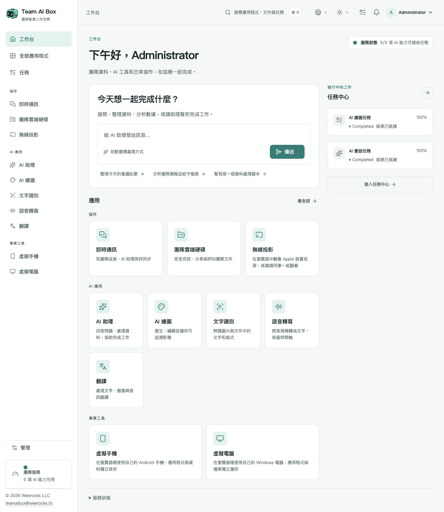

<!-- Generated from docs/readme-locales/zh-TW.json by tools/render-readmes.mjs. -->
# Team AI Box

<p></p>

**Powered by NVIDIA DGX Spark · MIT · Weerocks LLC**

[English](README.zh-TW.md) · [简体中文](README.zh-TW.md) · [繁體中文](README.zh-TW.md) · [日本語](README.zh-TW.md) · [한국어](README.zh-TW.md) · [Français](README.zh-TW.md) · [Deutsch](README.zh-TW.md) · [Español](README.zh-TW.md) · [Português](README.zh-TW.md) · [Русский](README.zh-TW.md) · [العربية](README.zh-TW.md) · [हिन्दी](README.zh-TW.md) · [Bahasa Indonesia](README.zh-TW.md) · [Italiano](README.zh-TW.md) · [Türkçe](README.zh-TW.md) · [Tiếng Việt](README.zh-TW.md) · [ไทย](README.zh-TW.md)

**你的 DGX Spark，整個團隊的 AI 工作空間。** Team AI Box 將一台 NVIDIA DGX Spark 變成整合本機 AI、檔案協作、即時通訊及虛擬裝置的瀏覽器工作空間。自行掌握部署，讓不同電腦共用能力，無須為每個人另建 AI 環境。

[teamaibox.com](https://teamaibox.com/) · [GitHub](https://github.com/weerocksllc/teamaibox) · [MIT](LICENSE) · [teamaibox@weerocks.llc](mailto:teamaibox@weerocks.llc)

## 為什麼選擇 Team AI Box？

- **單機整合。** AI、協作及虛擬裝置共用一致的介面與帳號體系。
- **本機優先。** 核心推論在 Spark 執行，外部模型 API 可選，不需 USB Key。
- **專為 DGX Spark 設計。** 安裝流程面向 Ubuntu ARM64、NVIDIA GPU 容器及 KVM，不依賴開發機設定。
- **開放共同改進。** 自研程式碼採 MIT；介面支援 17 種語言及明暗主題，記住手動選擇，預設英文。

## 真實工作空間畫面

繁體中文產品實拍，並非設計稿。圖片隨 GitHub 明暗偏好切換，下方提供原圖。僅含示範狀態，不含客戶檔案或憑證；模型輸出、客體系統及自訂名稱有各自語言設定。

<picture>
  <source media="(prefers-color-scheme: dark)" srcset="docs/assets/screenshots/zh-TW/workbench-dark.jpg">
  <source media="(prefers-color-scheme: light)" srcset="docs/assets/screenshots/zh-TW/workbench-light.jpg">
  
</picture>

[淺色畫面](docs/assets/screenshots/zh-TW/workbench-light.jpg) · [深色畫面](docs/assets/screenshots/zh-TW/workbench-dark.jpg)

## 功能介紹

### AI 助手

透過對話提問、撰寫與修改內容、整理資訊及處理文件。本機推論是核心，外部服務由你選擇。

### AI 繪圖

根據提示產生圖像、編輯圖片並保存成果，查看任務進度與輸出。

### 文字辨識

擷取圖片及文件中的文字與版面，檢查後直接重用，減少手工輸入。

### 語音轉寫

把音訊或影片轉為帶時間資訊的文字，用於會議紀錄、字幕及後續整理。

### 翻譯

翻譯文字與支援的檔案，語種取決於已安裝模型；介面語言與模型翻譯語言是不同清單。

### 即時通訊

進行私訊及群組討論，與團隊檔案協作；透過明確入口管理訊息及刪除聊天。

### 團隊網碟

上傳、整理、分享及重用團隊檔案，在支援的應用中直接選取檔案。

### 無線投屏

接收相容 Apple 裝置的畫面與聲音，在瀏覽器觀看並邀請同事；裝置探索需要正確的區域網路連線。

### 虛擬 Android 手機

在瀏覽器使用持久化手機、安裝應用及保留狀態。各手機資料獨立；Google 服務適用自身相容性與授權條件。

### 虛擬 Windows 與 Linux 電腦

上傳合法 ARM64 ISO 或從網碟選取，掛載虛擬光碟機並透過虛擬顯示器自行安裝。觀看開機與重新啟動、使用音效、邀請觀看或控制、交接或共同控制，擁有者可收回控制權。遠端桌面為附加模式。

### 團隊管理與任務狀態

建立一般帳號、管理存取權限、查看各應用就緒狀態及任務進度；模型首次啟動可能需要等待。

<a id="install"></a>

## 在全新 DGX Spark 上安裝

準備執行 **Ubuntu 24.04 ARM64 的全新 DGX Spark**，具備 Docker Engine、Compose v2、NVIDIA 驅動與容器支援、KVM、Git 及 Python 3.10+。模型、建置及安裝包需要數百 GB 暫存空間，不可覆蓋既有業務資料。

```sh
git clone https://github.com/weerocksllc/teamaibox.git
cd teamaibox
sudo bash install/from-source.sh
```

在 **Spark 本機**執行上述命令。腳本下載模型與建置輸入、建置映像、製作完整離線包並安裝。首次需連網且耗時；clone 不代表安裝完成。沿用既有 Docker/NVIDIA，不複製開發者帳號、磁碟或憑證。

### 預檢與續跑

`--check` 執行預檢。中斷後保留 `/var/tmp/teamaibox-source-build`，重跑**相同命令**，重用已驗證的下載與階段；勿清除快取或重複並行建置。預設官方來源；無法連線時按[安裝文件](install/SOURCE-INSTALL.zh-TW.md)選用替代來源，或搬移經驗證的快取/完整離線包。鏡像站不保證可用。程式碼變更需新 `--work-dir`，可重用 `--cache-dir`，勿跳過檢查點。

```sh
sudo bash install/from-source.sh --check
sudo bash install/from-source.sh
```

### 安裝之後

1. 以當前區域網路位址開啟 `https://<BOX_LAN_IP>/`，確認本機 HTTPS 憑證屬於自己的裝置。
2. 以 `admin` / `admin` 登入，**立即更改初始密碼**並建立一般帳號，不向公網暴露預設憑證。
3. 等待各應用就緒，在個人選單選語言及主題。就緒紀錄：`/srv/teamaibox/installation/readiness.json`。
4. 虛擬電腦需自行提供合法 Windows/Linux ARM64 ISO 與授權。離線目標先準備完整安裝包，再依[離線說明](install/README.zh-TW.md)安裝；原始碼準備需連網。

## 授權與邊界

自研程式碼及文件採 MIT，**不涵蓋安裝內所有二進位檔**。第三方程式碼、模型、NVIDIA、韌體、Google 服務與 Windows 保留原條款。倉庫不提供權重、已安裝手機/電腦磁碟、登入狀態、ISO 或離線包。Google 相容不等於 Play Protect 認證；投屏不含 DRM 或 Apple 認證；不宣稱支援 Windows 10 ARM64。效能與並行量取決於硬體及工作負載。行銷官網獨立私有，產品介面在此公開。

## 歡迎一起貢獻

歡迎問題回報、文件、翻譯、無障礙改善、應用整合及程式碼。先以 Issue 說明使用者問題，再 fork、建立分支及提交 PR，附相關檢查與畫面。改善文件或獨立元件不必擁有 Spark；硬體驗證須如實標註。不要上傳密鑰、個人檔案或已登入映像；安全問題依 SECURITY.md 私下回報。不要求強制 CLA 或付費許可。

[Issues](https://github.com/weerocksllc/teamaibox/issues) · [Pull requests](https://github.com/weerocksllc/teamaibox/pulls) · [CONTRIBUTING](CONTRIBUTING.zh-TW.md) · [SECURITY](SECURITY.zh-TW.md)

## 延伸文件

- [原始碼安裝與復原](install/SOURCE-INSTALL.zh-TW.md)
- [離線包建置與安裝](install/README.zh-TW.md)
- [開發環境與建置](docs/open-source/BUILDING.zh-TW.md)
- [貢獻流程](CONTRIBUTING.zh-TW.md)
- [私密安全回報](SECURITY.zh-TW.md)
- [第三方授權與發行範圍](THIRD_PARTY_NOTICES.zh-TW.md)

`apps/` · `services/` · `packages/` · `install/` · `deploy/` · `docs/`

© 2026 Weerocks LLC. [MIT](LICENSE) · [第三方授權與發行範圍](docs/open-source/RELEASING.zh-TW.md)
