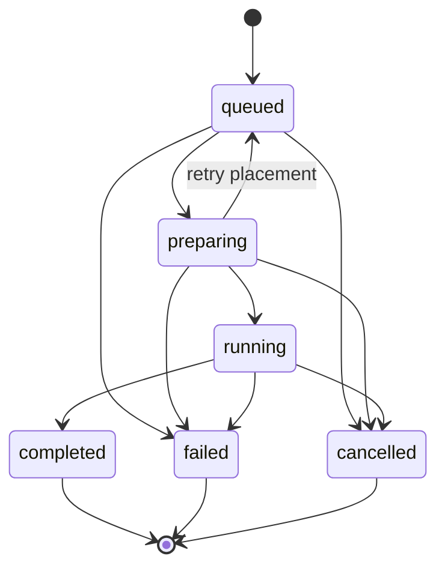

# Task-center state model

The task center is a projection of durable compute and file-processing jobs. It
does not own scheduler truth and it does not treat Agent tool permission as a
compute approval.

Progress is monotonic from 0 through 99.99 within one progress revision. A new
attempt can explicitly increment the revision and reset progress while the task
is preparing. Completion fixes progress at 100 and attaches labeled artifact
references. Failure records a stable error code, localized guidance key,
retryability, and an optional safe retry action.

Cancellation is a durable idempotent request. It does not claim that execution
has stopped until a scheduler or worker transitions the task to `cancelled`.
Events have ordered cursors so a browser can reconnect without replaying its
entire task history.

Agent operation confirmations use a separate record and API shape named
`agent_operation_confirmation`. Each record belongs to one user and Agent
session, declares the exact operation scope, expires, and accepts one
authenticated allow/deny decision. It never appears in the ordinary task list.

