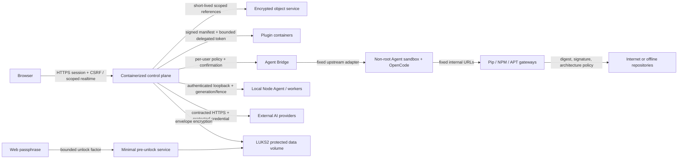

# Team AI Box end-to-end threat model

Status: release-gating model v1  
Scope: one local appliance, browser clients, plugin and Agent containers, external compute providers, software sources, removable media, and encrypted appliance storage.

The executable catalog is `docs/security/end-to-end-abuse-cases.v1.json`. Every catalog entry names an exact automated test. CI rejects a missing domain, duplicate case, stale test reference, or case that is absent from this model.

## Security objectives

- Preserve confidentiality of team content, prompts, workspaces, object bytes, credentials, keys, model inputs at rest and across every handoff.
- Preserve integrity of identities, sessions, plugin and package supply chains, model/provider routing, object versions, node facts, update evidence, and audit records.
- Preserve core-control availability under AI load while failing closed when authorization, freshness, integrity, or encryption evidence is missing.
- Make uncertain side effects, degraded recovery, stale capacity, and manual intervention explicit instead of inventing success or replaying work blindly.
- Keep administrator authority separate from ordinary user application access, including when the UI hides or exposes a feature.

## Assets and actors

Protected assets include local account verifiers and recovery codes; browser sessions and CSRF state; object and Team Drive data; Agent workspaces and conversation state; model, plugin, provider, and software-source metadata; external provider and source credentials; node certificates; audit evidence; LUKS key slots and header backups; and live CPU, unified-memory, accelerator, codec, storage, and network capacity.

Actors are ordinary authenticated users, local owners/administrators, plugin publishers, the local Node Agent, external compute providers, upstream package repositories, recovery operators, and attackers. An attacker may control a browser origin, LAN host, external endpoint, package registry, plugin bundle, Agent prompt or generated code, removable disk, or stolen appliance media. Administrator compromise and malicious firmware are residual risks, not trusted-away implementation shortcuts.

## Trust boundaries and data flow

Every arrow is a trust boundary. Browser claims do not confer authorization; a service re-evaluates identity, permission, team/object scope, expiry, revision, and idempotency. The executor accepts only the installed appliance identity over its loopback boundary; LAN clients cannot register execution capacity. Containers do not receive host, Docker socket, device, secret, or network access unless their runtime policy requires it.

## Domain abuse cases and recovery

| Domain | Primary abuse paths | Prevent/detect boundary | Fail-safe and recovery | Executable evidence |
|---|---|---|---|---|
| Local accounts | Password guessing, distributed attempts, disabled-session reuse, deletion of the last owner | Argon2id, account/network throttles, server-side status checks, final-owner invariant, audited local recovery | Reject authentication generically; revoke all sessions on disable/recovery; use one-time recovery only with separately controlled local proof | ABUSE-ACCOUNT-001, ABUSE-ACCOUNT-002 |
| Browser sessions | Plain HTTP login, cross-origin mutation, CSRF, duplicate-cookie confusion, stolen session | HTTPS and exact origin, Secure host-only cookie, unambiguous cookie parser, CSRF binding, expiry/revocation | No session or mutation is created; sign-out and account changes revoke server state | ABUSE-SESSION-001, ABUSE-SESSION-002 |
| Plugins | Publisher/key substitution, tampered artifacts, excessive permissions, host escape | Canonical signature, digest/SBOM/provenance/vulnerability gates, immutable version identity, non-root sandbox compiler | Candidate remains uninstalled or prior healthy slot stays active; corrected release requires a new reviewed artifact | ABUSE-PLUGIN-001, ABUSE-PLUGIN-002 |
| Agent code execution | Prompt-driven host escape, unsafe egress, cross-user access, confirmation widening, duplicate or uncertain side effects | Per-user non-root sandbox, no host controls/devices, internal source routes, exact one-shot confirmations, durable acceptance boundary | Deny before execution; stop/restart sandbox without losing durable conversation; uncertain side effects require reconciliation | ABUSE-AGENT-001, ABUSE-AGENT-002, ABUSE-AGENT-003 |
| External providers | Credential disclosure, false capability, data-policy violation, unsafe retry after output | Protected credential references, HTTPS/trust policy, adapter conformance, health and rate limits, acceptance/output fences | Disable or route around unhealthy provider before acceptance; partial/uncertain results remain incomplete until reconciled | ABUSE-PROVIDER-001, ABUSE-PROVIDER-002 |
| Object grants | Reference theft, audience/version/operation substitution, expired use, revoked workload access | Signed short-lived exact grants, live state, issuer/audience and integrity checks, use-count fence | Reject and revoke; revoked grants cannot be reused | ABUSE-OBJECT-001, ABUSE-OBJECT-002 |
| Software sources | Dependency confusion, corrupted cache, wrong architecture, credential leak, stale removable repository | Ordered policies, pin/deny, digest/signature/metadata checks, ARM64 filtering, internal-only sandbox URLs, media identity | Artifact remains unavailable; removed media detaches immediately; reattachment requires re-index and approval | ABUSE-SOURCE-001, ABUSE-SOURCE-002 |
| Local appliance | Forged local identity, replayed health reports, false capacity | Fixed local identity, authenticated loopback, freshness and generation checks | Reject invalid reports without changing local guests or accepting remote capacity | ABUSE-NODE-001, ABUSE-NODE-002 |
| Physical media | Stolen NVMe/appliance, passphrase retention, lost factor, damaged header | LUKS2 block encryption, minimal pre-unlock surface, non-retained factors, separate slots and independent header/recovery material | Protected services remain unavailable; use offline recovery to revoke/replace factors and restore header only through reviewed recovery | ABUSE-MEDIA-001, ABUSE-MEDIA-002, ABUSE-MEDIA-003 |

## Cross-boundary attack chains

The suite treats chained attacks as the important case, not an exception:

1. A malicious browser origin cannot create a session, invoke an administrator API, then mint an object reference because HTTPS/origin, CSRF, permission, and object-scope checks are independent.
2. A signed plugin still cannot escape its declared sandbox; signature trust authenticates the publisher and artifact, not unlimited runtime authority.
3. Agent-generated package names cannot select arbitrary Internet sources because sandbox package clients contain only fixed internal gateway URLs and gateway policy independently checks trust, digest, architecture, pin, and deny rules.
4. A LAN host cannot become a worker or submit capacity by spoofing headers; the fixed local identity, authenticated loopback, generation, inventory, and metric freshness are checked independently.
5. An external provider cannot turn partial output into a second automatic execution; object handoff, acceptance, output observation, idempotency, and reconciliation are separately fenced.

## Detection, containment, and evidence

Security-relevant failures emit bounded structured facts with correlation identifiers. Health/circuit alerts must not contain prompts, package credentials, provider response bodies, passphrases, cookies, object bytes, or recovery factors. Administrator mutations, denials, local device configuration, provider/source changes, plugin lifecycle, object grants, Agent confirmations, key, and update operations enter the tamper-evident audit chain. Diagnostic export excludes user content by default and separately gates and audits any authorized sensitive-content access.

Containment favors narrow fencing: revoke the exact session, grant, node generation, worker/profile route, plugin slot, provider, source, or key slot. Platform-wide shutdown is reserved for loss of the protected-volume factor or a safety boundary that cannot be isolated.

## Assumptions and residual risks

- LUKS2 protects offline media. Default automatic unlock improves usability but does not protect an appliance stolen together with all local automatic-unlock material. Web passphrase protection is available when that threat matters.
- A malicious administrator with current physical and platform authority can intentionally export authorized data or weaken policy. Audit, separation of recovery material, and explicit confirmations improve detection and recovery but do not create organizational separation that the user rejected.
- Firmware, boot-chain, kernel, and NVIDIA/Docker runtime compromise are bounded by host minimization, maintenance workflow, signed/pinned artifacts, Secure Boot evidence where configured, and drift checks; full hardware-root attestation is not claimed.
- Internet and external providers can be unavailable, malicious, or legally unsuitable. Internal-only routing and offline sources remain supported; provider data classification is an administrator policy decision.
- Physical destruction can make local encrypted data unavailable. The product does not provide disaster restoration. Offline recovery/header material supports key recovery, not recovery of destroyed data.

## Release gate

The model is not complete merely because this document exists. Release validation must execute all cataloged tests, the domain-to-test integrity check, the broader security suite, and applicable real-Spark checks. Any missing exact test, changed test name, unreferenced case, unexpected domain, or weakened fail-closed assertion blocks the gate rather than silently reducing coverage.
